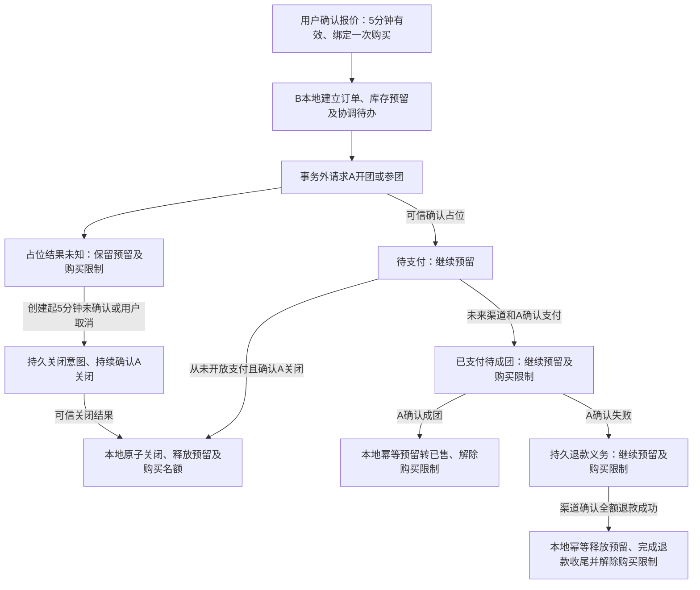

# B-03开发过程：商城订单、库存与拼团占位

更新：2026-10-10。工作树：`D:/Java/zj-market-b03`，分支：`b-03`（2026-10-10按用户要求由`b03`更名）。基线：主分支 `master` 的 `36dbc6b7f88181d008f200617ba846a05a3cce31`，与本次拉取的 `origin/master` 一致。

本文件是B-03唯一开发过程记录，维护用户选择、设计、实施、迁移、接口、验收证据和交接；[路线图第18节](development-roadmap.md#18-b-03前置工作联合设计与开发阶段)负责阶段总览。B-04开始时另建对应过程文档，B-01不补建。

## 1. 当前状态

已完成工作准备：从已包含七模块整理和三项补修的主分支创建b03分支及工作树，并建立本文件。主目录存在尚未提交的最新B-03路线图，已复制到此工作树作为阶段依据，当时原文件保留不动；随后按用户明确要求仅同步主目录路线图第18节，其他章节保留；没有提交、暂存或丢弃主目录改动。

B-03.0已完成：打包与26项测试、双库迁移/权限、真实RPC/MQ/签名、隔离样本及原键恢复验证均通过。暂停记录见第9节，恢复后的最终证据见第10节。B-03.1联合设计已完成：D1～D27确认，状态/事务锁序/表约束/HTTP/资金交接与验收矩阵已形成，交付见第12节。选择按用户要求逐个讨论；B-03.2库存基础与运营已实现并验收，见第14节；B-03.3本地订单与预留已实现并验收，见第15节；B-03.4 A占位与结果恢复已完成，见第16节；B-03.5未支付关闭与页面闭环已完成，D33确认与验收见第17节；B-03.6联合故障验收与交接已完成，2026-10-09批次及交接见第18节；2026-10-10的D6配置与阶段状态补修已完成，见第19节。

## 2. 接续基线与边界

- B-02源码和文档已合入master：目录整理 `d9f12c7`，三项补修 `f93c861`，归档 `36dbc6b`。B-02本轮接续证据为 `review-20261009-115312`，26项测试及真实联合验收PASSED，详见[B-02第18节](b02-development.md#18-三项评审补修2026-10-09)。B-03.0另做本阶段通路验收，未重复整套B-02浏览器验收。
- 沿用api/types/domain/infrastructure/trigger/app/verification七模块、I*Service及独立实现目录、MyBatis与显式事务，目录规则见[project-layout.md](project-layout.md)。业务协调归domain，不重新建立application模块，A DTO留在集成边界。
- 固定JDK21、Boot4.1.1、Netty4.1.118.Final和独立签名编解码；B脚本显式选JDK，终端及A默认Java8保持。Vue3/TypeScript6.0.3/Vite沿用，不重复选型或升级依赖。
- 沿用已有用户/运营权限、商品权威数据与统一版本、可靠同步和真实A试算。报价不保留价格或资格，不能把旧试算页面结果直接当成交金额。
- 接入权威来源为[A/B契约](../../group-buy-market/docs/ab-api-contract.md)及[业务词汇表](../CONTEXT.md)。本阶段设计前重新核对实际契约，不复制另一套协议，不直接读写A业务库。

## 3. 范围与已确认选择

B-03范围承接路线图：单仓SKU库存、运营入库/调整与流水、幂等创建和查询商城订单、本地库存预留、A开团/指定团队参团及未知结果恢复、从未开放支付订单的取消/超时关闭，以及商城和简易运营页面。

首版保持单SKU、数量1、CNY、最低实付0.01元、不叠加B优惠。库存由B负责，团名额和成团/失败由A裁决；用户只访问本人订单，运营操作有权限与审计。支付参与全生命周期设计，真实接入归B-04，资金核对/失败退款归B-05；B-03不提供伪造付款成功的入口，不自动纳入收货地址、物流、普通购买或多SKU合单。

以下选择承接最新路线图18.2，属于已有确认，后续无需重复询问：

| 编号 | 已确认选择 | 实施约束 |
| --- | --- | --- |
| B03-D1 | 提供运营入库/调整接口和简易页面，记录库存流水 | 有稳定操作标识、原因和审计；调整不能侵占预留，不以仅执行SQL代替功能验收 |
| B03-D2 | 开团＋分享链接查询并加入指定团队；推荐列表后续做 | teamId是候选输入，服务端重新校验归属/可加入状态，最终以A占位裁决 |
| B03-D3 | 报价变化返回最新报价，用户确认后重新提交 | 不自动接受涨价、降价或活动变化；新意图与原键恢复分开，未知旧单先恢复或关闭 |
| B03-D4 | B-03.0只准备测试SKU库存计划，B-03.2通过运营接口入库 | 计划open=10、full=2、expired=1、ineligible=1，尚未实际入库 |
| B03-D5 | 同用户同SKU同时限制一笔未结束购买，跨活动/团队也互斥 | 下单处理中、占位结果未知、待支付、关闭中均占用名额；同幂等键重试返回原订单；原购买完成或确认关闭后再发起新购买 |
| B03-D6 | 占位未确认最多等待5分钟，之后主动关闭；时限可配置 | 从本地订单创建起计时；超时转关闭中，A确定关闭后才释放库存及D5名额 |
| B03-D7 | 运营库存调整输入增减量 | 显示增加/减少数量；稳定操作键与并发版本、原因、权限和流水，不侵占预留 |
| B03-D8 | 报价确认采用服务端MySQL短期记录 | 浏览器提交确认编号，绑定用户与购买条件；下单仍校验A，变化重新确认 |
| B03-D9 | 报价确认记录从B签发起有效5分钟 | 未建单过期重新报价确认；已建订单原键恢复不受影响，与D6独立 |
| B03-D10 | 每份报价确认记录只绑定一次购买 | 与成功建单同事务绑定；关闭后新购买重新报价确认，同键重试仍回原单，本地回滚不消耗记录 |
| B03-D11 | 支付确认后等待成团仍保持同用户同SKU一笔限制 | 成团且库存处理完成，或失败且退款/库存释放完成后才允许复购；不等待收货，未知仍限制 |
| B03-D12 | A确认成团后库存预留转已售 | 已支付待成团仍预留，不恢复可用；成团后幂等减少预留并增加已售，不代表已发货 |
| B03-D13 | 已支付拼团失败后，退款成功才释放库存 | 渠道确认全额退款成功，才幂等释放；退款处理中/未知继续预留，退款与库存完成后解除D11限制 |
| B03-D14 | 下单本地提交后直接返回处理中 | 新建受理返回订单号，后台事务外调用A；页面查单更新，不同步等待A或将超时视为失败 |
| B03-D15 | 订单进度自动查询＋手动刷新 | 可见时每3秒查询，连续最多5分钟；后台/离页暂停，返回立即查；待支付/已关闭停止，后台恢复独立 |
| B03-D16 | 库存修改先锁库存行，再校验更新 | 取得当前数量后处理预留/运营调整/释放/转已售，余额与流水同事务；网络调用在事务外 |
| B03-D17 | 交易协调采用及时恢复节奏 | 扫描2秒，每轮最多20条、逐条执行前认领、租约30秒、单次A调用超时10秒；技术失败2/4/8/16/30秒退避，上限30秒加抖动，可配置 |
| B03-D18 | 连续技术失败5次告警后继续恢复 | 按D17退避持续原键查单/关闭，运营可受控暂停/恢复；D6仍生效，未知不释放库存 |
| B03-D19 | 零可用库存的在售商品继续展示并标记缺货 | 列表/详情保留，禁用新购买；不自动下架，不影响原订单，库存恢复后重新校验购买条件 |
| B03-D20 | 创建商品时同事务建立零余额库存账户 | 已有商品迁移补零账户，不猜真实库存；实际数量仍运营入库，单SKU唯一账户 |
| B03-D21 | B库内核心长期关联沿用数据库外键 | 库存到商品、预留到订单等关系由数据库与应用共同保障；保留唯一/CHECK/事务，A标识不建跨库外键 |
| B03-D22 | 商品变更后已受理购买按冻结条件继续 | 不因改价/下架/改版自动取消，不改旧价格/版本/团队；A拒绝原条件则关闭收敛，重新购买需新确认 |
| B03-D23 | 公开商城只显示有货/缺货 | 不返回精确可用/预留/已售余额；运营查看准确余额和流水，展示快照不保证预留成功 |
| B03-D24 | 一单一条当前A交易协调记录 | 阶段内推进reserve/query/close，集中租约/退避；保留冻结请求及独立尝试日志，关闭意图不被迟到结果覆盖 |
| B03-D25 | 分享团队详情需登录后查看 | 未登录只按既有规则浏览公开商品；团队摘要/本人关联由B认证后查A，试算/参团需登录，不泄露他人记录 |
| B03-D26 | 简易运营页面提供异常订单受控操作 | 查询、暂停、恢复和立即核对；权限/原因/稳定操作键/审计，不强制成功或释放未知库存 |
| B03-D27 | 严格证明从未发送时允许B本地关闭 | 持久发送标记与订单/任务锁内证明，原子阻断worker并关闭释放；可能已发始终确认A关闭 |
| B03-D28 | 下架商品允许运营维护库存 | 可入库及调整可用库存，不自动上架，不直接修改预留/已售；新购买仍受在售条件约束 |
| B03-D29 | 库存写响应未知时自动查询结果＋手动重试 | 按原操作标识查询持久结果；不自动重发写请求，手动重试保持原标识及原参数，NOT_FOUND不证明未执行 |
| B03-D30 | 待核对库存操作支持关闭浏览器后恢复 | localStorage保存原操作标识/参数并绑定运营账号，不保存登录凭据；同一账号恢复后只自动查询，写重试仍手动 |
| B03-D31 | 同商品未知库存操作先核对，再发起新操作 | 本浏览器同运营同SKU暂禁新入库/调整，允许原键查询/手动重试；不锁商城、后台或其他运营 |
| B03-D32 | 库存成功及确定业务拒绝均持久记录 | 原编号永久绑定原请求与终结结果；成功一次记账，拒绝不动余额/流水；改参数用新编号 |
| B03-D33 | 鉴权修复后立即核对仅执行原订单只读签名查询 | 鉴权通过且结果可信后恢复原任务；失败继续停止，证据矛盾不可页面恢复；不绕过验签/释放未知库存 |

后续出现不同方案选择交用户决定，在此记录问题、选择、影响和确认日期，不默认批准。

## 4. 小阶段进度与依赖

| 小阶段 | 依赖 | 当前状态与本阶段记录目标 |
| --- | --- | --- |
| B-03.0 基线与接续 | 已验收B-02及补修 | 已完成：实际环境、隔离样本、日志关联、原键重跑及清理通过，见第10节 |
| B-03.1 联合设计 | .0 | 已完成：D1～D27、详细联合设计及16项HTTP操作契约已收口；文档结构/引用及边界核对通过，见第12节 |
| B-03.2 库存基础与运营 | .1确认 | 已完成：V5/V6库存三表、6项运营接口和页面、双库14表授权、持久幂等及跨关闭恢复；30项JUnit/真实HTTP/MySQL/Edge通过，见第14节；依赖订单FK的预留表在.3落地 |
| B-03.3 本地订单与预留 | .2 | 已完成：V7五表/流水扩展、真实报价确认、6项本人接口、原子预留/任务及页面；34项JUnit/真实MySQL/真实A报价/Edge通过，见第15节 |
| B-03.4 A占位与结果恢复 | .3 | 已完成：V8、真实签名占位/查询、持久任务与租约、团队及报价确认页面；真实MySQL/A进程重启/Edge通过，见第16节 |
| B-03.5 未支付关闭与页面闭环 | .4 | 已完成：V9、D27本地关闭、冻结close/query原子释放、D33只读核验、取消/运营页面；43项JUnit及真实MySQL/A新进程/Edge通过，见第17节 |
| B-03.6 联合故障验收与交接 | .2～.5 | 已完成：43项JUnit、全套B-02回归、真实MySQL组合故障/守恒、真实A停启/B新进程恢复、Edge与资金交接通过，见第18节；收尾补修见第19节 |

各完成门槛以路线图18.3～18.7为准；仅有设计或单元测试不能标记真实联合验收完成。每次实施补入日期、改动、用户选择、命令、实际批次、结果、遗留和交接。

## 5. 联合设计时待用户确认

承接路线图18.6，同用户同SKU互斥规则已确认D5；占位待确认业务等待期限已确认D6；库存调整已确认D7按增减量；报价确认方式已确认D8为服务端MySQL短期记录，有效期已确认D9为签发起5分钟；真实支付渠道或沙箱待后续确认。支付先定义能力需求，具体渠道在B-04前确认。

D1～D33均已确认，状态/幂等/并发设计及补充选择见第12～17节。B-03.0～.6均已完成，当前无B-03遗留待选方案；后续实施若需改变既定选择，仍先逐项交用户。真实支付渠道明确延期至B-04前选择。

## 6. 环境与验收接续清单

- 创建工作树时仅有Git内容；B-03.0已显式复用既有外部数据库DPAPI文件和验收密钥，存放被忽略的.local。node_modules未复制。本机实际B-02证据仍在 `D:/Java/zj-market-b02-noFileUpdate/target/acceptance/review-20261009-115312`；启动前显式复用外部配置或准备被忽略本地文件，不把秘密加入文档或Git。
- B-03.0继续核对独立B开发/验收库、分角色账号、现有V1～V4与权限、A隔离环境和外部RPC/MQ/TLS配置。新增迁移先验收、再按表授权；不重建中间件、清洗共享业务库或改A表。
- 联调样本需包括已确认同步的商品、受控库存、普通用户/运营账号，以及可开团、满员、过期、资格不符等独立活动；使用唯一测试标识。B-03.0样本已创建并通过实际接口验证；受控库存按D4只保留计划，具体标识与证据见第10节。
- 后续验收覆盖库存最后一件并发、幂等同/异参、调整与预留竞争、本地原子回滚、占位响应丢失/迟到、close先到、重复取消/重启/租约、身份权限及实际页面；未接真实支付的关闭测试不当作付款竞争验收。

开发入口（已在目标JDK实际打包）：

```powershell
Set-Location D:/Java/zj-market-b03
./scripts/mvn.ps1 -MavenArguments @('-B','-o','package')
```

IDE打开此工作树根pom.xml，重新加载七模块，运行配置仍为B - JDK 21。普通启动、显式迁移与独立验收沿用[b-startup.md](b-startup.md)；真实配置核对后再运行，保持凭据外部注入。

## 7. 开发记录

2026-10-09：按用户要求从master创建b03分支和D:/Java/zj-market-b03工作树，基线36dbc6b，与origin/master一致；复制主目录最新未提交路线图，保留其原件；建立唯一B-03过程文档和当前交接入口。本次仅准备工作树/文档，未改业务代码、框架依赖或数据库，未执行环境或业务测试，也未提交、合并或推送本轮文档。

该条为创建工作树时的历史记录，不代表当前进度。当前B-03.0～.6全部完成，汇总以第1/4节为准，收尾补修见第19节。

## 8. 此次实施复杂度

此次工作准备复杂度低：核对基线与原目录改动 → 创建分支/工作树 → 接续路线图并建唯一过程文档 → 检查文件与Git状态。B-03整体实施复杂度高，按.0～.6的依赖分步推进，不以准备完成代替业务完成。

第9～18节为2026-10-09各开发时点的历史归档，其中“待开展”“下一步”“不得推进”等语句仅表示当时状态；保留原验收批次和指纹，不覆盖成最新证据。当前完成状态见第1/4节，2026-10-10补修见第19节。

## 9. B-03.0暂停保存点（2026-10-09，历史）

用户因额度即将耗尽明确要求暂停，等待“恢复工作”再继续。本节为暂停时状态；用户随后明确恢复，最新结果见第10节。

**B03-D4已确认**：B-03.0只准备各测试SKU库存计划，B-03.2通过运营接口入库。计划open=10、full=2、expired=1、ineligible=1，不提前创建库存表或实际入库。

已保存未提交成果：verification中的B03ReadinessCommands.java、主入口分派、docs/tests/run-b03-readiness.ps1及阶段文档。工作树D:/Java/zj-market-b03，分支b03，HEAD36dbc6b；没有本轮提交、合并或推送，未开始B-03.1/.2。正常业务服务、依赖版本和V1～V4未改。

实际批次：target/b03-readiness/b030-20261009-1328。JDK21离线package成功，26项JUnit全部通过，日志target/b03-build.log。独立开发库和验收库migrate/verify通过，运行账号按表DML、DDL/history/A/system/grant拒绝。baseline.json为PASSED：真实正确签名RPC、错误签名拒绝、MQ发布/授权订阅/签名结果/持久补查及未授权发布拒绝；固定JDK21.0.2/Boot4.1.1/Netty4.1.118.Final/Dubbo3.2.16/RocketMQ4.9.7。A/B基线与契约/JAR指纹见provenance.txt。

沿用现有外部配置：本机.local中复制既有开发/验收数据库DPAPI文件及验收RSA密钥，未纳入Git。随机USER/MEMBER/SECOND/THIRD/OP账号已通过B服务建立，四个B商品及冻结待同步事件已创建；样本清单fixtures.json保存随机标识、稳定outTradeNo/closeId/verifiedAt和库存计划，无密码。账号凭据仅保存在.local/b03-b030-20261009-1328.credentials.xml（DPAPI，同机同用户）。A隔离活动/标签插入入口已执行，恢复先确认完整性，不能盲目重复prepare或重置共享库。

暂停在prepare后、真实联合verify前，无verify.txt，**B-03.0尚未完成**。待验证商品同步、实际HTTP权限、A报价/资格、reserve/query、指定团队加入、满员/过期拒绝、NEVER_OPENED关闭、CLOSE_MARKER和迟到reserve拒绝；随后验证重跑恢复、环境清理和敏感内容，再更新完成状态。库存PLAN_ONLY，无B订单/库存/支付表实现，无付款成功消息。

验收会话已中断，暂停清理检查未发现本轮Java进程或50051/18091监听；原有容器保留。批次缺少自动cleanup报告，不能宣称完整自动清理验收通过。环境更改限验收子进程，没有修改系统/用户JDK。

恢复入口（先核对样本完整性）：

    Set-Location D:/Java/zj-market-b03
    ./docs/tests/run-b03-readiness.ps1 -RunName b030-20261009-1328 -Mode verify -SkipBuild

verify使用原稳定清单及DPAPI凭据，在独立rechecks时间目录保存结果，不重复prepare。此入口已编译，尚未完成实际联合运行；恢复后修正实际发现问题。样本超时则使用新RunName重新prepare，保留旧批次并记录原因；不把过期团队当作可加入样本，不删除旧数据。其他业务方案选择仍交用户。

## 10. B-03.0恢复与完成（2026-10-09）

用户明确“恢复工作”后，在b03工作树继续。阶段结论：**B-03.0完成，B-03.1待开展**。工作树仍为D:/Java/zj-market-b03，分支b03，基线36dbc6b；本轮源码和文档未提交、合并或推送。主目录用户的路线图原稿保留不动，当前阶段更新落在本工作树。

### 10.1 实施与实际环境

- 新增独立验收工具B03ReadinessCommands及run-b03-readiness.ps1，复用实际B启动、身份/商品服务、可靠同步和A原契约，不实现B订单业务。普通应用包已检查不包含verification或Flyway。
- B显式运行C:/Program Files/Java/jdk-21（21.0.2），A仍使用Java8（1.8.0_391）；Boot4.1.1、Netty4.1.118.Final、Dubbo3.2.16、RocketMQ4.9.7及独立签名编解码不变。沿用MyBatis4.1.0、Vue3/TypeScript6.0.3/Vite，没有重新选型或升级。
- MySQL8.0.32、Redis和RocketMQ复用原容器；A临时提供方仅指向group_buy_market_phase1_test，RPC端口50051启用TLS与签名，临时HTTP端口18091；B HTTP随机端口。MQ沿用本机回环学习验收配置及ACL，不把本次结果推广为生产MQ TLS验收。
- B开发库zj_market、隔离验收库zj_market_b02_test均复核migrate/verify。各11张既有B表及Flyway历史，V1～V4不变、无新增迁移；运行账号按表DML，DDL/历史/A库/系统库/授权均拒绝，迁移账号与运行账号分离。仅维护工具获得迁移凭据，业务进程清除迁移凭据。没有新增订单、库存或支付表。
- A源码基线8c0a3faee01d20730f05c7a357a491bb4438027f；实际A预构建包、A契约文本、B普通/验收包及新增工具源码的SHA256均记录于provenance.txt，不仅凭Git提交号推定运行版本。本轮未改A源码或A表结构；隔离活动/映射/标签仅插入本批次随机数据，A订单及团队事实通过真实SDK生成。

### 10.2 隔离样本及库存计划

五个随机学习账号：USER、MEMBER、SECOND、THIRD、OP。通过实际B服务准备，真实HTTP登录与身份映射核对成功，普通用户访问运营入口403，运营访问200。凭据只存本机被忽略的DPAPI文件.local/b03-b030-final-20261009-1610.credentials.xml；样本清单不含密码，后续验收由脚本按角色读取，无需把凭据抄入文档。

四个在售商品均为B权威版本1、原价100.00 CNY；对应冻结事件已经真实MQ投递并收到A签名确认。活动优惠10.00，实际可用报价90.00。

| 样本 | B goodsId | A activityId | 库存计划（未入库） |
| --- | --- | --- | --- |
| open | 36320e99-c113-400c-b547-2a6b9cc91930 | 738274432159 | 10 |
| full | 4c9d2fd1-455a-48c7-9189-194b9a5d9e27 | 738274416723 | 2 |
| expired | 8edda970-77f5-49e2-bd15-647cd9e8e5f9 | 751882325564 | 1 |
| ineligible | 0ad96679-8db9-43f0-a414-d2fc94907979 | 782486283882 | 1 |

open活动目标3人，可开团并加入指定teamId；full目标2人，两个隔离用户占位后满员，paidCount仍为0。expired为活动结束时间已过，**本轮不是过期团队恢复验收**。ineligible为可见但不具资格的普通用户活动，MEMBER加入隔离标签后试算可用。全部样本保留独立标识，不清共享库。

实际openTeamId：b851bf5b-396c-4751-b995-e7f31c98f49b；fullTeamId：32c34cb5-6589-4289-b945-e6166052a81d。当前open支付截止2026-10-09T09:08:41.627Z、full截止2026-10-09T09:08:41.783Z（UTC，分别为北京时间17:08:41.627和17:08:41.783）。这是验收时快照，有效期60分钟；后续开发前重新查询，不承诺这些样本永久可加入。过期时以新RunName准备独立样本，不修改旧请求或删除旧批次。

### 10.3 真实验证结果

| 验证项 | 实际结果 |
| --- | --- |
| JDK21七模块package及既有JUnit | BUILD SUCCESS，26项通过；日志target/b03-build.log |
| 双库迁移/最小权限 | 四份migrate/verify报告均PASSED；migrationsExecuted=0 |
| 既有RPC/MQ/签名与ACL | baseline.json PASSED；错误RPC签名AUTH_INVALID，未授权MQ发布PERMISSION_DENIED，持久结果PROCESSED_APPLIED |
| B身份/运营权限和商品同步 | HTTP身份及权限、四商品版本1真实签名确认均通过 |
| 实际A试算 | open AVAILABLE/90.00，非成员INELIGIBLE，标签成员AVAILABLE |
| TradeService.reserve/query、TeamService.query | 真实开团、查询关联/金额/版本/期限及指定团队加入通过 |
| 满员/过期/资格不符占位 | 分别E0109、E0102、E0110，均拒绝 |
| 已占位但从未开放支付的关闭 | NEVER_OPENED、稳定closeId/verifiedAt，close成功，query=CANCELLED |
| 关闭先到 | query记录CLOSE_MARKER，迟到reserve=ORDER_CLOSED |
| 原键恢复/重复执行 | 原批次两次verify沿用相同清单、outTradeNo及close请求；同一订单/团队标识保持，重复关闭成功 |
| 进程与环境清理 | 最终report.json PASSED，环境恢复、两个自有端口释放、默认Java8保持 |
| 普通包边界 | target/b03-package-boundary.json PASSED，无verification/Flyway |

最终完整准备及验证批次：**b030-final-20261009-1610**，证据目录target/b03-readiness/b030-final-20261009-1610。report.json、verify.txt、baseline.json、fixtures.json、live-fixtures.json、provenance.txt及双库报告均保留。首次续验旧批次b030-20261009-1328/rechecks/20261009-160359接口通过，但即时端口检查记录false；修正停止后限时等待释放，20261009-160559重跑report.json通过。原始失败清理证据保留，没有覆盖为通过。

日志中仍存在Dubbo/Hessian在JDK21初始化时的反射访问异常输出；本轮目标接口与数据断言实际全部通过，未添加add-opens或调整既有依赖。作为兼容性观察项保留，不能宣称日志问题已消除。

### 10.4 复现、关联与恢复入口

从本工作树运行，默认prepare为“新批次准备＋真实verify”，每批随机独立学习数据，禁止重复使用已存在的RunName：

```powershell
Set-Location D:/Java/zj-market-b03
./docs/tests/run-b03-readiness.ps1 -RunName b030-新批次标识
```

脚本显式选JDK21并打包；如已经打包且源码未改变可加-SkipBuild。依赖现有容器、A预构建JAR、A外部app.env/b.env及本机.local中的既有数据库DPAPI和验收RSA文件。新机器需先按既有数据库与启动说明完成外部配置，DPAPI文件不能跨用户/机器解密；任何秘密都不入Git。

对已经prepare的批次，在有效期内重跑（不重新创建账号、商品或A活动）：

```powershell
./docs/tests/run-b03-readiness.ps1 -RunName b030-final-20261009-1610 -Mode verify -SkipBuild
```

重跑读取原稳定fixtures与DPAPI账号，在rechecks/时间目录生成独立证据。首次prepare若被中断，先核对隔离种子完整性；未完整时使用新批次，不盲目重放INSERT。reserve业务字段沿用原userId/outTradeNo/goodsId/activityId/productVersion/金额/teamId；closeId/reason/disposition/verifiedAt保持，RPC的requestId/nonce/timestamp每次重新生成。此处仅是验收工具的原键重跑入口，B持久订单任务恢复仍归B-03.3/.4/.5开发。

关联链：fixtures中的goodsId/productVersion/eventId关联B出箱、同步、Inbox及A结果；outTradeNos/closeId关联A预约/关闭；live-fixtures中的orderId/teamId关联团队；verify.txt保存HTTP与各次签名RPC requestId，RPC响应已断言回显一致。目标包及源码指纹见provenance.txt，完整运行日志只留忽略目录，不外发Cookie/JWT或签名秘密。

### 10.5 边界与交接

B03-D4本阶段只准备库存计划，B-03.2再通过运营接口入库并验收流水。此次A占位均为隔离通路样本，没有对应B业务订单/真实库存预留，也没有发送付款成功事实；不计作B-03.3～.6功能或并发/故障/页面验收。前端依赖与页面未改，无需重复B-02全部浏览器开发。

下一阶段B-03.1先推演订单—库存—支付完整生命周期，再讨论状态、事务、表和HTTP；第5节未决方案继续交用户选择，不在此次接续默认决定。此次B-03.0复杂度中：基线及权限 → 隔离样本 → 真实SDK/HTTP/MQ → 原键恢复与清理 → 证据与交接；各步均有实际结果。

## 11. B-03.1联合设计选择过程（2026-10-09，已完成）

用户要求根据路线图18节开展联合设计，问题一个一个提出。沿用第10节实际基线，只更新设计文档及已明确的业务词汇，不在设计未定稿时建表、改业务代码或引入新框架。方案获确认即记录，未回答的选项保持待定。

### 11.1 设计步骤与固定原则

本阶段复杂度高，按依赖推进：具体正常/异常场景与不变条件 → 订单/库存/资金/A团队分别建模 → 本地事务与统一锁序 → 结构/唯一约束/索引/迁移计划 → HTTP及页面语义 → 未来支付/退款端口与验收矩阵。逐条复核18.4～18.7后才收口；以下按讨论顺序保留历史，最终交付与审查结果见第12节。

已确定正常链路：用户确认报价 → B校验身份/商品版本/在售与同步及A可信报价 → 本地原子建立订单、库存预留、持久协调待办 → 事务外向A开团或加入指定团 → 核对A回应后展示待支付。真实支付从B-04接入，A成团后才允许履约。

已确定异常原则：库存不足不调用A；改价/活动变化要求重新确认；RPC超时或一次NOT_FOUND保持结果未知，不换业务键或直接释放库存；取消可能已发出的占位须经A关闭/关闭标记，确认后本地关闭与释放同事务；付款或退款状态未知保留核对，不用A关闭或团队失败替代渠道资金证据。未定时限和具体状态/表名在相应选择后落实。

### 11.2 B03-D5：同用户同SKU的未结束购买

用户确认限制一笔：同一用户同一SKU，不论活动/团队是否不同，只能存在一笔未结束购买；处理、占位未知、待支付、关闭中均纳入。原幂等键重复请求继续原订单，不当新购买；新购买意图遇到仍占用名额的订单时应引导查看/恢复/关闭原订单，不自动换团或创建第二单。

场景核对：两个标签页分别请求开团和加入另一团，只能成功建立一笔本地购买；网络超时后换幂等键不能绕过限制；发起取消但A尚未确认关闭时也不能新占一笔。必须在本地数据库事务与唯一约束层保证并发互斥，具体结构与锁序在后续落表设计确定，不能仅用前端按钮禁用保证。

“完成”不能解释为HTTP结束、请求发送成功或RPC超时。支付后的复购边界已由D11明确：成团且库存处理完成，或失败且退款/库存释放完成后，才解除本次购买限制；无需等待收货。资金、退款或团队结果未知仍限制。A活动参与次数限制仍独立生效，B关闭不能恢复A参与额度。

下一问题原为B03-D6，现已确认，见11.3。

### 11.3 B03-D6：占位未知最多等待5分钟后主动关闭

用户确认5分钟后主动关闭：从本地订单创建时间起，尚未确认A占位成功的订单最多等待5分钟，默认值允许外部配置。等待期限需要持久保存，重启、重新认领或用户重试不能重新开始计时；这是B的主动放弃等待期限，不是猜测A的paymentDeadline。

到期先持久记录关闭意图、停止继续争取占位，转入关闭中，并由后台持续完成query/close核对。网络中的旧reserve可能迟到，必须通过A关闭结果或CLOSE_MARKER阻断；一次NOT_FOUND、后台任务停止或5分钟本身都不允许释放库存。只有取得可信A确定关闭结果后，本地订单关闭、库存释放和D5名额释放才原子提交；关闭仍未知则保持关闭中及预留。

场景核对：4分59秒发出的reserve可能在5分钟后才返回。若超时关闭意图已经提交，迟到的占位成功不能把订单重新开放为待支付，应保存可信关联并继续关闭。关闭意图与占位成功写回须在同一订单的本地并发保护下裁决，具体锁序随事务设计落实。若此前已可信确认占位成功，不用此5分钟规则缩短A返回的支付期限；正常待支付超时仍以A的paymentDeadline/serverTime为依据。用户主动取消可以早于5分钟，未来资金支付已开放时必须先取得对应渠道证据，不能沿用NEVER_OPENED。

下一问题原为B03-D7，现已确认，见11.4。

### 11.4 B03-D7：运营按增减量调整库存

用户确认方案一：页面填写增加或减少的数量及原因，服务端据此调整可用库存，不接受本阶段未选择的目标数量覆盖入口。示例当前可用20、预留5：增加10后可用30、预留5；减少3后可用17、预留5；减少21拒绝，不动预留。正常到货的入库单独表达为正向入库，不与盘亏/损坏等调整原因混淆。

每次操作有稳定操作标识，重复同键同参仅返回原结果，同键异参拒绝；同一次增减不能因超时重试执行两次。提交携带所见库存版本；期间其他订单预留或运营操作改变库存时，提示刷新后确认，不在后台按旧页面静默重算。幂等重试先识别已有操作结果，不能仅因原操作成功已推进版本而把同键重试误判为新的版本冲突。

数量调整、库存版本更新和审计流水同一事务，记录操作类型、增减量、前后数量、关联标识、运营身份和原因；条件检查确保不出现负可用量、不侵占预留。取消订单产生的释放由订单流程执行，不通过运营调整绕过关闭结果。具体表字段和锁序在后续结构设计统一确定。

下一问题原为B03-D8，现已确认，见11.5。

### 11.5 B03-D8：服务端短期报价确认记录

用户确认使用现有MySQL保存短期确认记录，浏览器下单提交确认编号。记录绑定可信用户、渠道、商品/SKU、商品版本、活动、金额/币种、数量及开团或指定团队条件，并保存签发与到期时间；具体字段、唯一约束和清理策略随结构设计确定，不新增Redis依赖或报价签名密钥。

确认编号只能表达B签发给当前用户的购买条件，不能由请求正文重新声明用户或修改价格。下单时校验记录归属、有效性及绑定条件，重新检查当前商品和A可信报价；变化按D3返回需重新确认，不把记录有效期当作锁价、库存或团名额保证。确认记录本身不预留库存、不创建A占位，也不占用D5的未结束购买名额。

原购买已建立后，其幂等重试和任务恢复使用已保存的订单及冻结请求，不能因确认记录后来过期或被清理就改参数、换业务键或制造第二单。新购买意图的确认记录使用规则与幂等关联在后续事务/索引设计落实；不能仅依赖确认编号替代订单幂等键。

下一问题原为B03-D9，现已确认，见11.6。

### 11.6 B03-D9：报价确认记录有效5分钟

用户确认从B签发起有效5分钟，保存签发时间及固定到期时间。刷新页面或重复提交旧编号不能延长到期时间。有效窗口为签发时间至到期时间之前；尚未建立订单且到期时，需要重新获取报价并由用户确认，不能静默续期或沿用旧价格。

场景核对：16:00签发的确认记录，在16:05及以后不能用于首次建立订单；若16:04已成功建单但响应丢失，16:06携原幂等键重试应返回已有订单，不因确认记录过期拒绝恢复。首次建单的事务边界内需再次校验到期，不能只在网络报价校验前读一次时间后无限期等待锁。

本规则仅限制首次使用购买条件的时效，不保证5分钟内价格/资格/商品版本不变，仍遵守D3/D8重新校验。D6的5分钟从本地订单创建起另行计算，不能因报价记录已使用4分钟就只给占位恢复1分钟。订单一旦建立，恢复依赖订单冻结事实及稳定业务键，不依赖临时确认记录继续存在。

下一问题原为B03-D10，现已确认，见11.7。

### 11.7 B03-D10：报价确认记录只绑定一次购买

用户确认一份报价确认记录只绑定一次购买。首次成功建立订单时，将确认记录与该购买意图/订单在同一本地事务绑定；后续其他购买意图不能复用，即使原订单已关闭且确认记录还没到期，也必须重新获取报价并确认。绑定记录保持历史关联，不因取消而恢复为未使用。

原购买意图同键同参重试返回原订单，不以确认记录已绑定或过期为由拒绝恢复；同键异参拒绝。另一幂等键引用已绑定记录时不能静默改成原购买或另建单，应告知该确认已用于原订单，并在权限允许下引导查看。两个标签页同时以不同购买意图提交同一记录，至多一个成功绑定，需与D5互斥、本地订单/库存预留/协调待办一起原子提交。事务回滚不留下已消费报价记录，不产生半笔订单或库存占用。

下一问题原为B03-D11，现已确认，见11.8。

### 11.8 B03-D11：已支付待成团仍限制一笔

用户在详细比较后选择方案一：渠道支付已确认且A已接受支付事实，但团队仍在等待成团时，同用户同SKU的购买名额继续占用，不能开另一团或加入另一团购买该SKU；其他SKU不受此项限制。支付结果未知、A尚未确认接受支付或团队结果未知时同样保持限制，不把支付回调到达等同整次拼团购买结束。

解除边界：未支付购买取得确定关闭结果，并完成本地关闭/库存释放后解除；已支付购买需A确认成团并完成对应库存处理，或A确认失败且退款/库存释放均完成后解除。仅已申请退款、退款处理中/未知、A失败通知到达、已发送库存处理任务都不等于完成。成团成功无需等待收货，本阶段不加入物流/收货功能。库存确认时点已由D12决定为A确认成团后，不能把购买名额和库存预留混为同一状态。

场景核对：第一笔商品X已付90元、A已接收、团队1/3时，第二笔同SKU无论活动/团队是否不同都被引导查看原单；购买商品Y仍可进行。拼团失败后退款未知期间仍不允许购买X；待退款和库存处理均确定完成后，使用新报价及新购买意图发起购买，仍受A自身活动限购约束。已支付不支持主动退团，不能借新购买替换旧单。

B-03.1只设计支付后的状态、解除条件及未来任务/事件扩展点，真实支付、成团及退款分别在B-04/B-05落地和验收；不宣称本阶段已实现资金路径。

下一问题原为B03-D12，现已确认，见11.9。

### 11.9 B03-D12：A确认成团后预留转已售

用户确认成团后转已售。示例初始可用10：本地订单创建及预留成功后可用9、预留1；支付渠道和A均确认支付但团队仍FORMING时，继续可用9、预留1；取得可信A成团结果且确认该订单支付被A接受后，预留减1、已售加1，可用仍9。已售表达本次销售被确认，不等于已发货或已收货。

成团确认需校验团队/订单归属、成交事实及A状态/版本，不能以浏览器人数展示、支付回调或页面倒计时替代。库存确认、该单预留状态和相关订单状态/审计同一本地事务，重复消息或后台恢复不能重复减少预留或重复增加已售。符合D11的成团及库存处理完成条件后才解除该次同用户同SKU限制。

若A结果仍未知或核对中，保留库存预留；已确认支付不使预留失效，不通过库存TTL自动释放。拼团失败时尚未形成已售，走该预留的释放路径，具体释放顺序已由D13确定为渠道确认全额退款成功后再释放。未支付取消仍按已有确定关闭规则释放，不因本选择改变。退款与成团库存确认的实施分别在B-05/B-04，本阶段只记录设计需求。

下一问题原为B03-D13，现已确认，见11.10。

### 11.10 B03-D13：退款成功后释放失败购买的库存

用户选择退款成功后释放：前提是支付身份/金额等资金事实可信且A已确定该购买所属团队失败。先持久建立全额退款义务及可恢复待办；退款提交成功、退款处理中或一次查询未找到都不是退款成功，继续保留库存预留及D11购买限制。只有支付渠道可信确认该单全额退款成功后，才允许执行对应预留的幂等释放。

退款事实需关联原订单/支付/退款标识，核对金额币种和渠道状态；不能以A失败通知、A退款事件发送成功或收到不匹配的回调替代。可信退款成功落库后，即使随后本地库存处理失败或服务崩溃，后台也应继续原释放任务，不再次申请一笔退款。库存余额、预留状态、流水及订单本地收尾/购买名额解除需在同一本地事务确定，至多释放一次；完整表和任务结构在后续设计确定。

对A发布退款事实仍需可靠投递与持久结果核对，发布未知不能伪装成A已接受；渠道退款成功事实与A同步进度分别表达。本选择确定的是库存释放以可信渠道退款成功为必要资金依据，不以Broker ACK替代资金事实。A拒绝/矛盾证据进入核对，不用运营强制成功按钮绕过。

示例：可用9、预留1，A确认失败后退款超时，可用仍9、预留1；渠道后来确认90元全额退款成功，本地原子释放后可用10、预留0，完成D11失败收尾条件。非全额退款、金额/归属冲突或资金结果未知继续核对，不按成功释放。未支付的确定关闭仍走原有关闭释放规则，不额外要求不存在的退款。真实资金与退款路径在B-04/B-05实现和验收。

### 11.11 已确认的库存与购买限制流程（设计中）

以下只表达已确认的业务关系，不是已实现状态枚举或数据库结构。金额与A事实、资金渠道、库存状态分别保存，不能用单个“成功/失败”覆盖。



占位成功迟到且关闭意图已存在时仍沿关闭流程；已开放支付后的关单必须先取得对应渠道证据，不能套用NEVER_OPENED。A核对中或资金未知均保留恢复，不能从倒计时/网络错误直接推导终态。前述未来资金分支后续还需补付款/关单竞争、截止后收款等异常矩阵，不据此标记联合设计已完成。

下一问题原为B03-D14，现已确认，见11.12。

### 11.12 B03-D14：下单本地提交后直接返回处理中

用户选择直接返回处理中。首次新建购买在可信报价/当前商品/身份/库存校验及本地事务成功后，以HTTP 202表达受理，返回稳定订单号、可查询入口和处理中状态；不在该请求内同步等待A占位结果，不将202解释为A已占位或已允许支付。数据库内订单、预留、报价绑定、购买名额和持久协调待办同提交或同回滚，失败不返回已受理。

后台在事务外执行A调用，再以受并发保护的本地事务校验/保存结果。后台可能在浏览器收到首次响应前已经推进状态，首次受理响应不覆盖新状态；页面查询原订单获取当前事实。普通用户只能查本人订单，浏览器不直接调用A，不从前端自行决定库存释放。

HTTP响应丢失时保持原购买意图键重试；先恢复已经建立的原订单，不重新试算或因报价过期再建一单。原键异参拒绝，新键遇D5限制引导查看原购买。网络错误仅表示浏览器尚未取得结果；不能把错误提示写成“下单失败，可换键再试”。首次业务校验拒绝与已经受理但尚待协调的状态分别表达，具体字段/错误码及重试响应码在HTTP设计统一列明。

下一问题原为B03-D15，现已确认，见11.13。

### 11.13 B03-D15：订单进度自动查询＋手动刷新

用户选择自动查询加手动刷新。订单处于处理中或关闭中时，在页面可见期间每3秒查询一次，连续最多5分钟；离开页面/切后台暂停，返回时立即查询当前订单。达到本轮时限后停止自动查询，明确提示后台仍在处理，并保留手动刷新入口；进入待支付或已关闭后停止本轮自动查询。后续已支付待成团等未来资金页面的刷新策略不由此提前扩展。

避免同页面并发叠加查询：前一次未结束不再发起下一次；页面/订单/登录身份变化时停止旧轮询，迟到回应不能覆盖新订单或新身份的页面。接口超时显示暂未取得最新状态，保留最后可信状态，不推断交易失败。自动查询5分钟是前端请求预算，独立于D6从本地创建起的业务等待5分钟；打开页面不能重置订单等待期限。

刷新仅读取B当前事实，不由浏览器直接驱动A reserve/close或库存释放。手动刷新不生成新购买意图或报价确认；取消仍使用独立受授权的取消入口，不能用“重新下单”代替原单恢复。后台依赖持久任务继续运行，关闭页面、浏览器离线或自动查询停止均不影响正确性。

下一问题原为B03-D16，比较效率与审计要求后用户确认第一种，见11.14。

### 11.14 B03-D16：先锁库存行，再校验更新

用户在比较条件原子更新的效率后，明确选择第一种：沿用MyBatis与显式本地事务，按SKU唯一键SELECT FOR UPDATE取得库存行锁，再读取当前可用/预留/已售及版本，校验业务条件，更新余额与版本并写流水。下单预留、运营入库/调整、取消释放和未来成团转已售统一遵守，不能由某个入口绕过库存事务规则。

同SKU竞争在数据库锁内串行裁决：最后1件库存两人同时购买，先获锁者预留并提交，后获锁者读到可用0并拒绝，本地订单/预留/报价绑定/待办按事务边界回滚。运营操作按D7在取得锁后检查提交版本；相同操作幂等重试先恢复原结果，不能因上次成功推进版本而再次增减。库存流水准确记录该事务内前后数量，不能使用锁外旧读数。

仅持有本地短事务，不在库存锁内调用A、MQ或支付渠道。先锁行方案并不自动解决多行死锁，所有订单、名额、报价、库存、预留、操作幂等及任务入口仍需统一全局锁顺序；完整锁序在后续事务设计列出。后台认领/写回需取得相关行锁后再读取数据库时间校验租约令牌，不能重现B-02成功写回的旧时间问题。

选择依据为本项目统一校验与审计路径清晰；没有进行两种库存方案性能压测，不宣称本选择性能更高。后续B-03.6以真实MySQL并发与库存守恒验证正确性。

下一问题原为B03-D17，解释后台恢复后用户确认及时恢复，见11.15。

### 11.15 B03-D17：交易协调任务及时恢复

用户在理解后台恢复职责后选择及时恢复：每2秒扫描到期交易待办，每轮最多处理20条；每条在即将执行时才认领，租约30秒，单次A调用超时10秒。技术失败按2、4、8、16、30秒指数退避，之后上限30秒，并加入随机抖动；运行参数可外部配置。一次认领不得串接无界网络重试，后续调用在可用租约预算内执行或另存待办，避免把20条提前认领后顺序执行导致后面的租约过期。

交易待办与商品Outbox分开，不能把商品事件1/2/4/8分钟退避机械套用到订单。后台处理尚未发送的占位、原键查单及关闭核对；页面3秒查询只读B状态，不驱动任务。扫描只挑到期可执行任务，不每2秒重发所有订单。已经成功处理且无新待办的订单不参与重复调用。

结果未知先按原业务键查单，单次NOT_FOUND不构成未执行证明；需要受控重试时保留冻结业务参数、新网络requestId/nonce，不能换订单号、活动、价格或团队。技术失败不会重置D6从本地创建起5分钟的等待期限，到期后持久转关闭，不继续争取占位；关闭未知保持预留。业务拒绝、证据矛盾、鉴权或配置故障需要区分，不能无条件按技术退避反复发送。

认领和写回先取得相关行锁，再读取数据库时间并校验租约、令牌及当前关闭/处理意图。旧worker即使收到迟到成功也不能越过租约和状态保护写回；重启由数据库持久待办继续，不依赖内存队列。具体表结构、统一锁顺序和错误分类后续设计定稿。

下一问题原为B03-D18，现已确认，见11.16。

### 11.16 B03-D18：技术失败告警后继续自动恢复

用户确认连续技术失败达到5次告警后继续恢复。网络超时、连接断开、A临时不可用等技术故障，按D17退避并以30秒为上限加随机抖动持续执行原键查单/关闭；不因尝试次数耗尽丢弃任务或将订单改为确定失败。告警与故障进度持久保存并可脱敏查看，同一持续故障需控制重复告警频率，具体告警呈现和计数恢复规则随任务结构定稿。

D6从本地订单创建起5分钟的期限独立生效：尚未确认占位成功则持久转关闭意图，不再继续争取占位；A持续不可用时保持关闭中，继续核对，库存预留及D5名额保持。任务重启或运营恢复不能重置期限、改业务键或更新已冻结的close请求。鉴权/配置错误、确定业务拒绝及可信证据矛盾单列错误分类，不机械归入本技术恢复规则。

运营可以在有权限及审计的维护入口受控暂停/恢复原任务，不允许伪造A结果、强制释放未知库存或直接改正文。暂停不撤销已发出的网络请求，迟到回写仍受令牌/租约和关闭意图保护；本地记录关闭意图及到期判断不能被暂停网络调用绕过。暂停后库存仍保留，原名额不能作为新购买使用。

场景核对：A离线超过5次失败时告警仍持续；5分钟到期订单进入关闭中。A后来恢复，原close得到确定关闭结果，B才原子关闭并释放一次库存；若A已先处理迟到reserve，仍由同一业务键close收敛，不能因为调用先后不确定重开新单。

下一问题原为B03-D19，现已确认，见11.17。

### 11.17 B03-D19：在售缺货商品保留展示

用户确认保留展示并标记缺货。公开列表及商品详情继续展示在售商品，可用库存为0时显示暂时缺货并禁用新购买；库存恢复后读取最新状态，满足当前商品、报价、资格及库存条件才能购买。已有订单的查询、原键恢复及关闭不受新购买按钮限制，不自动把商品改为下架或修改A商品状态。

库存全被其他订单预留也属于可用0，不将预留算为可购买库存。页面库存仅为读取时快照：显示有货不保证提交时有货，最终由D16库存行锁内的当前余额裁决；页面显示缺货也不能阻止服务端恢复已建立订单。匿名展示不泄露预留用户、订单、操作流水或运营审计数据；公开展示精度已由D23确定仅有货/缺货，具体HTTP字段后续统一列明。

缺货与无营销活动、资格不符、商品下架分别表达，不用缺货伪造A试算结果。D19只调整商品库存可购买展示，不增加收藏或补货通知等未列入范围的功能；先前问题提到既有链接可打开，不代表新增收藏功能。

下一问题原为B03-D20，现已确认，见11.18。

### 11.18 B03-D20：创建商品时建立零余额库存账户

用户确认新商品创建时同一B数据库事务建立零余额库存账户，可用/预留/已售起始均为0。商品、已有商品冻结事件与同步目标以及新增库存账户要么全部提交，要么全部回滚；库存初始化不写入A营销快照，不改变既有商品事件契约。库存服务/仓储分属独立职责，具体端口及本地事务编排在后续模块设计明确，不把业务SQL下沉到Controller。

每个SKU只有一个库存账户，使用唯一约束确保；首次运营入库操作更新已有账户并记流水，而非正常路径临时创建。已有商品在B-03.2迁移补零账户，包括在售和下架商品；补零不是入库，不从商品价格、营销快照、历史销量或D4计划猜真实数量。迁移补零记录与真实运营增减流水需区分，业务入库仍要求稳定操作键、权限及原因。

迁移验收应验证每个商品恰有一个账户，且无凭空新增可用量。发布顺序需防止旧版本在补零后仍创建不带账户的商品，可通过受控商品写入窗口完成结构迁移、存量补零及新版创建入口切换；具体迁移与授权在B-03.2实施。迁移后账户缺失属于数据完整性异常，不能通过下单时临时创建或猜数绕过；阻止新预留并提供可排查的错误。创建零账户不改变D19缺货展示、不自动下架。

下一问题原为B03-D21，用户确认沿用外键，见11.19。

### 11.19 B03-D21：B库内核心关联沿用外键

用户确认沿用数据库外键，与现有V2身份/V3商品表原则一致。在同一B库内，库存账户关联真实商品，库存预留关联真实订单和对应库存账户，订单/任务等核心长期关系在结构设计中列明引用方向；同时使用主键/唯一约束、CHECK及应用校验保障数量、状态和幂等。外键只保障引用存在，不能替代订单归属、金额/版本、生命周期及事务校验。

沿用现有阻止误删被引用父记录的语义，不通过级联删除丢失订单、库存或审计历史；清理应先区分可清的临时未绑定报价与已绑定购买的历史依据。报价有效期5分钟不等于5分钟后可以删除被订单依赖的证据，建单冻结事实和长期幂等关联必须保留。具体报价外键/历史保存及任务关联在表设计逐项明确，不将每个外部关联都机械加外键。

A orderId/teamId、活动ID和支付渠道标识仅作为外部事实保存，不跨库建外键，不从B直接操作A业务表。未来尚未落地的支付/退款表只约定语义端口，不在B-03.1创建空表或伪造引用。

外键检查会涉及父记录锁，必须纳入D16统一锁序及插入/迁移/清理顺序；不能仅排列显式FOR UPDATE而忽略外键隐式访问。迁移先在隔离库验证并检查外键及运行账号按表权限；V1～V4保持原文件，新增结构在B-03.2及后续对应迁移实施。

下一问题原为B03-D22，现已确认，见11.20。

### 11.20 B03-D22：已受理购买按冻结条件继续

用户确认保持原购买条件继续处理。B本地建单事务提交后，该购买的商品版本、活动、数量、用户确认金额/币种及开团/指定团队条件冻结；商品之后改价、下架或编辑描述/图片提升版本，不自动取消该购买，也不修改原reserve参数。已取得A占位的保存不变成交快照，后续沿该订单的权威期限及状态处理；未确认占位的按原键查单/原参数协调，不能为了匹配新版商品重新试算覆盖原请求。

A若拒绝旧版本、资格或活动条件，按确定拒绝/原业务键关闭规则收敛，告知原购买不能按确认条件继续，用户待原单确定关闭释放后以新报价/新意图发起购买。已支付路径仍按A成团或失败及真实资金规则处理，不因商品编辑主动退团。D22不保证A必须接受旧条件，只保证B不擅自改变已受理条件。

首次本地提交前仍严格检查当前在售、商品版本、同步及有效报价，商品行的并发检查计入建单事务，不能检查后等待锁期间商品改版却仍创建未经确认的购买。已建单恢复不重新要求当前商品仍在售，不能误把首次购买准入检查套到历史查单或旧任务上。D6的5分钟及用户取消仍生效，关闭意图已经成立时优先关闭，不能用D22复活旧购买。

### 11.21 商品变更及未知结果场景核对（已定原则）

| 场景 | B的处理依据 | 禁止的处理 |
| --- | --- | --- |
| 报价确认后、本地提交前商品改版/下架 | 事务内复核当前商品，拒绝首次建单并要求按当前条件重新确认；不留下部分预留 | 沿用锁外旧版本建单 |
| 本地已受理，尚未首次向A发送时改版 | 仍以冻结原参数协调，由A校验；D6/取消可转关闭 | 改价格、换活动或换团队 |
| A已占位但响应丢失，商品此后下架 | 按原键查单并校验历史成交事实，当前下架不使已受理事实失效 | 以当前下架推断A无记录或直接释放 |
| A拒绝原条件且可能有其他迟到发送 | 停止争取占位，原业务键关闭/标记阻断迟到，再本地关闭释放 | 仅凭一次拒绝/NOT_FOUND释放后另建单 |
| 5分钟到期已提交关闭意图，迟到收到占位成功 | 保存可信关联并继续关闭，不开放支付 | 回退成待支付或重新开始计时 |
| 已占位后只改描述/图片提升版本 | 保持原成交快照继续，新的购买须确认新版条件 | 批量静默更新历史订单版本 |

完整错误码、状态枚举、锁序、字段/索引与HTTP接口仍在设计中；本场景表不是实现或实际故障验收结果。

下一问题原为B03-D23，现已确认，见11.22。

### 11.22 B03-D23：公开商城只显示有货/缺货

用户确认公开商品列表与详情只展示有货或暂时缺货，不返回准确可用、预留或已售余额，也不显示预留订单/用户或流水。D19继续保留在售缺货商品，缺货时禁用新购买；库存恢复后读取最新可购买条件。不将展示状态作为库存锁定或报价确认的保证。

运营库存入口经现有运营权限核验后返回准确可用/预留/已售、版本及按权限裁剪的流水；公开和运营响应字段分开，不能仅由前端隐藏后端已经返回的精确余额。普通用户订单只能展示本人的购买数量与状态，不通过订单字段泄露SKU总预留或其他用户信息。

页面库存快照可能落后于并发修改，最终仍由D16当前库存锁内校验。同期商品下架、同步未确认、登录/资格等购买限制分别表达，有货不等于允许购买；已有订单查单/恢复不重新按当前有货状态拒绝。具体字段与错误展示在HTTP设计定稿。

下一问题原为B03-D24，现已确认，见11.23。

### 11.23 B03-D24：一单一条当前A交易协调记录

用户确认一笔订单一条当前协调记录，使用唯一订单关联约束。记录当前待执行意图（占位、查单或关闭）、运行状态、认领令牌/租约、下次执行时间、技术失败计数及安全错误摘要；操作阶段推进不新增相互独立的reserve/query/close任务，尝试历史另存。具体枚举、字段与索引后续结构设计定稿，不混入商品Outbox或未来支付/退款协调任务。

首次建单时与订单/库存预留/报价绑定同事务建立该记录。首次reserve业务请求冻结保存，不随阶段切换覆盖；发起关闭时生成并持久冻结closeId及完整关闭业务请求，重复请求不得改verifiedAt、原因或付款依据。RPC签名、nonce、requestId属于每次网络尝试，不作为冻结业务正文的一部分。进入查单只改变当前行动，不丢弃原占位事实及可能已发送的证据。

取消或D6到期先持久关闭意图，协调记录以关闭为目标，不再推进新的占位。写回除令牌/锁后时间/租约外还检查所认领意图与当前关闭状态，旧worker的成功不得把关闭中改回待支付。租约失效并不撤销网络中旧请求，A关闭标记仍是阻断迟到reserve的必要依据，不能只靠一条记录认为不会并发到达A。

D18暂停/恢复是调度控制，不能删除或回退业务关闭意图、改冻结请求、重置D6期限或释放库存。已知A确定关闭后，订单关闭、库存释放、购买名额释放及协调完成在同一本地事务落定。业务完成后当前协调记录停止调度，历史关联及尝试日志保留用于恢复核对，不以删除任务实现幂等。

下一问题原为B03-D25，现已确认，见11.24。

### 11.24 B03-D25：团队详情登录后查看

用户选择登录后查看团队详情。未登录打开分享链接可按既有规则浏览对应公开商品，但不查询或返回团队人数、状态、期限和本人参团摘要；页面提示登录后查看，登录完成恢复合法的站内目标。若商品不符合公开展示规则，不通过团队链接绕过商品权限或暴露隐藏商品资料。

B团队详情HTTP入口校验当前登录身份，向A TeamService.query传入可信用户标识及固定渠道范围，校验返回团队标识、商品/活动关联、状态、计数及期限等字段。teamId只是候选资源标识，不构成修改订单或参团授权。B裁剪公开给当前用户的团队摘要和本人关联，不透传他人订单、身份或支付明细，也不把后台TeamService.queryReconciliation开放给浏览器。

团队可加入展示是查询时快照，加入仍重新检查当前商品、确认报价及库存，最终由A reserve裁决。团队已满/过期或条件变化后不能替用户自动改成开新团。对用户已存在的订单保持D5原键恢复及本人查询，不因分享页面重新创建购买。链接中的userId、价格、订单号等不能替代当前Principal或可信服务器快照。

下一问题原为B03-D26，现已确认，见11.25。

### 11.25 B03-D26：简易运营页面提供受控异常操作

用户选择简易运营页面。首版提供脱敏异常订单列表/详情、当前协调阶段、暂停状态、失败计数、下次执行时间、安全错误摘要及最近尝试/操作审计，允许运营提交暂停、恢复和立即核对。每次操作验证当前运营身份、资源范围、稳定操作标识、状态并发条件及非空原因，幂等提交并保存操作者/时间/前后调度状态，不能由浏览器直接改库。

操作只控制原订单/原协调记录：暂停阻止后续网络调度，不代表撤销已发请求；恢复沿原业务键/冻结参数继续，立即核对安排符合当前阶段的后台动作，不在持锁HTTP事务中调用A。已提交关闭意图不能被恢复改回占位，D6本地到期判断不被暂停绕过；当前租约仍有效时不能跳过令牌规则强行并发执行。

正常技术失败由D18继续自动恢复，运营无需逐笔点击才能收敛。确定业务拒绝、鉴权/配置错误或证据矛盾必须显示对应受限原因，不能用立即核对按钮改成新购买、篡改请求或伪造成功。恢复前仍执行错误类别及当前事实校验，具体可操作状态矩阵在HTTP/任务设计列明。

不提供强制成功、直接释放未知预留、改消息/签名正文、代用户变更价格/团队或绕过资金事实的入口。普通用户无权访问这些运营接口；脱敏错误及审计不包含密码、JWT、Cookie、RPC/MQ秘密或完整敏感正文。

下一问题原为B03-D27，用户确认严格证明未发送时本地关闭，见11.26。

### 11.26 B03-D27：严格证明未发送时本地关闭

用户确认严格证明未发送时本地关闭。后台在任何reserve网络调用前，必须在本地短事务中校验订单/当前意图/租约令牌，并先提交不可逆的may_have_dispatched标记；标记提交后才调用A。标记表示可能发送，不等于A成功；进程在标记后、发送前崩溃也按可能已发处理，不能凭实际发送计数或内存信息回退。

取消在统一订单/库存/任务锁序内取得当前事实及锁后时间：仅当资金依据为NEVER_OPENED、持久标记为false且能使所有旧worker在发送前的检查失效时，将订单本地关闭、预留释放、D5名额释放及任务完成/令牌失效原子提交。即使worker曾认领但尚未提交发送标记，也必须重新经过该发送前事务；看到已关闭或旧令牌就不能发出调用。此路径关闭依据记为LOCAL_NEVER_DISPATCHED，不伪造A CANCELLED或A关闭标记。

只要标记为true、证据缺失/矛盾或存在不能排除的网络在途，就不走本地捷径；持久关闭意图及冻结close请求，取得可信A关闭/CLOSE_MARKER后才释放。取消与发送前事务竞争时，由本地锁串行裁决：取消先则worker不发送，发送标记先则取消走A关闭。暂停后台、租约到期、一次NOT_FOUND、尚无A orderId均不能证明未发。

适用于用户取消及D6到期主动放弃；不可用A不阻塞严格未发的本地取消，但不能为了加速把已发标记改回false。真实并发及崩溃窗口在B-03.6专项验收。

D5～D27已确认，随后的完整设计交付与审查见第12节；仅问答记录不视为联合设计交付。

## 12. B-03.1设计交付与收口（2026-10-09）

**B-03.1已完成，B-03.2未开始。** D1～D27已逐项确认；最后D27为严格未发且原子阻断worker时本地关闭，否则确认A关闭。选择记录仍以本文件第3/11节为唯一过程入口。

### 12.1 实施依据

- [详细联合设计](b03-joint-design.md)：具体正常/失败/未知场景、订单/库存/资金/A状态分离、事务及统一锁序、外键父记录、发送前标记及租约fencing、幂等与冻结请求、10张计划表的字段/索引/约束、V5/V6迁移与权限计划、页面/资金端口及按阶段验收矩阵。
- [结构化HTTP设计](b03-http-api.json)：OpenAPI3.1，15个路径/16项操作/48个schema；确认报价、异步建单、本人查询/取消/分享团队、运营库存及协调控制。全部design-only，不覆盖B-02已实施契约，不声明服务已提供这些接口。
- 业务词汇见[CONTEXT.md](../CONTEXT.md)：购买意图、已售库存等沿用已确认含义。七模块、接口/实现分目录、MyBatis显式事务及现有依赖不变。

### 12.2 一致性审查与证据

已对照路线图18.4～18.7、A/B契约及当前B身份/商品/同步实现逐项核对：

| 检查项 | 结果及边界 |
| --- | --- |
| 未知及关闭 | 每条网络未知路径均有持久恢复方；D27标记前取消先/标记先/标记后崩溃均明确；不是NOT_FOUND就释放 |
| 冻结及版本 | 原reserve及close请求不变，verifiedAt不重写；旧商品改版不重解释旧单；A归属/快照/单调版本核对 |
| 本地原子性 | 订单/报价绑定/库存预留/流水/guard/task同事务；所有写入口同序，FK父记录前置；锁后取时及旧令牌/旧意图拒绝 |
| 资金接续 | B-03仅NEVER_OPENED，无伪支付；未来PAID/UNKNOWN/退款证据与A裁决分开，实际渠道B-04前选择 |
| 实施边界 | .2库存及运营基础；订单FK依赖的预留表在.3落地，V5流水不提前引用不存在订单；V1～V4不改 |
| HTTP结构 | JSON解析、243个本地引用、路径参数、16项operationId唯一、认证声明、选定输入格式边界均通过；OPEN/JOIN及支付禁用语义已检查 |
| 权限/披露 | 本人订单/登录团队/运营接口分开；公开仅有货/缺货；错误offer受可见性控制，审计不含秘密 |

文档校验证据：target/b031-design-review.json。此为结构/引用与选定边界检查，未运行完整OpenAPI规范验证器；业务约束还须后续代码实现和真实MySQL/A验收。B-03.0实际通路证据沿用b030-final-20261009-1610及26项测试，不为文档改动重复业务测试，也不把旧测试当新库存/订单验收。

最终安全复查：target/b03-safety.json扫描191个待入库文件，对照21项本机已有秘密，无命中、完整私钥或令牌；本地凭据/产物仍被忽略，无误跟踪忽略项。git diff --check通过；分支b03、HEAD36dbc6b，主目录路线图哈希未变，旧b02-noFileUpdate工作树干净。

### 12.3 接续与交接

下一阶段B-03.2按详细设计第5/8节实施库存基础和运营页面，先隔离库迁移/权限后真实接口验证；新商品零账户原子建立、存量补零与受控写窗口、运营幂等/版本/数量溢出/负库存/流水核对是门槛。现有A样本有效期已过需新唯一批次，不复用旧活动期限。

当前变更留在b03工作树，尚未提交、合并或推送；主目录用户路线图原稿保持不动。后续出现新的实质方案分歧继续一次一个问题交用户；当前联合设计无未答选项，真实支付渠道按既定边界延后。未自动开始B-03.2。

## 13. B-03.2库存基础与运营（2026-10-09，历史设计记录：当时实施待开展）

用户要求继续B-03.2联合设计并提出问题；本次先细化库存运营规则，问题一次一个，不将请求解释为已经开始业务编码或迁移。继承D1～D27，不重复选型。主目录路线图仍为早期规划稿，阶段实际进度以本工作树路线图及本过程文档为准，主目录原稿不覆盖。

### 13.1 B03-D28：下架商品允许库存维护（已确认）

用户选择允许维护。商品下架不阻止运营入库或按增减量调整可用库存，便于备货和盘点；权限、操作幂等、并发版本、原因、非负/溢出及流水约束保持。入库或调整不自动上架，也不改变已预留/已售数量；新购买仍要求商品在售且符合既有准入，历史购买按D22恢复。

### 13.2 B03-D29：自动查结果＋手动重试原操作（已确认）

用户选择自动查结果＋手动重试。入库/调整响应丢失后，页面按可信当前运营和原操作标识查询持久结果；成功返回原操作结果快照，不用当前余额猜测是否执行。查询未找到或依赖不可用都不能证明原写请求未执行，不自动生成新编号或重发写请求；运营可手动以原编号、原参数重试，由服务端幂等保证不重复增减。

增加设计接口GET /api/v1/admin/inventory/operations/{operationId}，operationId为浏览器原提交的稳定操作标识（对应operation_key，不是另造内部行ID）。只查当前运营自身操作，运营权限必需；成功200返回原InventoryResult，不存在或非本人404；历史结果可过期于当前余额，页面另查当前库存。查询无副作用，不创建、占用或执行新操作。

D29后的HTTP设计增量：新增1路径/1操作，当前共16路径/17操作；第12节的15/16为B-03.1收口时记录。

### 13.3 B03-D30：关闭浏览器后也能恢复（已确认）

用户选择关闭浏览器后也能恢复。首次发送库存写请求前，将原操作标识、商品、操作类型、原数量/增减量、expectedVersion、原原因及所属运营用户标识保存到localStorage；仅保存恢复所需业务字段，不存JWT/Cookie/密码或服务端原始异常。操作结果未确认时保留，关闭标签页/浏览器后同一账号回来继续核对；浏览器清理存储或换设备不能保证恢复，服务端操作事实仍为权威。

恢复须先取得当前已认证运营身份，只处理所属用户一致的记录；其他账号不展示或重试该记录，退出登录停止查询和清除内存中的展示，但不自动删掉未确认记录。重新登录同一账号后查询原操作结果；不因登录切换改操作编号、商品或参数。查到匹配原请求的持久成功或确定拒绝结果后标记本地已解决并刷新当前余额，不能把旧结果快照当当前库存；原写重试始终需手动触发。localStorage不是凭据或可信操作来源，服务端每次仍鉴权、校验请求与幂等。

### 13.4 B03-D31：先核对原操作（已确认）

用户选择先核对原操作。在本浏览器中，同一运营对同一SKU存在结果未确认的入库/调整时，页面暂停该SKU的新库存写操作；仍允许查询、手动以原编号原参数重试，以及维护其他SKU。持久结果确认成功，或服务端明确证明该次操作已终结且未生效后，才能解除；一次NOT_FOUND、请求超时或本地删除记录不构成解除依据。

与D30联动，通过同源localStorage及跨标签页状态通知恢复待核对提示；实现需防止本浏览器多个标签页同时绕过检查，不能只禁一个按钮。此约束为页面防误操作，不替代服务端库存锁、幂等及版本检查，也不声称跨设备强制限制。商城购买、后台恢复及其他运营不受此页面等待状态限制。

### 13.5 B03-D32：成功、业务拒绝都持久记录（已确认）

用户选择成功、业务拒绝都持久记录。通过身份/权限、格式和合法库存账户定位后，在既定短事务与锁顺序内裁决同运营同操作标识：已有结果先比较原请求，同参回原结果，异参拒绝且不改原记录；无记录则把原请求绑定该编号并裁决库存版本、余额、数量运算与版本溢出。确定业务拒绝也提交REJECTED及原请求/安全错误码/裁决时余额快照，不改变库存版本或余额、不产生虚假库存流水。成功提交SUCCEEDED、余额/版本、操作结果与一条流水，全部原子。

业务拒绝不能在保存后抛异常导致事务回滚；仓储以终结结果正常返回并提交后，HTTP层再映射409。数据库失败、死锁回滚、提交结果未知或其他技术故障不伪造REJECTED；继续按D29核对原键。鉴权、格式、资源定位失败不宣称已经受理并终结该业务操作。查询必须读权威B库，404依旧不构成未执行证明。

结果查询GET返回200表示查询成功，data.outcome区分SUCCEEDED/REJECTED，包含原规范请求、安全code/message、completedAt及裁决时库存快照；写接口首次成功201、成功重放200，确定拒绝及其重放409并可带原操作终结结果。IDEMPOTENCY_CONFLICT不是给当前异参请求的可重用编号，也不能覆盖原操作。已终结编号不重新执行；修改参数必须新编号、新expectedVersion及重新确认。

D31等待只在得到匹配本人/原编号/原规范请求的可信终结结果后解除。REJECTED展示明确失败原因，更新当前库存，让运营重新编辑确认新操作；不会自动把原请求改价/改量/改版本补发。查询原操作与刷新当前库存是两件事。D30本地记录仅用于恢复，不能自行改成成功或拒绝。

### 13.6 本轮设计收口与实施交接

D28～D32全部确认，已同步详细设计和HTTP设计；本轮库存运营选择无待回答项。B-03.2状态为设计细化已完成，业务编码、V5迁移/授权、真实接口及页面验收待开展，不将设计完成记作B-03.2整体完成。当前HTTP设计共16路径/17操作/49个schema；第12节保留B-03.1历史交付计数。

后续实施重点：
- SUCCEEDED/REJECTED同键并发、同键异SKU/异参数、原请求迟到与拒绝竞争；不得以旧expectedVersion挡住合法成功重放。
- 成功余额/版本/流水原子，拒绝只有操作终结记录；数据库故障不能留下伪拒绝或半记账。
- 响应丢失后查询原终结结果，404保持未知；已拒绝后新编号明确重做。
- localStorage先保存再发送；同账号关闭浏览器后恢复只自动查询；身份切换丢弃迟到响应，多标签页不得绕过D31。
- 下架维护不自动上架；库存初始化、最小权限、公开余额裁剪沿既定设计。精确字段格式和业务边界按结构化契约实施，未新增订单/资金表。

设计复查已通过：target/b032-design-review.json，16路径/17操作/49个schema、257个本地引用、D1～D32决策表完整且唯一、文件链接及结果/错误模型关系均已核对。未使用完整OpenAPI规范验证器，未把文档检查视为实际业务验收。git diff --check及敏感信息复查通过：191文件、21项已有秘密对照无命中，主目录路线图保持原哈希。

本轮只维护b03工作树设计文档，不提交、合并或推送，不修改主目录用户路线图原稿。实施时发现新的实质方案分歧仍一次一个问题交用户。


### 13.7 同步主目录路线图（2026-10-09）

用户明确要求把完成成果同步至D:/Java/zj-market/docs/development-roadmap.md第18节后，已更新该节：.0已完成、.1已完成、.2设计已细化而实现/验收待开展；D1～D32及当前HTTP设计、证据与下一步完整同步。主目录第18节前后其他内容保持，新增18.8收口摘要，链接指向尚未合并的b03工作树实际文件；未复制源码或宣称已经合并主分支。

文档链接与32项决策完整性、git diff --check通过。本次是用户授权修改主目录路线图，先前“主目录原稿未变”的描述保留为历史。新的主目录校验基线为target/b03-main-roadmap-after-sync.sha256；旧target/b03-main-roadmap-before.sha256保留接续历史，后续若复用b03-safety.ps1，需按此次新授权基线检查，不能将这次同步判为意外改动。未提交、合并或推送。


## 14. B-03.2实现与验收（2026-10-09，已完成）

用户明确授权开始开发后，在b03工作树实现，不再停留于设计讨论。复杂度高，按依赖执行：三表迁移及存量补零 → 领域/仓储与新商品原子初始化 → 运营HTTP/权限/幂等与持久拒绝 → 页面恢复/多标签页 → 实际MySQL/浏览器/受影响回归 → 权限及证据收口。D1～D32沿用，本次未增加业务选择或中间件。

### 14.1 当前实现范围

- domain.inventory独立entity/valobj/service/impl/adapter.repository；库存可用/预留/已售及版本使用long，数量运算检查溢出；预留/释放/确认的纯领域规则已提供，订单关联预留持久表仍按计划B-03.3实施。
- infrastructure的IInventoryDao/PO/InventoryRepository使用MyBatis、显式READ_COMMITTED短事务及STATEMENT缓存。用户/角色共享锁 → 商品锁 → 账户锁 → 操作记录 → 库存更新/流水；锁后读取数据库时间，不在事务内调用RPC/MQ。
- 同运营同编号绑定规范请求，SUCCEEDED/REJECTED不可重解释；原结果先于旧expectedVersion检查。跨SKU唯一冲突整事务回滚后新事务读赢家。业务拒绝提交记录，HTTP再返回409；技术故障仍为未知。
- 商品仓储insert在原事务内增加零账户初始化，商品/outbox/sync/账户一起提交或回滚；存量商品补零，无猜库存、无虚假初始化入库流水。
- 六项运营HTTP：列表、详情、入库、增减调整、流水、本人操作结果查询；handler再次检查运营身份，结果按本人作用域查询；数量/版本用十进制字符串，公开商品仅显示有货/缺货。
- 运营页面支持商品编号查询、准确余额、增减量/原因/版本、最近流水及操作者。写请求前localStorage保存恢复信息，Web Locks协调同账号同SKU跨标签页；未知仅自动查询，手动原键原参重试；身份切换拒绝旧身份请求和迟到结果。
- 普通start-market显式启用库存；b.inventory.enabled默认false。身份/数据库维护入口显式关闭库存，避免继承环境开关导致无关装配；普通包继续不包含验收程序/Flyway。

### 14.2 已执行迁移与阶段编号调整

V5__inventory_foundation.sql创建b_inventory_account/b_inventory_operation/b_inventory_ledger，补齐已有商品零账户，带B库内外键/唯一/CHECK与查询索引。V5已在隔离库和开发库执行，后续不改写其校验和。

补齐规范请求SHA-256审计字段通过新增V6__inventory_request_audit.sql完成，并回填既有操作摘要；规范为operatorId/kind/goodsId/delta/expectedVersion/reason按LF拼接、UTF-8，无末尾LF，原因拒绝控制字符。读取时验证摘要与原规范字段一致。V5/V6已在隔离库和开发库执行、校验及授权复验通过；最终迁移与权限证据见14.4。

因此B-03.3原计划V6交易迁移顺延至V7起，实际DDL实施时冻结；阶段编号不等于迁移版本。V1～V4及已执行V5不重写，订单/资金表未提前创建。

### 14.3 验收入口与当前证据

- docs/tests/run-b03-inventory.ps1 -JavaHome 'C:/Program Files/Java/jdk-21' -SkipBuild：复用DPAPI外部凭据、隔离库V5/V6及表级授权，运行实际B HTTP/MySQL验收。
- docs/tests/run-b03-inventory-browser.ps1 -JavaHome 'C:/Program Files/Java/jdk-21' -SkipBuild：默认复验身份/库存后端及原身份/商品页面，再执行库存Edge验收；SkipBackendChecks/InventoryOnly仅用于已有通过证据后的定向故障复验，不把跳过当通过。
- scripts/start-market.ps1为完整商城启动；仅本地商品/库存可用既有start-products.ps1并外部设B_INVENTORY_ENABLED=true，数据库及身份密钥仍外部注入；启动前完成迁移/授权，不运行旧版商品写入口。
- 已通过30项JUnit及前端TypeScript6.0.3/Vite构建；实际库存HTTP/MySQL覆盖权限/本人隔离/严格输入、下架入库、原键成功/拒绝重放、同版本/同键/跨SKU竞争、原子回滚、BIGINT、存量账户及摘要一致性、公开库存裁剪和断库503。证据target/b032-build.log、target/inventory/verify.txt、target/b032-acceptance.log。
- 原身份和商品实际HTTP/浏览器回归已通过；库存浏览器最终流程已全部通过；仅编译不作为业务验收。首次浏览器探针在请求未完成时过早读取余额，失败日志留target/inventory/browser-first-run.log；已把等待条件修正为原发送/恢复路径结束后再断言实际提交结果。


### 14.4 最终验收与证据（已完成）

**B-03.2已完成，B-03.3未开始。** 汇总target/inventory/report.json，实际执行时间为2026-10-09晚间，B工作树仍b03。普通包与验收包SHA256保存在汇总报告，普通包Java21字节码、无verification/Flyway已核实。

| 验证 | 实际结果/证据 |
| --- | --- |
| JDK21七模块及30项JUnit | 全部通过，target/b032-build.log；新增4项库存守恒、调整不侵占预留、数量/版本溢出和非法解决规则 |
| 前端TS6.0.3/Vite | 类型和生产构建通过，target/b032-frontend-build.log |
| 双B库V5/V6及权限 | 开发target/b032-development-migrate.txt、b032-development-permissions.txt；测试target/database/migrate.txt、verify.txt；运行账号14张B表DML，DDL/history/A/system/grant拒绝 |
| 实际库存HTTP/MySQL | target/inventory/verify.txt、b032-acceptance.log：六项接口、权限/本人范围/格式、下架维护、持久成功/拒绝、同版本/同键/跨SKU并发、原子回滚、BIGINT/溢出、账户完整性及摘要回填、流水核对、公开裁剪、断库503均通过 |
| 实际Edge库存页面 | target/inventory/browser.json、operator.png：入库成功、响应丢失只提交一次、刷新/实际关闭重开恢复、多标签页阻止同SKU新操作、其他运营不恢复别人操作、手动原键原参重试、拒绝后解除等待；pageErrors=0 |
| 受影响身份/商品回归 | target/identity/verify.txt、browser.txt及target/products/verify.txt、browser.txt通过；商品不可变契约9/6字段及创建/编辑事务回滚保持，库存账户与商品一起回滚 |
| 范围与未重跑项 | RPC/MQ实现与签名契约未改，保留.0真实通路基线b030-final-20261009-1610，当前不声称重新验收了A下单/真实资金；库存仅B权威数据 |

浏览器第二次探针在退出尚未完成时就跳转导致验收等待失败，日志保留target/inventory/browser-second-run.log；修正脚本等待退出完成后，最终定向库存验收通过。该等待修正未改写失败日志或将其算作通过。先前已通过的身份/商品浏览器回归未为脚本等待修正重复执行。

### 14.5 交接与下一阶段

- 下一阶段B-03.3：报价确认、购买守卫、订单、订单关联库存预留和一单一条协调记录；原子本地建单，真实A占位及关闭分别按.4/.5实施。交易迁移从V7起规划，需扩展ledger的订单关联/允许类型及运营operation可空语义，不反改V5/V6。
- 当前预留/释放/确认只有纯领域规则与测试，不提供绕过订单的HTTP入口或伪造订单表；成团转已售/退款成功释放待B-04/05实施。
- .0旧A活动样本已过期，不延长旧活动或猜库存。后续真实开团联调使用新有效批次并通过运营接口给对应SKU入库，本阶段真实库存样本已通过独立接口验证。
- 未升级/降级依赖、未改A源码或A表、未发送支付事实；凭据仍外部注入。未提交、合并或推送，后续方案分歧仍逐个交用户。

### 14.6 安全、环境清理与路线图同步

最终扫描219个待交付文件，对照23份本地已知敏感值：实际凭据命中0、完整私钥命中0、常见令牌命中0；已跟踪却应忽略的文件0，.local/target/node_modules/dist均被忽略。报告target/b03-safety.json；此检查覆盖本次文件内容，不代表对远程历史的额外扫描。此前b02-noFileUpdate工作树干净，当前仍b03/36dbc6b，未提交。

验收端口18092/5173无监听、无残留本工作树Java/Node进程，终端默认java1.8.0_391；报告target/inventory/cleanup.json。测试脚本通过finally恢复其覆盖的环境变量并结束自有进程，保留原有中间件容器。JDK21仅由B脚本显式选择。

主目录路线图仅第18节按既有授权同步到.2完成，章节前后字节保持，链接指向实际b03工作树；最新授权检查点保存在target/b03-main-roadmap-after-sync.sha256。主目录其余章节中的早期状态属于历史，以第18节为准。HTTP契约17个唯一操作中6个实施/11个设计，全部本地引用与路径参数、D1～D32完整性、文档链接/UTF-8及git diff --check通过。

本次开发复杂度高，14节开头所列迁移、领域事务、HTTP/恢复页面和实际验收各步均已完成；后续订单依赖与边界见14.5，不自动扩大阶段范围。

## 15. B-03.3本地订单与预留（2026-10-09，已完成）

用户授权继续开发，沿用D1～D32，复杂度高：①V7报价/守卫/订单/预留/协调及流水扩展；②事务外真实报价、锁内复核与原子建单；③本人HTTP查询和最小订单页面；④真实隔离MySQL并发/回滚/过期/身份及受影响回归；⑤证据/权限/交接。各步依赖前步，不把模拟A当真实占位验收。A reserve发送、结果恢复及用户取消分别留.4/.5。

报价确认及首次建单调用真实A试算，JOIN另做签名TeamService.query准入；商品/确认/库存锁内复核。原键恢复优先于报价时效/在售检查；同SKU购买守卫跨活动和团队。订单/确认绑定/HELD/RESERVE流水/guard/READY任务同事务，普通包不加入迁移或验收依赖。

### 15.1 实现与持久边界

- 新增domain/order的entity/valobj、IOrderService/impl、repository/quote端口；A SDK仅在infrastructure适配。真实A试算/签名团队准入在事务外，失败不生成确认；报价变化409返回安全latestOffer，用户重新确认，不静默改价。
- V7创建confirmation/guard/order/reservation/coordination五表，核心复合FK同时保护订单所属用户和SKU；ledger扩展business_key/order_id、运营操作可空、预留/释放/确认数量CHECK。V1～V6未改写，双库V7及19表DML/DDL/history/A/system/grant边界通过。取消操作及attempt审计在.4/.5后续迁移，不预造资金表。
- 建单优先找原意图，同键同参200原单、异参409；新受理202。用户/角色共享锁→商品→guard→确认→库存→新订单→预留→任务→流水，锁后数据库时间复核报价5分钟及商品同步；商品改版/下架不重解释已受理快照。确认单次绑定、guard跨活动/团队，一单一条HELD和READY协调记录；库存不足/溢出/过期全部回滚。
- 六项本人HTTP：签发确认、建单、本人列表、详情、原意图查询、同SKU当前购买。参数白名单及严格类型，大整数/金额精确字符串，外人订单/确认404。Order安全视图按联合HTTP契约，A结果字段空、paymentEnabled/canCancel=false，不暴露冻结请求正文。
- 商城开团入口先核对报价再明确确认购买；写前保存绑定当前用户的原购买编号/confirmationId到localStorage，不存令牌。未知结果保留原键，每3秒查询最多5分钟、隐藏暂停、可手动查/原参重试；实际网络返回超出25秒仅视为未知，不假定取消请求。首次确定业务拒绝允许重新确认，当前购买查询及数据库guard仍防止并发重复受理。订单列表/详情仅本人，详情状态轮询同D15。
- JOIN后端签名团队校验及本地受理已实际验证，分享链接/团队详情展示按.4实现；本阶段只开团UI。READY任务尚无worker，5分钟期限已持久化但实际超时关闭在.5，页面停止轮询不释放库存。当前没有付款/取消按钮。

### 15.2 验收与复现

| 验证 | 实际结果与证据 |
| --- | --- |
| 七模块JDK21及34项JUnit | target/b033-build.log；新增4项金额/版本/团队形状、原键优先且不依赖A、跨用户确认、到期禁止网络回归；0失败/错误 |
| 双库V7及19表权限 | target/b033-test-migration.log、b033-development-migration.log；真实A批次内database.credentials.xml/b02-test-database.credentials.xml的migrate/verify记录再次验证 |
| 真实B HTTP/MySQL | target/orders/verify.txt、b033-orders.log；权限/本人范围/严格输入、最后一件库存、同键并发、同SKU不同意图OPEN/JOIN竞争、跨SKU同键唯一冲突回滚、写后故障全回滚、实际行锁等待跨报价期限、不可变快照及下架后原键重放、HELD/READY/未发送事实均通过 |
| 真实A新批次 | b033-live-20261009-2010；target/b03-readiness/该批次/report.json、local-orders.json、verify.txt；TLS签名真实试算、变价要求重新确认、JOIN团队准入/满团拒绝、真实HTTP确认/本地建单、原单重放及B余额8/预留2通过；两笔B新单在A查询NOT_FOUND，未发业务reserve |
| Edge订单页面 | target/orders/browser.json、detail.png；实际HTTP写入、提交后丢响应、真正关闭浏览器并重开同profile、原意图恢复、只预留一件、本人列表/详情、跨用户隐藏及无支付按钮；8项检查，pageErrors=0。浏览器报价由验收端口控制，与上一行真实A证据分开 |
| 受影响回归 | target/inventory/verify.txt及b033-inventory-regression.log；V7后原运营入库/调整/幂等/流水回归通过。target/identity/browser.txt、target/products/browser.txt为本轮完整浏览器运行器通过；最后订单定向运行不重复计算被跳过回归 |
| 前端 | TS6.0.3/Vite类型及生产构建通过，最终运行器target/b02-frontend-build.txt；依赖未调整 |

复现（均显式选择JDK21、凭据外部注入）：

- docs/tests/run-b03-orders.ps1 -JavaHome 'C:/Program Files/Java/jdk-21' -SkipBuild：独立B库权限/迁移＋真实HTTP/MySQL，报价故障用验收包专用端口，不假称真实A。
- docs/tests/run-b03-orders-browser.ps1 -JavaHome 'C:/Program Files/Java/jdk-21' -SkipBuild：默认后端与身份/商品/订单页面；SkipBackendChecks和OrdersOnly只用于已有通过证据后的定向复验。
- docs/tests/run-b03-readiness.ps1 -JavaHome 'C:/Program Files/Java/jdk-21' -RunName <新的唯一批次> -WithLocalOrders -SkipBuild：新隔离A样本、既有真实通路与本阶段真实报价/团队/本地预留；WithLocalOrders只用于fresh prepare，不重复插种子或把已有单换键重建。
- scripts/start-orders-browser.ps1与--orders-browser仅为验收包/独立测试库入口，正常包不包含它们，不代替start-market.ps1。

首次实际验收发现库存流水扩展后的MyBatis记录列顺序不匹配，已对齐构造字段并复验通过；没有修改已执行迁移解决映射问题。汇总与最终产物SHA256见target/orders/report.json。真实A批次环境恢复/自有端口释放/defaultJavaUnchanged均为true；该批次时间早于最后验收夹具增强，生产报价/建单语义未改变，指纹按批次provenance与最终汇总分别记录。

### 15.3 交接与复杂度收口

B-03.3已完成。下一阶段B-03.4接入冻结reserve/query、可信A结果、发送前mayHaveDispatched标记/租约与恢复，以及分享团队页面；V8及后续迁移扩展A结果/attempt。B-03.5才实施取消/到期关闭及HELD释放，不手工把当前测试订单改成成功或释放未知库存。真实资金仍归B-04/05。

本次高复杂度五步已完成，有独立迁移、实际本地并发/回滚、真实A报价及浏览器证据；成果留b03工作树，未提交、合并或推送。后续实质方案分歧仍逐个交用户，未自动开始.4。

### 15.4 最终安全与环境检查

扫描247个待交付文件，对照30份本地已知敏感值，凭据/完整私钥/常见令牌命中均0；已跟踪却应忽略的文件0，.local及生成物仍被忽略，先前工作树干净，主目录路线图授权检查点一致。报告target/b03-safety.json；不将文件扫描表述为远程历史扫描。

最终18092/5173/50051/18091均无监听，本工作树Java/Node残留0，默认java1.8.0_391；报告target/orders/cleanup.json。真实A批次环境变量恢复通过，浏览器运行器finally结束自有进程/恢复覆盖变量，原中间件容器保留。HTTP17个唯一操作/12实施/5设计、本地引用/参数、D1～D32、文档链接/UTF-8及git diff --check通过。未提交、合并或推送，主目录仅路线图第18节更新、其他章节保留。

B-03.3高复杂度工作已按15节五步收口；后续A占位和关闭依赖见15.3，当前不自动开展下一阶段。

## 16. B-03.4 A占位与结果恢复（2026-10-09，已完成）

用户授权按路线图继续开发，沿用D1～D32，未重新选型。高复杂度，依赖推进：①V8 A证据/不可变关闭意图/尝试审计；②真实签名reserve/query及结果精确校验；③锁后认领/发送标记/租约fencing/原键恢复；④登录团队详情/分享参团/报价重新确认与订单展示；⑤真实A及MySQL故障/重启/并发和浏览器验收；⑥安全/环境/交接。

超时先查询，NOT_FOUND只允许未到D6期限的原键原参重放，不释放库存、不换团队或报价。业务拒绝或D6到期持久CLOSING/冻结close请求，.5再执行关闭/释放；本阶段不提前实现取消或支付。后台不因用户禁用或商品下架阻断已有单的安全恢复，旧worker不得在锁等待跨租约后写回。

### 16.1 实施边界

- V8只扩展订单A证据/摘要/接收时间/权威期限映射、核对标识、不可变关闭意图，并新增b_trade_attempt；双库已执行，运行账号共20张B表DML，DDL/Flyway历史/A库/system/grant仍拒绝。V1～V7未改写，不建立资金表。
- domain/order新增独立ITradePort/ITradeRepository/ITradeCoordinationService/ITeamService及impl；A DTO留在infrastructure的DubboTradePort，后台调度留trigger/job。沿用真实Triple TLS、签名附件和零RPC自动重试，单次reserve/query/团队查询10秒；每次请求ID/nonce更新，业务outTradeNo及冻结参数不变。
- 认领、发送前校验和写回均按用户→商品→guard→库存→订单→预留→任务锁序，取锁后读取数据库时间，校验令牌/租约/意图版本和业务状态。发送前事务先验证冻结JSON及摘要，再持久mayHaveDispatched和STARTED尝试，提交后才调用A；网络不进入数据库事务。崩溃后可能已发的过期租约先QUERY，旧token/锁等待跨租约的结果只记stale审计，不修改订单事实。
- reserve/query可信结果验证用户/渠道/外部单号、SKU/活动/数量、三项精确金额/CNY、指定团队、A订单/团队、严格UTC毫秒时间及精确long版本；同版本异事实和身份/金额/团队矛盾需核对。旧版本不覆盖新证据；CLOSE_MARKER不能当NOT_FOUND，也不能替换已存在的参团证据。未接支付时出现资金事实/PAID/已成团矛盾转核对，不发布支付成功。
- 正常有效RESERVED转WAITING_PAYMENT，保存A成交证据和SHA256，HELD仍保留；权威paymentDeadline/serverTime映射为数据库调度时间，不凭页面或B墙钟推定可释放。后续关闭须重新确认A/资金依据。
- 技术失败先QUERY；NOT_FOUND只让未过D6的原键原参RESERVE重新待办，绝不换报价/活动/团队或释放。默认2/4/8/16/30秒加抖动，上限30秒，可外部配置；5次连续技术失败在提交后发安全日志告警并持久alerted，第6次仍继续。鉴权配置或不可验证证据停止自动推进，保留reviewRequired。
- D6到期/确定业务拒绝/可信A已关闭或团队失败持久CLOSING、一次生成完整closeId/verifiedAt请求及摘要，阻断reserve推进；迟到成功不得复活。本阶段没有CLOSE执行器及释放事务，关闭中/核对/未知始终HELD，B-03.5承接。用户禁用或商品改版/下架不重新解释已受理条件。
- GET /teams/{teamId}登录后按可信身份查真实A，只返回安全摘要及能对应本人本地订单的myOrderId；不返回成员、后台核对资料或其他人的订单。已有本地A证据与团队矛盾则拒绝该摘要。共17项HTTP中13项已实施、取消及3项协调运营仍为设计。
- /teams分享入口支持登录后回到原链接，指定团队参团、当前试算和明确确认。变价409显示最新金额，用户重新试算/确认；不静默接受，也不自动改开新团。满团/活动不匹配禁新购买，已有同SKU原单仍优先恢复；/orders展示真实A团队/期限/核对状态，支付仍关闭。身份/团队/商品版本/试算变化会废弃旧页面确认，未知原意图按既有规则保存和恢复。

### 16.2 实际验收与复现

| 验证 | 结果及证据 |
| --- | --- |
| 最终七模块/JDK21 | target/b034-build.log，40项JUnit，0失败/错误；新增精确版本/时间/同版本矛盾/关闭标记及本人团队关联回归。运行exec普通包无verification/Flyway，Java class major=65 |
| 双库V8及20表权限 | target/b034-development-migration.log、b034-trades.log；最终真实批次database.credentials.xml和b02-test-database.credentials.xml的migrate/verify记录复核V8及DML/DDL/history/A/system/grant边界 |
| 实际MySQL故障矩阵 | target/trades/verify.txt、b034-trades-final.log；提交可见的发送标记/事务外RPC、响应丢失查询、NOT_FOUND原参重放、废弃worker租约、旧token、真实行锁等待跨租约且stale审计、D6/迟到成功、业务拒绝、鉴权/证据矛盾、金额/超大版本/指定团队/异常资金/关闭标记、5次告警后继续、下架/禁用后恢复；所有未知/核对/关闭中HELD不变。专用受控端口不冒充真实A |
| 最终真实A/B进程重启 | 新批次b034-final-20261009-2203，target/b03-readiness/该批次/report.json、trade-restart.json、trade-recovery.json、trade-recover.txt、verify.txt及provenance.txt；真实TLS签名OPEN/JOIN、金额/期限/版本保存与真实查询一致、团队本人裁剪/满团/变价拒绝；故意丢弃实际A成功reserve响应，旧B进程退出后新PID只执行原query，尝试日志严格reserve→query两次，成功WAITING_PAYMENT。余额8/HELD2，未发送付款/退款事实 |
| Edge团队与订单页面 | target/trades/browser.json、waiting-payment.png；9项检查：登录/回链、变价显示且不自动建单、重新确认JOIN、实际B状态轮询和A字段、指定团队/冻结价格、分享/期限、满团不改开团、活动不匹配、支付关闭；pageErrors=0。target/orders/browser.json的8项原购买跨浏览器关闭恢复/本人范围检查同时通过 |
| 受影响回归 | b034-orders-regression.log、target/orders/verify.txt；真实HTTP/MySQL六接口及本地并发/回滚/报价过期/快照回放。b034-inventory-regression.log、target/inventory/verify.txt；库存6接口/运营幂等/拒绝/并发及流水。target/identity/browser.txt和target/products/browser.txt为本轮完整浏览器回归通过，最后定向运行未重新计算被跳过的回归 |
| 前端 | target/b034-frontend-build.log及最终浏览器运行器target/b02-frontend-build.txt，固定TS6.0.3/Vite类型与生产构建通过；报价及A端口在页面故障测试中受控，真实A证据独立列于上一批次 |

复现（从b03工作树，显式JDK21，外部/DPAPI凭据，不打印密码）：

- docs/tests/run-b03-trades.ps1 -JavaHome 'C:/Program Files/Java/jdk-21' -SkipBuild：独立B测试库V8/权限及真实MySQL交易故障；未构建时去掉SkipBuild。
- docs/tests/run-b03-readiness.ps1 -JavaHome 'C:/Program Files/Java/jdk-21' -RunName <新的唯一批次> -WithTradeRecovery -SkipBuild：隐含WithLocalOrders，fresh prepare，先真实基线/MQ商品/试算，再真实占位/丢响应，结束旧B消费者进程并启动trade-recover新进程按原任务查询。不会重建原购买；A仍用JDK8。
- docs/tests/run-b03-orders-browser.ps1 -JavaHome 'C:/Program Files/Java/jdk-21' -WithTrade -SkipBuild：默认后端、身份/商品、订单和团队页面。已有后端证据后可用SkipBackendChecks；OrdersOnly仅跳过身份/商品页面，不把跳过项算本次重跑。
- run-b03-orders.ps1、run-b03-inventory.ps1仍可独立回归；交易/浏览器专用端口仅在verification包，普通B没有受控成功端口或验收HTTP后门。

首轮团队满团浏览器断言曾在原单查询尚未完成时要求按钮立即消失；修正为“按钮不存在或禁用，且未发送新建单”，最终定向复验通过。实际MySQL锁等待、完整进程重启和真实A均已完成，未把调用顺序或内存重建当成这些验收。

JDK21下既有Dubbo/Hessian初始化反射异常输出仍存在（首次记录在第10节），实际目标RPC与数据断言通过；本轮未加add-opens、升级/降级框架或改变固定Netty/独立签名编解码。兼容性观察项保留，不声称日志问题消失。

### 16.3 安全、环境及交接

最终成果及运行exec/模块/verification SHA256集中在target/trades/report.json；运行exec SHA256为654edd90bd85d372900bd1a0c92ff1c3d392a4438b16ccea4bdd7f073c6d1494。真实A最终批次provenance的verification/模块指纹与最终产物一致。

扫描274个待交付文件、对照45份本地已知敏感值，凭据/完整私钥/常见令牌命中均0；已跟踪应忽略文件0，.local/IDE私有连接和生成物继续忽略。先前工作树干净，主目录路线图只同步授权第18节，其他字节保留；详见target/b03-safety.json。

最终真实批次environmentRestored/ownedPortsReleased/defaultJavaUnchanged均true；额外清理检查见target/trades/cleanup.json，18092/5173/50051/18091无监听，本工作树Java/Node无残留，终端默认Java8保持。原中间件容器及验收审计样本保留，不清共享库。

B-03.4已完成，下一阶段B-03.5实现冻结关闭请求的执行/结果恢复、D27严格未发时本地关闭、确认关闭后的订单/预留/余额/流水/guard原子收尾，以及用户取消和最小运营异常入口。A期限已落库，支付仍未开放；不在未知状态直接释放或换键购买。当前仍b03未提交、合并或推送。

本次实施复杂度高，第16节六步均已完成：持久化→适配/校验→租约恢复→页面→真实故障/重启/浏览器→安全交接。B-03.5/.6需后续授权，未自动展开；以后实质方案分歧仍逐个交用户选择。

## 17. B-03.5 未支付关闭与页面闭环（2026-10-09，已完成）

用户授权接续，沿用D1～D32。复杂度高，依赖拆分：①V9关闭依据/操作幂等/核验字段；②不可变close、query确认及原子释放；③D27发送竞争和权威到期；④用户取消/运营控制及页面；⑤真实MySQL/A/重启/浏览器与受影响回归；⑥安全/路线图/交接。不得推进真实支付或B-03.6。

B03-D33用户已确认：鉴权/配置故障修复后，运营CHECK只调度原订单的只读签名查询，鉴权通过且结果可信才恢复原任务；失败仍停留，证据矛盾不允许页面恢复。核验不发reserve/close，页面不能强制成功或释放未知库存。

### 17.1 实施结果

- V9扩展closedAt/closeBasis及关闭摘要/摘要哈希，新增协调authCheckRequired/authProbe和b_order_operation，尝试日志允许close。开发/验收两库实际执行V9，运行账号21张B表DML；DDL、Flyway历史、A/system库及GRANT仍拒绝。已执行V1～V8未改写，运行启动不自动迁移。
- domain/order新增独立IOrderLifecycleService/Repository与impl、CloseInstruction/CloseEvidence及操作值对象；TradeRepository复用全局用户→商品→guard→库存→订单→预留→任务锁序，所有发送/写回取得锁后取数据库时间并校验租约/令牌/意图。RPC在事务外，普通运行包无受控验收端口。
- D27严格未发送且无A证据/无需核对时，事务内关闭并阻断旧worker。mayHaveDispatched已提交或事实不确定时，持久冻结一次closeId、reason、verifiedAt等完整请求及摘要，重试不可变；真实签名close成功摘要后仍保留HELD，再原键query验证完整CANCELLED证据及版本/身份/时间/金额/团队，才允许释放。关闭标记不是NOT_FOUND，不允许迟到reserve复活。
- 订单CLOSED、HELD→RELEASED、库存可用加一/预留减一、唯一RELEASE流水、guard解除、任务DONE同事务完成；故障全部回滚，重复结果不重复释放。资金事实、已支付或矛盾均停止核对并保留HELD；不能以A关闭替代未来资金渠道证明。
- D6从本地创建5分钟到期持久关闭，即使暂停后台发送也生效；确定从未发出可本地收尾，否则等待A。WAITING_PAYMENT的B期限只调度原单查询，须可信A serverTime已达paymentDeadline才冻结PAYMENT_TIMEOUT关闭，B时钟/页面倒计时不直接释放。
- 新增本人POST /orders/{id}/cancel及运营异常列表/协调摘要/coordination-controls四项HTTP，契约共17项全部实施。运营控制要求权限、原因、原操作键及协调版本，原键重放在版本校验前返回原受理快照；PAUSE阻断新发送和旧写回，RESUME只恢复原任务，CHECK只查原单。D33鉴权故障必须只读核验成功再恢复，失败仍停止；证据矛盾无CHECK/RESUME。
- /orders提供本人取消、处理中/待支付/关闭中/已关闭与关闭依据；/admin/orders提供脱敏异常、协调记录、最近20次安全尝试与允许的动作。localStorage只保存绑定账号的原取消/控制业务参数；响应未知、浏览器重开仍用原键原参手动重试，不存身份令牌、不自动重发写操作。沿用可见3秒/最多5分钟查询，支付入口保持关闭。

### 17.2 实际验收及复现

| 验证 | 实际结果及证据 |
| --- | --- |
| JDK21七模块构建 | target/b035-build.log，43项JUnit、0失败/错误；新增关闭标记/精确版本/摘要与查询关联检查。运行exec class major=65，无verification/Flyway；最终指纹见target/closes/report.json |
| 双库迁移与权限 | target/b035-development-migration.log及真实批次两份数据库凭据对应migrate/verify报告；V9、21张B表DML，DDL/history/A/system/grant拒绝 |
| 真实B HTTP/MySQL关闭 | target/closes/verify.txt、b035-closes.log；D27认领未发送被取消原子阻断、原取消重放/异参拒绝、释放后新购买与旧意图永远闭单；关闭标记拒绝迟到占位、原关闭重试/响应丢失/完整query确认；注入释放流水写后故障证明六类本地事实一起回滚；真实行锁等待跨900ms租约，旧关闭结果不释放，后续原query收尾；权威A期限、暂停后D6；D33只读核验成功恢复、查询失败仍停止、证据矛盾无页面恢复、支付矛盾HELD；本人/运营权限与严格参数通过 |
| 真实A与完整B进程重启 | 新批次b035-live-20261009-2251，target/b03-readiness/该批次/report.json、close-restart.json、close-recovery.json、close-recover.txt、trade-recovery.json及provenance.txt；真实TLS签名OPEN/JOIN关闭，关闭标记确认后实际迟到reserve返回ORDER_CLOSED；故意丢弃实际A关闭成功响应，旧B进程退出后新PID原query确认CANCELLED并原子释放；原关闭摘要不变，一单一条RELEASE，库存10可用/0预留，A名额释放；新购买可发起，旧意图仍闭单。此前RPC/MQ/签名及真实占位丢响应新进程恢复同时通过 |
| Edge取消与运营页面 | target/closes/browser.json、closed.png/operator.png，7组检查、pageErrors=0；实际取消和PAUSE提交成功但丢响应，真正关闭/重开磁盘profile后恢复同原键/原参/版本并重试，释放一次；RESUME/CHECK和安全摘要/无强制释放/付款按钮通过。页面用verification专用受控A端口，真实A证据独立列于上一行 |
| 受影响回归 | b035-trades-regression.log、b035-orders-regression.log、b035-inventory-regression.log及对应verify.txt；占位/租约/精确证据、本地建单并发/回滚、库存幂等/流水通过。target/orders/browser.json与trades/browser.json、身份browser.txt及商品browser.txt通过；最终定向运行跳过的身份/商品不重复计算 |
| 前端 | 固定TS6.0.3/Vite类型检查和生产构建通过，target/b02-frontend-build.txt；无升级框架或依赖 |

复现：从b03工作树执行，显式JDK21，凭据由外部/DPAPI注入。

- docs/tests/run-b03-closes.ps1 -JavaHome 'C:/Program Files/Java/jdk-21' -SkipBuild：独立B验收库真实HTTP/MySQL故障；首次未构建则去掉SkipBuild。
- docs/tests/run-b03-readiness.ps1 -JavaHome 'C:/Program Files/Java/jdk-21' -RunName <新的唯一批次> -WithUnpaidClose -SkipBuild：隐含WithTradeRecovery/WithLocalOrders，fresh prepare，真实A/JDK8、真实B/JDK21及reserve/close两次完整进程重启恢复。不重复创建原订单。
- docs/tests/run-b03-orders-browser.ps1 -JavaHome 'C:/Program Files/Java/jdk-21' -SkipBuild -WithClose：默认后端、身份/商品/订单/团队/关闭与运营页面；已有后端通过证据可加SkipBackendChecks，OrdersOnly仅跳过身份/商品页面。
- run-b03-trades.ps1、run-b03-orders.ps1、run-b03-inventory.ps1用于受影响回归。测试端口/加速租约只在verification及独立测试数据，不改变业务30秒租约和生产参数。

首轮启动发现同一仓储被重复注册为两个候选，已改为一个具体仓储bean实现两接口；实际MyBatis全空nullable关闭列返回null，已用非空摘要映射修复，未改已执行迁移。旧浏览器“支付按钮”宽泛匹配误算新增取消按钮，且已关闭状态早于原重试响应完成，已收窄断言并等待请求完成；最终验收通过。既有Dubbo/Hessian JDK21初始化反射异常仍保留观察，实际RPC/状态和数据断言通过，未添加add-opens或升级/降级版本。

### 17.3 交接与复杂度收口

B-03.5已完成，D1～D33记录齐全。下一阶段B-03.6按既定矩阵联合故障验收和支付交接；本次不自动开始，不创建资金表或发送PAYMENT_SUCCEEDED。B-04开放资金后必须先废除NEVER_OPENED假设并接可信渠道关单/支付证据，不能直接复用当前取消释放条件。

本次高复杂度六步已完成：迁移→冻结关闭/query原子收尾→发送竞争/到期→HTTP与页面→真实数据库/A新进程/浏览器→安全/路线图交接。成果仍位于b03工作树，未提交、合并或推送；主目录仅同步路线图第18节，不表示主分支源码已更新。最终安全和环境证据见下一小节。

### 17.4 最终安全与环境

最终扫描292个待交付文件、对照50份本地已知敏感值，凭据/完整私钥/常见令牌命中均0，已跟踪应忽略文件0；.local、IDE私有连接、生成物继续忽略。target/b03-safety.json记录当前b03/36dbc6b、旧工作树干净及主目录路线图检查点一致；这是当前待交付文件扫描，不宣称远程或历史提交已扫描。

target/closes/report.json保存最终运行exec、模块及verification SHA256，真实A批次provenance与最终模块/验收包指纹一致；exec SHA256为4f04e882a5b783db7f728fc9bcc8f95d7ca792408e0978bfa20563deae135823。真实A批次environmentRestored/ownedPortsReleased/defaultJavaUnchanged均true，target/closes/cleanup.json确认18092/5173/50051/18091无监听、本工作树Java/Node残留0、默认Java1.8.0_391保持；原中间件及验收审计保留。

HTTP17项唯一操作/全部实施、内部schema引用、D1～D33、UTF-8与git diff --check通过。主目录仅第18节同步，前18节及第19节起其他字节保留，记录target/closes/main-roadmap-boundary.json；未暂存、提交、合并或推送。后续B-03.6等待授权，真实支付/退款仍归B-04/05。

本次高复杂度开发六步已收口，后续若出现实质方案选择仍逐个交用户确认。

## 18. B-03.6 联合故障验收与交接（2026-10-09，已完成）

用户授权按路线图18.7收口，沿用D1～D33，不自动开展B-04或选择支付渠道。复杂度高，拆分：①核对矩阵/补多worker与库存调整-预留/取消-发送组合竞争；②统一批次入口/当前产物指纹/逐项证据归档；③真实A签名及完整B进程恢复/受影响B-02回归/页面；④库存守恒与订单、任务、guard和A名额收敛；⑤B-04/05资金事实/端口/期限/Outbox接续交接；⑥敏感内容/环境恢复/路线图。测试专用故障与加速参数仅在verification/独立B库，不修改正常生产参数或已执行迁移。

### 18.1 新增故障验证与当前结果

JointFaultCommands仅在verification包，实际启动B装配及真实MySQL，远端故障使用明确标注的测试端口。16个并行worker一份有效租约/一次出站尝试、8个重复写回只一次推进、6次取消/发送竞争、8次同原键取消仅一份审计/一次释放、取消与占位成功写回竞争、6次运营调整与新预留竞争、PAUSE在途写回fencing/RESUME尊重旧租约后只query、D33鉴权通过但旧证据仍停止均通过。17个自有SKU余额与流水之和、HELD数量、实物库存和订单/任务/guard一致；不清理旧未知单或共享数据。

真实A新批次b036-outage-20261009-2314通过：OPEN/JOIN、reserve及close丢响应后的完整B新进程恢复、关闭标记拒绝实际迟到reserve；另新建原单，停止本次启动的A进程，真实close连接失败后订单CLOSING/库存9可用1HELD、原关闭摘要不变、失败计数持久且无释放。实际启动新PID的A及B后，原close/requestId分离重试、完整query确认，库存10可用0HELD，A名额归零，一条RELEASE。报告close-outage.txt、close-outage-recovery.json及a-outage-processes.json；共享MySQL/MQ未停止，A源码未改。

首批统一验收b036-final-20261009-2306未通过，明确保留FAILED：普通exec以目标JDK21启动、43项JUnit、双库V9/21表权限、真实商品同步故障/死信及提交后ACK重启通过；同步页面90秒未轮到本次事件。只读核对该事件send/query次数均0，前方93条历史待发，不能把未执行说成同步逻辑成功或A失败。用户随后确认：新增仅处理本次事件的verification后台入口，复用真实同步服务、A和MQ，不改生产调度、不清理旧记录。独立库存/订单/交易/关闭和页面回归通过；现以新批次重新执行完整验收，尚未标完成。

交接清单已形成[b03-payment-handoff.md](b03-payment-handoff.md)，固定原订单/成交快照/HELD/期限和未来资金证据、Outbox/Inbox扩展边界，真实渠道/支付模型/回调及资金锁序留B-04逐个确认，不提前实现完整资金表。

### 18.2 用户确认的页面验收隔离

新增SyncBrowserCommands与scripts/start-sync-verification-browser.ps1，仅verification可执行包提供--sync-browser，严格限定b02-test库/运行账号及本批browser-fixture.json的eventId、goodsId、不可变bodyHash。后台只对该eventId调用真实IProductSyncService.publishOne/queryOne，不全局扫描；仍使用实际A签名RPC、RocketMQ、生产仓储与8次业务重试消费者。生产ProductSyncJob及其扫描/租约/退避参数不变，历史记录不删除、不重置。

为了实际检查页面“恢复→暂停→恢复”，测试后台等待该事件两次真实RETRY审计提交后才开始发送，随后仍由生产认领逻辑校验暂停与租约；不伪造发送确认或A结果。验收进程最多存活5分钟，父脚本只停止自己启动的子进程。B-02脚本新增显式ScopedSyncBrowser/ScopedBrowser/ScopedBackground开关，默认行为不变；B-03统一入口显式开启本次已确认的隔离模式。

新批次b036-final-20261009-isolated的同步页面隔离验证已通过；随后试算页面的在途修改检查暴露同类历史积压：只读实际B库确认自有race商品旧版本1/2均已发送，新版本3为PENDING、send/query均0，未在65秒内执行，批次保留FAILED。真实A试算后端仍通过。沿用用户已确认的本次事件隔离方式，--trial-browser仅verification启用真实试算端口；页面把自己实际编辑得到的eventId/goodsId写入本批本地原子allowlist，暂停新商品在手动恢复后才加入（不提前发送破坏60秒等待断言）。后台最多20个明确事件，逐一校验关联和不可变bodyHash、原服务认领及真实A/MQ，不全局扫描、不启用旧订单恢复。B-02默认仍普通启动，A离线页面仍检查普通商城启动。新增新批次b036-final-20261009-scoped重新完整构建/验收。

### 18.3 最终统一批次与验收矩阵

最终新批次`b036-final-20261009-scoped`于2026-10-09 23:44通过，报告`target/b03-acceptance/b036-final-20261009-scoped/report.json`。本批重新构建43项JUnit、0失败/错误/跳过，后续所有步骤使用同一组运行exec/模块/verification和前端锁文件，结束再次核对指纹；20份本批证据复制并记录SHA256，拒绝旧报告/覆盖批次。两个此前失败批次保留，未计入通过结论。

| 验收要求 | 本批实际执行及证据（相对统一批次目录） |
| --- | --- |
| 目标运行环境/固定依赖/模块边界 | build.log、normal-runtime.log，普通exec实际Java21.0.2；B-02 dependencies/middleware-baseline重新检查既定版本、真实RPC/MQ/独立签名。普通包无verification/Flyway；target/b03-delivery/class-version.txt确认major65。终端及A仍Java8 |
| 独立数据库/权限/已执行迁移 | development-permissions.txt、test-permissions.txt及两份migrate报告，双B库V9/21表运行DML；DDL、Flyway历史、A/system及GRANT拒绝，V1～V9校验通过；本阶段没有新增或改写迁移 |
| 最后一件库存/重复入库/运营调整与预留竞争 | inventory.txt、orders.txt、joint-faults.json；真实B HTTP/MySQL并发、原键原参重放/异参拒绝，版本和库存行锁仲裁；调整不能侵占HELD，确定拒绝持久记录 |
| 本地订单/报价/预留/任务事务性 | orders.txt、closes.txt；原确认一次绑定，单用户SKU一笔、跨用户隐藏、商品版本/资格变化、确认过期；注入写后故障验证订单/预留/余额/流水/guard/任务一起回滚 |
| reserve/close未知与迟到请求 | trades.txt、closes.txt、real-a-close.txt；原条件恢复、NOT_FOUND不释放、close先到与实际迟到reserve被ORDER_CLOSED阻断；重复取消/丢响应仅一次释放，真实A开团/JOIN/满团/过期/资格拒绝同时验证 |
| 租约/多worker/取消及运营竞争 | joint-faults.json、trades.txt、closes.txt；16 worker一份租约/一次出站，8重复写回仅一次；6次取消发送竞争、8次同键取消一份审计，取消和成功写回竞争、真实锁等待跨租约、旧token、PAUSE在途写回fencing、RESUME尊重原租约后只query。D33只读鉴权核验成功但证据过旧仍停止并保留HELD |
| 完整B进程重启 | real-a-reserve-restart.json、real-a-close-restart.json；真实A已提交reserve/close而B故意丢弃响应，旧B进程结束，新PID按原任务query核对，不以重建内存对象替代重启 |
| 实际A停机/重启/关闭恢复 | real-a-outage.txt、real-a-outage-recovery.json、real-a-outage-processes.json；仅停止本批A，离线CLOSING/9可用1HELD且无释放；新A和B PID恢复原close、摘要不变，新requestId、完整query后一次RELEASE，10可用0HELD0sold，A名额0。MySQL/MQ未停止 |
| 库存守恒与本地收敛 | joint-faults.json对17个自有SKU核对available=流水delta、reserved=HELD数量、available+reserved+sold=入库+调整；CLOSED/RELEASED/DONE/guard解除一致。真实A结果另外核对原订单和名额，无未知状态提前释放 |
| B-02受影响全套回归 | b02-regression.json及`target/acceptance/b036-final-20261009-scoped-b02`：真实商品同步、MQ8次业务重试/隔离死信、提交后ACK前实际退出与新进程去重、双凭据退出/多标签页、商品/同步/试算在线离线页面及18项B-02 HTTP契约通过；同步/试算页面只处理明确本次事件，生产调度不变 |
| 用户/运营浏览器闭环 | inventory-browser.json、orders-browser.json（8项）、trades-browser.json（9项）、closes-browser.json（7项）；真实关闭/重开磁盘profile恢复原操作键/参数、同SKU跨标签互斥、取消丢响应一次释放、OP控制/脱敏摘要/无强制释放。B-03 UI远端为verification受控端口，真实A验收单列，不混称浏览器直接使用真实A；pageErrors均0 |

本批运行exec SHA256：`770F9522C77243A2DC825B7ABC824A5B44C75A764C7A384CA1923F727672D3CA`；模块：`89EEEDF4FDA5E086E9A509B14AB8EFDF138265BF7FB1B393FDDCF26018626063`；verification：`F2FEB7AE95881819A0E019AD544F35FE777B32F1A6BC834BDA6C13A6247EBF5B`。真实A来源及同一verification/模块指纹见real-a-provenance.txt；B-02子批次产物也一致。

复现（从b03工作树，PowerShell7，外部/DPAPI凭据）：

```powershell
pwsh -NoProfile -File docs/tests/run-b03-acceptance.ps1 -JavaHome 'C:/Program Files/Java/jdk-21' -RunName <新的唯一批次>
```

默认重新构建；SkipBuild明确不算新单元测试。单独组合故障用run-b03-joint-faults.ps1，真实A停启及新B进程恢复用run-b03-readiness.ps1 -WithJointFaults（使用新RunName）。入口与隔离说明见[b-startup.md](b-startup.md)。不会停止无关进程或清历史记录。

### 18.4 支付交接、局限与最终安全

[B-04／B-05交接清单](b03-payment-handoff.md)已完成：固定原订单/意图/金额及A成交证据、HELD与付款截止；明确渠道调用前持久支付可能开放标记，UNKNOWN保留，不能用A关闭证明渠道未收款；原冻结close不改写，可信已付按paidAt/权威窗口处理，成团后CONFIRM、失败全额退款后RELEASE，分别幂等。商品Outbox/SyncResultReader不混入交易事实，未来新增独立交易Outbox/Inbox和资金任务/迁移；具体渠道/SDK/支付尝试/回调/证据保存及锁序在B-04逐项交用户选择。本轮没有真实支付/退款，NEVER_OPENED关闭不代表付款/关单竞争已验收。

既有Dubbo/Hessian JDK21初始化反射异常输出仍保留观察，目标真实RPC及数据断言通过；未以add-opens或升级/降级框架掩盖。JDK21/Boot4.1.1/固定Netty/独立签名编解码沿用。生产后台参数与A源码不改，共享中间件和自有审计样本保留，未知历史库存未清理。

本批delivery-audit.json扫描301个待交付文件、对照60份本地已知敏感值，凭据/完整私钥/常见令牌命中0，已跟踪应忽略文件0，.local/IDE连接及生成物继续忽略。这是当前文件检查，不宣称远程或Git历史已扫描。文档收口后再次执行check-b03-delivery.ps1，报告target/b03-delivery/final-audit.json；17项B-03 HTTP唯一操作/全部实施、260处内部schema引用、D1～D33、UTF-8和git diff --check通过。

本批environmentRestored/ownedPortsReleased/defaultJavaUnchanged均true；最终清理元数据见target/b03-delivery/cleanup.json，18092/5173/50051/18091无监听、本工作树Java/Node无残留，默认Java1.8.0_391保持。主目录仅同步路线图第18节，前文与第19节起字节保留，边界证据target/b03-delivery/main-roadmap-boundary.json。B-03.0～.6完成；成果仍位于D:/Java/zj-market-b03的b03，未暂存、提交、合并或推送，不自动开始B-04。

### 本次任务复杂度与步骤收口

复杂度高，六步已完成：组合并发与故障→统一批次/指纹→真实A停启/B新进程/全套回归及页面→库存守恒与订单名额收敛→资金接续交接→安全/环境/路线图。依赖现有D1～D33、真实隔离A/B库与MQ，无新增中间件或生产参数选型；两次历史积压暴露后的隔离修复及失败证据均保留。后续新阶段仍单独维护过程文档，实质方案逐个交用户确认。

## 19. B-03剩余收尾补修（2026-10-10，已完成）

用户指出并授权修复两项遗漏：D6等待期限未配置化；当前阶段汇总仍有待开展表述。保持D1～D33及既有依赖/模块/签名不变，不开展B-04，不提交或推送。

### 19.1 D6配置与边界

新增`b.order.reserve-wait-millis=${B_ORDER_RESERVE_WAIT_MILLIS:300000}`，Spring装配OrderService时显式注入。域服务拒绝零/负数；外部空值、非数字或超出long表示范围由Spring类型转换拒绝启动。新订单在真实数据库创建时刻加配置时长，Math.addExact保护时间戳溢出，溢出不提交订单；既有四参数构造保留默认5分钟。

仅新订单采用新配置，reserve_wait_deadline_ms一旦落库，原键重试不重新计算；D9报价确认TTL仍独立5分钟，A付款截止不变。到期继续走既有持久关闭及D27/A确认规则，不把缩短等待变为提前释放未知库存。启动/复现说明见b-startup.md末尾。

### 19.2 实际回归与证据

- 显式JDK21全模块重新打包，46项JUnit、0失败/错误/跳过，target/b03-followup-build.log。新增3项测试覆盖自定义期限/D9独立性、默认5分钟/换配置原键重放不改期限、非正参数及溢出不写订单。
- 真实B Spring/HTTP/MySQL默认与外部60000毫秒各完整执行本地订单验收，分别断言数据库绝对期限差300000与60000；两次报价确认TTL均300000。保留并发/幂等/原子回滚/权限/锁等待回归。证据target/b03-followup/default-orders.txt、custom-orders.txt及对应日志。
- 真实MySQL未支付关闭回归通过，覆盖D27、关闭响应丢失、冻结请求/query确认、重复释放、回滚、真实锁等待跨租约、权威A期限和D33，见target/b03-followup/closes.txt。远端为既有verification受控故障端口，未混称本轮真实A复验。
- 外部0、-1、空字符串、非数字、超出long范围五类实际启动均因对应参数拒绝，见target/b03-followup/invalid-configurations.json及分项日志；未把其他启动故障算作参数校验通过。
- 本机Docker最初未运行，数据库准备失败；启动已有Docker Desktop后原mysql健康，复用原库/账号，未换库或清历史数据。首轮默认验收还曾因测试命令把未配置误设为空字符串被正确拒绝，改用既有Restore-BEnvironmentVariable清除后通过，空字符串另列非法配置验证。

最终本轮报告target/b03-followup/report.json保存当前三个产物指纹。2026-10-09的B-03.6完整联合批次及43项测试保留为历史证据；本次改变了运行产物，未声称旧联合报告对应本次新包，也未重复不受影响的RPC/MQ/浏览器全套验收。

### 19.3 当前状态与历史记录统一

第1/4节当前汇总统一为B-03.0～.6已完成；第9～18节明确标为各开发时点历史，保留原待开展/下一步与验收指纹，尤其第13节明确为历史设计记录。路线图18.8～18.11标为历史阶段记录，第19节移除“.4～.6待开展”和“下一步.4”的当前表述，统一B-03完成、B-04尚未开始。原先只同步第18节是当时操作边界；本次用户明确要求统一路线图残留状态，故同步第18节与第19节两处状态段落，其他字节保留。

最终安全扫描、主目录边界、默认Java/端口/进程检查见target/b03-followup/final-audit.json、main-roadmap-boundary.json、cleanup.json；本轮未新增迁移或明文凭据，仍位于b03工作树且未暂存、提交、合并、推送。

### 19.4 提交、合并与发布授权（2026-10-10）

用户已明确授权将当前工作树提交到b-03、合并master并推送origin。现工作树仍D:/Java/zj-market-b03，分支从b03更名b-03；本文此前“未提交/未合并/未推送”均为各验收时点记录。最终提交、主分支与远程状态以Git记录及本次交付回复为准，不更写历史验收产物指纹。

提交前再次扫描301份交付文件/60份已知敏感值，凭据、完整私钥、常见令牌命中0，已跟踪应忽略文件0。主目录和工作树路线图均有新增的B-04模拟支付规划，全部保留；仅移除工作树顶部过时的B-03准备中横幅并对齐主目录最新路线图，合并前将核对这份改动已完整包含在提交中，不丢弃未保存内容。

### 本次收尾复杂度

复杂度中等，四步已完成：配置注入/参数保护→默认与自定义/D9/原键/溢出单元回归→实际MySQL和非法启动/关闭回归→当前状态统一与历史归档/安全交接。已有B-03大阶段高复杂度六步结论不变，真实支付/退款仍留后续授权与方案确认。
