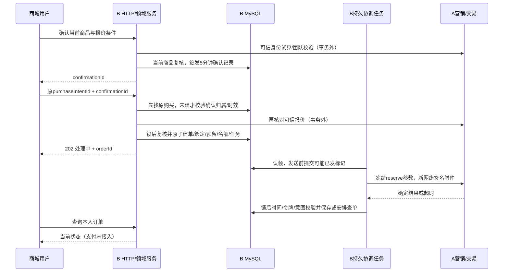

# B-03.1 联合设计

更新：2026-10-09。工作树D:/Java/zj-market-b03，分支b03。依据：路线图18节、B-03唯一过程文档11节D1～D27及13节D28～D32库存运营细化、现有V1～V4及A/B契约。本文为完整联合设计；B-03.2库存基础/运营六项接口及V5/V6已实现验收，其余交易结构仍是设计；实际通路基线为b030-final-20261009-1610。选择与开发历史只在b03-development.md维护，本文不另建一套过程记录或A协议。

## 1. 边界与不变条件

B拥有商品、商城订单、库存及资金渠道接入；A拥有营销资格、团名额、参团及成团/失败裁决。单仓、单SKU、数量1、CNY、最低实付0.01；不自动加入物流、多SKU、普通购买、推荐团列表、真实支付或收藏。七模块、MyBatis显式事务和固定依赖沿用，RPC DTO不进入domain/api。

1. 可用、预留、已售均为非负整数；一次订单预留最多确认或释放一次，二者互斥。任一数量运算先检查有符号BIGINT溢出，禁止截断/环绕。
2. 初始余额0；入库/调整只改变可用；预留：可用-1/预留+1；释放：可用+1/预留-1；确认销售：预留-1/已售+1。每次变化与预留状态、流水同事务，inventoryVersion递增一次；无余额变化的幂等重放不增版，版本溢出拒绝。
3. 同用户同SKU仅一笔未结束购买，跨渠道/活动/团队也不能绕过；已支付待成团仍占名额。A限购独立，关闭不返还A参与次数。
4. 订单、预留、一次报价绑定、购买名额和当前协调记录原子建立；事务外调用A。受理不等于A成功，页面故障不等于交易失败。
5. A占位业务键/完整请求冻结；原幂等键同参回原订单，异参拒绝。不用当前商品价覆盖旧单，不因超时换单号或团队。
6. 可能发送过reserve就不得凭NOT_FOUND、超时或租约失效释放。严格未发送证明按D27本地关闭；其他情况经A确定关闭。
7. 已支付待成团保持预留；A成团且该单支付被接受后转已售；A失败且渠道确认全额退款成功后才释放。
8. 资金、A参团/团队、库存和B订单分别表达。A关闭不代表渠道关单，Broker ACK不代表A接收，退款申请不代表退款成功。

## 2. 领域对象与状态

| 对象 | 含义及权威 |
| --- | --- |
| PurchaseConfirmation | B签发给可信用户的购买条件，5分钟有效、不锁价/预留，仅绑定一次购买 |
| MarketOrder | B稳定购买及冻结快照，orderId同时用作outTradeNo（沿用UUID标识风格，64字符内） |
| PurchaseGuard | 同用户同SKU长期守卫行，activeOrderId标记占用购买名额，不删除行模拟解锁 |
| InventoryAccount | 单SKU唯一可用/预留/已售余额及版本 |
| InventoryReservation | 单订单唯一预留，数量1，关联同SKU订单和账户 |
| TradeCoordination | 单订单唯一当前A协调意图及调度状态，独立于商品Outbox和未来资金任务 |
| InventoryOperation/Ledger | 运营幂等操作与不可变库存变化凭据 |
| OrderOperation/Attempt | 用户取消/运营控制幂等审计及每次网络尝试摘要 |

### 2.1 B-03实施状态

订单businessStatus：PROCESSING（受理/待确认）、WAITING_PAYMENT（A占位确认，但B-03支付未接入）、CLOSING（关闭意图已成立）、CLOSED（有确定依据且本地释放完成）。reviewRequired及errorCode独立，异常不是把未知伪报终态。

库存预留：HELD → RELEASED或CONFIRMED；CONFIRMED转换由B-04实现，B-03只实施HELD/RELEASED并预留语义。coordination意图RESERVE/QUERY/CLOSE/NONE；运行状态READY/LEASED/REVIEW_REQUIRED/DONE，paused单独表达。技术退避仍是可恢复任务，不是业务失败。

报价：未绑定且未到期可首次使用；到期禁止首次使用；BOUND永久关联原购买。记录到期不破坏已建订单恢复。绑定由订单confirmationId唯一外键表达，报价可记录boundAt，但不建立报价→订单的反向外键环。

关闭依据LOCAL_NEVER_DISPATCHED或A_CONFIRMED；本地关闭不能伪造A CANCELLED。可能发出过请求的A close返回CANCELLED/合法CLOSE_MARKER后，还需完成本地释放才为CLOSED。

### 2.2 本阶段迁移及运营动作矩阵

| 当前状态/证据 | 允许动作与后态 |
| --- | --- |
| PROCESSING，未关闭意图 | 确认合法占位→WAITING_PAYMENT；用户取消/D6到期→CLOSING，或D27本地原子CLOSED |
| PROCESSING，业务拒绝 | 固定关闭意图与原键，走A close（可能已发）→CLOSING；不得自动另建团队 |
| WAITING_PAYMENT，资金NEVER_OPENED | 用户取消/权威到期→CLOSING，确定A关闭及本地收尾→CLOSED |
| CLOSING | 持续原close核对；迟到reserve只补关联，不回到PROCESSING/WAITING_PAYMENT |
| CLOSED | 只读原结果/审计，重复取消可恢复；不再预留、发reserve或释放 |
| 任意状态，证据矛盾/意外PAID | reviewRequired，保留事实/预留并告警，不用未支付路径强制关闭 |

任务PAUSE仅对未完成任务开放，暂停后新认领/发送检查拒绝，不能撤销在途请求；RESUME仅对已暂停且当前错误类别/状态允许恢复的原任务开放；CHECK仅调度原意图的无破坏核对，不清除关闭意图或跳过有效租约。DONE均无控制动作；证据矛盾只允许暂停和只读展示，修复证据需受控维护流程，不能按钮强制成功。鉴权/配置故障先修复并核验，才可RESUME/CHECK；确定业务拒绝只推进关闭、不重发reserve。所有动作在锁内重算allowedActions并检查expectedVersion；页面可见按钮不构成授权。

### 2.3 未来资金扩展（设计交接，不实施完整资金表）

资金暴露：NEVER_OPENED → 开放中/已开放/未知，必须在首次创建渠道支付请求之前持久离开NEVER_OPENED，不因网络超时回退。可信PAID/CLOSED_UNPAID/退款状态由渠道事实决定。

未来订单可扩展WAITING_TEAM、REFUNDING、COMPLETED；失败且全额退款和库存释放完成后CLOSED并注明GROUP_FAILED_REFUNDED。库存预留与资金进度各自独立；A的FORMING/RECONCILING/COMPLETED/FAILED及recordVersion/teamVersion单独保存，不拿B状态替代A裁决。

付款已确认且A接受但未成团：继续HELD并占购买名额。成团及确认销售完成后COMPLETED/解除名额，无需等收货；失败退款及释放完成后解除。A退款事实同步单独可靠推进，不把“发送成功”写成A已确认；普通投递延迟不抹去已核实渠道退款，矛盾证据进入核对。

## 3. 正常、关闭及资金场景



| 具体情形 | 处理与库存 |
| --- | --- |
| 库存不足 | 本地回滚，不建立部分购买，也不调用A reserve；报价不因回滚被消费 |
| 建单前商品改版/下架、报价变化 | 拒绝首次建单，返回重新确认所需安全条件；旧记录不改价续期 |
| 建单后商品改版/下架 | 按D22冻结参数处理，历史查单不再套用新购买准入 |
| A拒绝旧版本/资格/满团/活动过期 | 不自动换价、换团或改为开团；可能已发则原键close阻断迟到，再释放 |
| A响应丢失/一次NOT_FOUND | 保持预留，用原键查询/受控重试，D6期限不重置 |
| 创建起5分钟未确认占位成功 | 持久关闭意图；严格未发则本地关闭，否则持续A关闭核对 |
| 用户取消与发送竞争 | 取消先阻断则本地释放；发送标记先提交则必须A关闭 |
| 关闭意图先提交、reserve成功迟到 | 校验并保存可信关联，继续关闭，不能重新开放付款 |
| A关闭成功但B写回失败 | 原close请求继续核对，确定结果后本地幂等释放一次 |
| A返回CLOSE_MARKER | 校验用户/渠道/单号及CANCELLED，允许无A orderId/金额/团队，不套RESERVATION必填检查 |
| A已占位、付款期限临近 | 保存paymentDeadline/serverTime，不猜新期限；到期需权威时间核对，资金未开放才可NEVER_OPENED关闭 |
| 未来支付创建响应丢失 | 资金可能已开放，不能NEVER_OPENED；按稳定支付键查渠道/关单，未知保留 |
| 未来支付成功但A尚未接收 | 保留预留/名额，原支付Outbox及queryEventResult恢复，不用未支付关闭绕过 |
| 截止前支付、消息到达时A已RECONCILING | 保留真实paidAt和原事件，按A契约补齐支付事实及核对，不按到达时间判未支付 |
| 渠道已付、A已关闭或支付不在窗口 | 建立可信收款及退款义务，核对冲突，不伪造CLOSED_UNPAID；已释放库存不能再释放或造负库存 |
| 团队RECONCILING、名单存在资金未知 | 保留待核对及预留，不提交伪造完整名单结果，不宣布失败 |
| A失败，退款提交超时或处理中 | 原退款键恢复，保持HELD/名额；渠道可信全额退款成功后才释放 |
| A成团及退款/付款证据矛盾 | REVIEW_REQUIRED，停止有副作用推进并告警；不同时确认销售和释放 |

### 3.1 冻结A请求与结果校验

reserve保存可信source/channel/userId、outTradeNo、goodsId、activityId、quantity=1、productVersion、expectedPayPrice、currency及请求teamId（OPEN为null）；每次重试完整业务字段不变，仅重新生成签名/nonce/requestId。query使用原user/source/channel/outTradeNo。A结果版本精确解析BIGINT，拒绝归属、金额、商品或团队证据矛盾；相同版本同事实幂等，旧版本不回退状态，新版本也不能改写不变成交快照。OPEN首次分配的teamId持久后固定，JOIN必须等于请求团队。

首次关闭意图同事务生成closeId、reason、paymentDisposition、verifiedAt并保存完整请求/hash；以后不改verifiedAt或reason重用原closeId。用户取消映射USER_CANCEL，D6未确认到期映射ORDER_ABORT，A付款截止核实后映射PAYMENT_TIMEOUT；浏览器reason仅为本地审计文本。B-03只允许以持久NEVER_OPENED事实声明对应disposition；未来CLOSED_UNPAID必须有渠道确定关单未付证据，UNKNOWN不可声明。技术网络附件每次重签，业务关闭请求保持不变。

Trade.close只返回关闭摘要，须核对业务键/关联/单调版本；必要时原键query取得RESERVATION或CLOSE_MARKER，不能强求close摘要包含query才有的所有字段。仅A明确CANCELLED、关联有效且本地资金依据仍有效时收尾；ORDER_ALREADY_PAID不是关闭成功，进入可信支付事实核对。

### 3.2 A期限与本地时钟

数据库毫秒时间沿用现有DAO方式；租约/确认记录/D6均在相应锁后取时。保存A的serverTime、paymentDeadline和B收到快照的数据库时间。以二者相对剩余时长安排本地查询，不将本机墙钟当A权威；临界时再查A校时，查询失败保持核对、不猜到期释放。重试不延长A期限，不变更paidAt。

## 4. 本地事务、锁顺序与崩溃窗口

所有B-03写事务遵守下列相对顺序；只锁本事务需要的既有行，但禁止后续反向补锁。多用户或同类多行按稳定标识排序。普通网络查单/试算在事务外，不将响应视为本地锁。

```text
需引用的b_user（买家/运营，稳定顺序共享锁，仅复核适用权限）
→ b_product（商品行；新购复核，旧单仅锁及关联，不重新拒绝下架）
→ b_purchase_guard
→ b_purchase_confirmation（仅首次购买/签发涉及）
→ b_inventory_account
→ b_market_order
→ b_inventory_reservation
→ b_trade_coordination
→ 运营/取消幂等操作记录
→ 库存流水/尝试日志/审计追加
```

既有商品修改保持product→outbox→sync路径，B-03不在持order/inventory锁后调用该修改路径。首次建单持商品锁读取当前同步目标，确需锁商品同步行时沿既有商品顺序，不从交易表反向锁商品。外键父行检查必须纳入相对顺序；例如库存→商品、预留→订单的父记录已先锁或在本事务内新建。当前订单/用户/SKU来自非锁定定位后，取锁时再次校验，定位读取不作业务裁决。

| 事务 | 原子内容/取时 |
| --- | --- |
| 商品创建/账户初始化 | 当前商品创建＋事件/同步＋零账户；旧商品迁移不猜库存 |
| 签发报价 | 网络试算后锁用户/商品，复核版本与在售同步，锁后时间生成固定issued/expires，再插确认记录；不预留 |
| 首次购买 | 原键二次检查、guard/quote/stock锁、锁后时间检查5分钟、商品/报价匹配、余额校验，绑定/订单/预留/流水/guard/task同提交 |
| 认领 | 按稳定锁序校验当前意图、due/paused/租约；锁后取时生成新令牌与30秒租约，每条执行前认领 |
| reserve发送前 | 再按锁序检查当前订单/任务/令牌/意图/锁后期限，先持久mayHaveDispatched=true，再事务外调用；标记永不回退 |
| A结果写回 | 重新取相应锁后取时，校验令牌、租约及意图；旧worker不得写业务结果，可信矛盾留安全核对摘要 |
| 用户取消/到期关闭 | 原子记录关闭意图；未发证明成立则本地释放并使旧令牌无效，否则冻结完整close请求并安排CLOSE |
| 确定A关闭收尾 | 验证NEVER_OPENED依据/关闭证据、订单/HELD及guard归属；订单关闭、释放流水/余额、guard清空、task DONE同提交 |
| 运营入库/增减 | 操作键恢复→同序取锁→锁后检查expectedVersion/数量/非负/溢出，操作结果/余额/版本/流水同事务 |
| 运营暂停/恢复/立即核对 | 原操作键恢复、相对顺序取锁、检查版本/可操作状态，调度变化及审计同事务，不直接调用A |
| 未来成团/退款后库存收尾 | 只读可信持久资金/A证据，按同序原子完成预留确认或释放及名额解除，不在事务内查渠道 |

幂等已有结果需先识别，再判断旧报价到期或旧expectedVersion，不能因上一请求已经成功而拒绝合法重放。快捷无锁读只用于返回不变请求关联/定位，所有新增与写回必须在锁内再次校验唯一性；数据库唯一冲突回滚后读取赢家并比较规范摘要，不捕获后继续使用已失败事务。

未发证明：mayHaveDispatched=false、资金NEVER_OPENED、锁内停止当前任务并失效旧令牌、任何worker发送前均必须再次持久检查。仅缺A订单号/次数为0/paused/租约过期不够。标记提交后崩溃，即使实际没发，也保守走A close。单条协调记录不等于网络不会并发；A关闭标记与本地fencing都必需。

正常错误状态不保持数据库锁等待用户或网络。死锁/锁等待超时回滚整次本地事务，再按原请求键查询/有限重试，不留下部分操作；不能在本地事务重试里再次执行网络调用。真实MySQL并发复验在B-03.6完成。

## 5. 持久结构与约束计划

沿用不透明ID VARCHAR(64) ascii_bin；activityId/业务版本为1～9223372036854775807无前导零十进制字符串，与A精确解析一致。金额DECIMAL(8,2)、UTC毫秒BIGINT、商品/业务版本BIGINT；HTTP中版本、库存余额/增减量和毫秒之外的大整数用十进制字符串，数量固定1可用安全整数。时间对外UTC ISO8601毫秒。主外键不跨A，不级联删除业务历史。

| 表（计划名） | 关键字段 | 唯一/外键/索引及约束 |
| --- | --- | --- |
| b_inventory_account | goods_id；available/reserved/sold BIGINT；inventory_version；initialized_by；created/updated_ms | PK/FK goods→b_product；三余额非负、version>0，单SKU一行；无库存猜值 |
| b_inventory_operation | operation_id；operator_id；operation_key；goods_id；kind INBOUND/ADJUST；delta；expected_version；reason；request_hash；outcome SUCCEEDED/REJECTED；result_code/message、结果快照、completed_ms；created_ms | UK(operator_id,operation_key)；FK operator/user、goods/account；delta非0、入库delta>0；idx(goods,created,id) |
| b_market_order | order_id/out_trade_no；user/source/channel；purchase_intent_id/hash；confirmation_id；goods_id；冻结商品名/图片/版本、活动、mode/team；quantity、原价/优惠/应付/CNY；business_status、order_version；created/updated_ms、reserve_wait_deadline；A记录/团队及版本/期限/serverTime/接收时刻；may_have_dispatched；payment_exposure；close意图/原因/依据/冻结请求及hash、closed_ms；review/error | PK order_id，outTradeNo取同值；UK(source,channel,out_trade_no)、UK(user,source,channel,intent)、UK(confirmation_id)、UK(order_id,goods_id)；FK user/product/confirmation；数量1、金额关系、CNY；idx(user,created,id)、idx(status,wait_deadline,id) |
| b_purchase_confirmation | confirmation_id；user/source/channel、goods/version/activity/mode/team；完整offer、quantity；issued/expires_ms；bound_at_ms | PK；FK user/product；idx(expires_ms,id)、idx(user,created,id)；绑定由order.confirmation唯一FK保证，避免反向FK环；已绑定不按5分钟删除 |
| b_purchase_guard | user_id、goods_id、active_order_id可空；updated_ms | PK(user,goods)，FK user/product及非空active_order→order；不含channel/activity/team以符合D5；首次插空guard，建order后填引用，关闭后清空 |
| b_inventory_reservation | order_id、goods_id、quantity=1；state HELD/RELEASED/CONFIRMED；created/resolved_ms；resolution_basis | PK order_id；复合FK(order_id,goods_id)→order，FK goods→inventory_account，禁止错SKU预留；idx(goods,state,order) |
| b_trade_coordination | order_id；intent/intent_version；run_state、paused；task_version；next_attempt_ms、lease_token/until；attempt/failure计数、alerted；安全last_error；reserve/close冻结请求引用及hash | PK/FK order→order；idx(run_state,paused,next_attempt,lease_until,order)；完成不删除；查询/发送前事务保护，无JSON签名/秘密 |
| b_inventory_ledger | ledger_id、goods_id、kind INIT之外的INBOUND/ADJUST/RESERVE/RELEASE/CONFIRM；business_key；operation_id或order_id；三余额delta/before/after；actor（系统或运营）；原因及时间 | UK(goods,kind,business_key)，运营business_key取内部全局唯一operation_id而非仅客户端操作标识；成功operation一条变化关联，拒绝无变化流水；FK goods及非空operation/order；idx(goods,time,id)；before/after非负且差额一致，系统初始化无数量变化不伪造入库流水 |
| b_order_operation | operation_id、actor_id、operation_key、order_id；action CANCEL/PAUSE/RESUME/CHECK；expected_version、reason、request_hash、结果/前后调度状态、时间 | UK(actor,action,operation_key)；FK actor/user及order；idx(order,time,id)；重放不重复改变调度 |
| b_trade_attempt | attempt_id、order_id、意图/令牌摘要、request_id、方法、开始/结束、code、结果hash/安全摘要 | FK order/coordination；idx(order,time,id)；无令牌秘密、签名/密码/Cookie，不能以尝试日志代替成交证据 |

字段组必须拆为可检索字段或严格JSON，冻结JSON保存规范body/hash并做JSON有效性校验，索引不能依赖扫描大正文。唯一键ascii_bin不大小写折叠；canonical request hash只含明确允许的业务输入、可信作用域，不包含每次RPC nonce/签名/requestId。operator相同key异SKU/异delta/异reason拒绝；取消同key异订单/异参拒绝。订单原意图绑定confirmationId，不因新确认生成而重解释原意图。

购买guard、订单confirmation唯一键及锁内检查共同保障“同SKU一笔”和“同报价一次”，不能只用先查后插。初始化guard先引用user/product、后引用新order，无循环必填FK。临时未绑定过期报价可批量清理；BOUND、订单、幂等关联及资金证据不在本阶段自动删除。人工禁用用户不级联清历史，后台仍可关闭/退款核对旧购买，不能把禁止新购买误用于阻断恢复。

### 5.1 迁移与按表权限

- B-03.2完成账户、流水、运营维护及预留的领域规则/仓储边界；依赖订单外键的预留持久表及原子建单在B-03.3落地，不在.2预造订单表。
- B-03.2：计划V5库存账户/运营操作/流水基础、存量商品零账户及创建端口；先隔离库迁移、核对数量与FK、分配运行账号DML后验收运营接口。V5流水只关联现有库存/运营操作父表；后续交易迁移再向ledger新增order_id及外键。允许阶段后续迁移向ledger补订单关联，不提前创建空支付/退款表。
- B-03.2实际迁移为V5库存基础＋V6请求审计；已执行迁移不改写。B-03.3交易迁移顺延至V7起，阶段编号与迁移版本分开。
- B-03.3实际V7包含报价确认、guard、订单、reservation、coordination五表及ledger订单引用；建表顺序confirmation→空guard→order→补guard复合FK→reservation/coordination→ledger约束。取消/控制操作及attempt依赖真实协调/关闭入口，在.4/.5按需以V8及后续迁移实施，不重写已执行V7。
- B-03.4/.5：按实际需要以新迁移增加A结果/关闭及到期索引，若交易迁移已完整无需为阶段编号重复建迁移。V1～V4不改；迁移版本与实际DDL在实施时冻结，不把计划文件当已执行。
- 每步在已有B测试库验证，运行账号只新增表级SELECT/INSERT/UPDATE/DELETE，迁移账号外部注入；A库/系统库/DDL/history/grant仍拒绝。普通包不引入Flyway或verification。
- 账户补零及新商品入口切换需受控写入窗口，避免旧版本在回填后漏账户；V5后旧商品逻辑如果不创建账户不能继续接收商品创建写入。回退优先关闭新功能/写入口，不删除业务事实或逆执行破坏性DDL。

## 6. HTTP与页面契约

统一/api/v1及ApiResponse{code,message,data,requestId}，X-Request-Id与正文一致，no-store。沿用现有Bearer身份、运营角色及auth入口的Cookie/CSRF规则，不为B-03新增Cookie鉴权旁路。请求拒绝未知字段，可信user/source/channel由后端提供，禁止浏览器传身份、A结果或库存余额。

| 方法/路径（设计） | 权限及输入 | 返回/核心语义 |
| --- | --- | --- |
| POST /purchase-confirmations | 登录；goodsId、mode、teamId（JOIN必填/OPEN不传）、expectedOffer | 201确认ID/完整安全offer/issuedAt/expiresAt；真实A校验后签发；变化409需用户重新确认 |
| POST /orders | 登录；purchaseIntentId、confirmationId | 新受理202/order；同键同参200当前原单；异参409；不同步等待A |
| GET /orders | 登录；page/size | 200本人订单分页；不接收任意userId查询 |
| GET /orders/{orderId} | 登录且本人 | 200状态/冻结商品报价/本人A关联/期限/关闭或安全异常；外人或不存在404 |
| GET /orders/by-intent/{purchaseIntentId} | 登录可信作用域 | 200原购买或404；HTTP丢失后优先恢复，不换键重建 |
| GET /products/{goodsId}/active-order | 登录且本人 | 200本人当前购买或null，原页面key丢失时找回；商品当前缺货/下架不阻断历史本人恢复 |
| POST /orders/{orderId}/cancel | 本人；operationId、reason | 本地未发闭合200，需远程关闭202，已有CLOSED200；同操作同参恢复，已支付不可主动取消 |
| GET /teams/{teamId} | 登录 | 200裁剪团队/商品关联、人数/期限/joinable及本人摘要，无他人明细；不存在/越范围404 |
| GET /admin/inventory | 运营；page/size、goodsId可选 | 200准确余额/版本及商品定位 |
| GET /admin/inventory/{goodsId} | 运营 | 200单SKU准确余额/版本 |
| POST /admin/inventory/{goodsId}/inbounds | 运营；operationId、quantity十进制正整数字符串、expectedVersion、reason | 成功首次201/重放200；确定拒绝及其重放409且持久原结果；不自动创建缺账户 |
| POST /admin/inventory/{goodsId}/adjustments | 运营；operationId、delta有符号整数字符串、expectedVersion、reason | 成功首次201/重放200，确定拒绝及重放409；不可减少超过可用、不可改预留/已售 |
| GET /admin/inventory/operations/{operationId} | 运营且原操作者；原提交的稳定操作标识 | 200原InventoryResult（SUCCEEDED/REJECTED）快照，未找到/非本人404；查询不触发写操作，NOT_FOUND不证明原请求未执行 |
| GET /admin/inventory/{goodsId}/ledger | 运营；page/size | 200流水，初始化不是虚构入库 |
| GET /admin/orders/exceptions | 运营；page/size、安全状态筛选 | 200脱敏异常列表/可操作动作，不直接展示冻结敏感正文 |
| GET /admin/orders/{orderId}/coordination | 运营 | 200当前阶段/版本/暂停/失败/due/近期安全尝试与审计 |
| POST /admin/orders/{orderId}/coordination-controls | 运营；operationId、expectedVersion、action PAUSE/RESUME/CHECK、reason | 202调度已受理或同参200原结果；仅操作原任务，不直接发RPC |

confirmation.expectedOffer包含goodsId/productVersion/activityId、原价/优惠/实付/CNY/targetCount，数量固定1，targetCount沿用A的1～100范围。B重新试算并校验实际offer与用户所见条件；不同返回409并仅在A允许该用户可见时带当前可展示offer，不能在返回中替用户默许新的条件。订单create仍再核对可信报价，网络检查后锁内复核商品版本/确认时效，避免等待锁时条件变化。

B-03 order DTO的paymentEnabled=false，不提供付款成功按钮；可展示WAITING_PAYMENT及权威期限，但明确真实支付未接入。公开产品DTO只新增availability=IN_STOCK/OUT_OF_STOCK等安全字段，不回传准确余额；运营DTO单独定义。匿名团队详情401，不在响应返回团队信息。分页沿用现有page从1、size≤100。

错误建议：
- 400 VALIDATION_FAILED；401 AUTH_REQUIRED；403 FORBIDDEN（运营入口）。
- 404 ORDER_NOT_FOUND/TEAM_NOT_FOUND/PRODUCT_NOT_FOUND（按资源归属裁剪）。
- 409 IDEMPOTENCY_CONFLICT、ACTIVE_PURCHASE_EXISTS（仅返回本人activeOrderId）、CONFIRMATION_EXPIRED/ALREADY_BOUND、QUOTE_CHANGED（可含最新安全offer）、STOCK_INSUFFICIENT、INVENTORY_VERSION_CONFLICT、PRODUCT_VERSION_CHANGED/NOT_READY、TEAM_NOT_JOINABLE、CANCEL_NOT_ALLOWED、CONTROL_NOT_ALLOWED。
- 503 UPSTREAM_UNAVAILABLE/DEPENDENCY_UNAVAILABLE用于未完成可信前置检查等临时故障，不声称已受理订单不存在；已受理后台故障通过查单200状态/安全错误表达。
- ApiResponse外壳不变；B-03特定409可带结构化data（latestOffer或本人activeOrderId），不更改B-02既有错误data=null行为，不把A原始异常/签名附件透传。

补充B-03.2已确认D28：下架商品允许运营入库及增减可用库存；维护不自动上架，不直接修改预留/已售，新购买仍校验在售条件。

D29：库存写响应未知时自动按原标识查询结果，不自动重发写请求；运营手动重试保持原标识及原参数。查询结果与当前余额分开显示，不根据余额或一次NOT_FOUND推断原操作失败。

D30：库存写请求发送前在localStorage保存原操作标识、原业务参数及所属运营用户；不保存登录凭据。关闭浏览器后同一运营可恢复核对，身份变化停止旧查询，其他账号不展示/重试；本地记录不是可信事实，写重试仍需手动且服务端鉴权幂等。

D31：本浏览器同运营同SKU存在未确认库存操作时，先核对原操作，暂禁新入库/调整；允许原键查询/手动重试及其他SKU维护。跨标签页需协调提示与提交，不能以删除本地记录或一次NOT_FOUND解除，不限制其他运营/商城/后台。

D32：库存操作以原编号绑定原规范请求，成功或确定业务拒绝都持久终结。先查同键结果再检查旧expectedVersion；SUCCEEDED只记账一次，REJECTED不动余额/版本、不追加库存流水。同参重放回原结果，异参不改原记录。业务拒绝须提交记录后再由HTTP返回409，不能抛异常回滚证据；技术故障/未知不伪装成拒绝。

查询GET的200表示读取成功，结果outcome为SUCCEEDED或REJECTED，附原规范请求、安全code/message、completedAt和裁决时余额；POST拒绝及拒绝重放409可附相同终结结果。404不表示原写请求已终结；页面仅凭匹配原请求的可信终结结果解除D31等待。修改请求必须新编号，不自动改版本重发。鉴权/格式/账户定位失败不是已受理业务终结记录。

### 6.1 页面动作

商品仍可匿名浏览；缺货禁用新购买。登录后试算与团队详情，OPEN/JOIN明确显示并固定用户选择；确认新报价后得到5分钟确认编号，再以一次购买意图提交。新单202进入订单详情，不自动轮询重发POST。

订单PROCESSING/CLOSING每3秒非重叠查询，页面不可见暂停，返回立即查，连续最多5分钟；到期只停止浏览器查询，显示后台仍在处理及手动刷新。身份/订单变化取消旧请求并丢弃迟到回应。WAITING_PAYMENT/CLOSED停止本轮查询；B-04资金页面刷新另行扩展。

运营库存页面提供入库、增减量调整、版本冲突刷新确认及流水；异常页提供安全状态/错误与可用控制动作。完成任务不可操作，证据矛盾不能按钮强制解锁；鉴权/配置故障修复后仍需受控校验再恢复，系统不自动向业务拒绝反复reserve。

## 7. 端口、模块与后续资金证据

domain增加inventory/order（含购买确认及协调）职责；接口I*Service放service、实现放service/impl，仓储接口adapter/repository，外部端口adapter/port；公开模型独立文件，不把A SDK或Spring对象引入领域。infrastructure实现MyBatis事务仓储、A报价/交易适配及配置；trigger负责HTTP/调度，api只放DTO；app装配，verification放隔离验收，保留原模块图。

建议领域端口：IInventoryService、IPurchaseConfirmationService、IOrderService、ITradeCoordinationService；本地工作单元IOrderRepository以事务聚合提交多个事实，跨领域参与必须同DataSource/TransactionTemplate。A出站端口IMarketingQuotePort、ITradePort、ITeamQueryPort返回B领域值对象，适配器校验A并映射类型；不把HTTP体或A RpcResult交给domain。

实际A接口只用既有MarketingService.trial、TradeService.reserve/query/close、TeamService.query；签名/序列化沿既有独立编解码，单次调用10秒、Dubbo隐藏重试关闭，业务重试由持久协调完成。RESERVATION核对user/source/channel/outTradeNo/goods/activity/version/quantity/三金额/CNY/team/期限；OPEN第一次接受A分配team，后续历史查询对已持久标识验证，不把返回新team默认为合法。

未来支付/退款能力端口（非本阶段具体渠道实现）：

| 能力 | 业务键、输入及可信返回 |
| --- | --- |
| createPayment | 稳定paymentId/订单、冻结实付/CNY/权威截止、请求摘要；返回渠道号/安全支付参数或UNKNOWN；外调前持久开放事实 |
| queryPayment | 原稳定键；可信PAID/UNPAID/CLOSED_UNPAID/UNKNOWN及身份金额/真实paidAt；NOT_FOUND不独立证明从未开放 |
| closePayment | 原关闭键/支付键；先停止新付款入口，再查已付或确定关单未付；未知不得发A CLOSED_UNPAID |
| verifyPaymentNotification | 验签/来源/防重放，关联订单与金额币种；持久可信事实及事件后才确认回调，不相信浏览器返回页 |
| requestRefund/queryRefund | 稳定refundId/原支付/全额金额CNY/原因；持久请求及UNKNOWN/SUCCEEDED等可信证据，重复查询/重试不能另退一笔 |
| 资金事件可靠投递 | 独立支付/退款Outbox、A结果Inbox、queryEventResult与Trade.query核对；不复用商品Outbox，不伪造支付成功 |

资金证据须保存渠道/支付/退款标识、冻结请求摘要、原订单关联、金额币种、渠道真实paidAt/状态、验真及查询时间、可信响应/回调的安全hash和必要受控证据；敏感支付参数不向普通日志或运营异常正文暴露。具体渠道/沙箱在B-04前单独选择，支付/退款完整表不在本阶段创建。

A RECONCILING核对由B持久任务精确覆盖授权名单：已付且A接受为PAID_ACCEPTED；明确未开放/关单未付走close；窗口外已收款形成退款义务；任何缺单/资金未知/证据冲突不提交伪完整结果。退款成功与库存释放各自幂等，A成团/失败只由其权威事实驱动。

## 8. 设计验收与后续实施矩阵

| 阶段 | 验证重点 |
| --- | --- |
| .2 | V5零账户完整性、新商品原子回滚、无猜库存；运营同键/异参、旧版本、负量/溢出、并发调整与预留、FK/最小权限 |
| .3 | 最后一件仅一单、同SKU跨意图互斥、同确认并发一次绑定、同键重放过期不影响、订单/预留/流水/名额/任务故障点全回滚 |
| .4 | 实际A开团/指定团、响应丢失查原单、拒绝原条件、只改图片/下架后的旧单、异常回应/版本/归属/金额验证及CLOSE_MARKER |
| .5 | D27取消先/发送标记先/标记后崩溃；D6重启不重置，A关闭先到与迟到reserve、重复取消/写回失败，PAUSE不绕过关闭意图 |
| .6 | 两MySQL连接锁等待跨租约、旧token/旧intent拒绝；5次技术失败告警继续、断A恢复原close、跨用户/运营权限、真实页面自动/手动查询及控制审计 |
| .4/.5/.6共同 | 正常商品/身份/可靠同步/试算受影响回归；实际产物/SDK/源码指纹和独立批次，不修改A日常库，环境/JDK恢复 |
| B-04/05交接 | 支付未知不NEVER_OPENED、支付/关单竞争、截止前付款迟到、核对未知名单、A失败全额退款后释放、重复/乱序资金事实不双释放 |

本阶段验证是文档/契约/场景一致性核对，不把设计审查称为已运行库存/订单测试。B-03.0既有26项测试及通路证据沿用，B-03.2之后按新增代码执行对应测试。

## 9. 当前收口状态

D1～D27均有用户确认，未选真实支付渠道明确延期到B-04前；当前设计未修改A契约或新引入中间件。本文库存三表及六项运营接口已在B-03.2落地验收；其余订单/团队/购买接口及资金扩展仍是实施依据。结构化HTTP设计另见[b03-http-api.json](b03-http-api.json)；过程与选择唯一入口见[b03-development.md](b03-development.md)。

设计审查须检查：每条未知路径有持久恢复方，业务关闭与资金证据分开，外键父记录及所有写入口同序，D27标记前后窗口均有确定裁决；后续实现若发现需要改变已确认方案，先列差异逐项交用户，不自行替换。

## 10. B-03.3实施增量

本地订单/报价六项HTTP已实施，V7在双B库执行。库存6项＋本地订单6项为当前12项已实施操作，其余5项仍为设计。待协调任务持久READY、mayHaveDispatched=false、paymentExposure=NEVER_OPENED；本阶段无worker发送reserve或关闭，没有支付开放。实际联调及恢复证据见[B-03过程第15节](b03-development.md#15-b-033本地订单与预留2026-10-09已完成)。

Order响应沿用version/status/product安全视图，A字段尚为空、canCancel/paymentEnabled=false；B-03.4扩展真实A结果字段及展示，B-03.5提供取消和到期关闭。当前商城提供开团报价二次确认及本人订单，JOIN报价/本地建单后端已实际签名验证，分享链接及团队展示按原计划在.4接入。

本次实施复杂度高，迁移/事务/HTTP页面/真实数据库和A报价/恢复验收按唯一过程记录推进；不以本地受理冒充A占位成功。

## 11. B-03.4/.5实施增量

以本节为当前实施状态；前文各阶段记录保留作为设计演进归档。17项HTTP操作已实施，V8增加可信A结果/发送审计，V9增加关闭依据、关闭摘要、鉴权只读核验标记及b_order_operation；双B库运行角色按21张B表授权，旧迁移未改写。

D33已由用户确认：运营CHECK只调度原订单只读签名QUERY；鉴权通过且结果可信才恢复原任务，失败继续停止。证据矛盾不允许页面CHECK/RESUME。运营控制带原操作键、协调版本、原因，原键重放返回原受理快照；不是强制成功或修改冻结正文。

D27在全局锁序内验证mayHaveDispatched=false、无A证据且无需核对，原子阻断认领/发送后本地关闭释放；任何可能已发均持久冻结closeId/verifiedAt等完整原请求，签名close后再以原订单query确认。关闭、HELD→RELEASED、可用加一/预留减一、唯一流水、guard清除、任务结束同事务；未知或资金矛盾仍保留HELD。B墙钟只调度查询，权威A serverTime/paymentDeadline才触发PAYMENT_TIMEOUT关闭。

商城提供取消和四态展示；简易运营页面提供脱敏异常列表、协调摘要/最近20次尝试和允许的PAUSE/RESUME/CHECK。取消/控制未知结果保留绑定当前账号的原键原参，浏览器重开后手动重试，不保存登录令牌，不自动重发写操作。实际验收与复现统一见[B-03过程第17节](b03-development.md#17-b-035-未支付关闭与页面闭环2026-10-09已完成)。

本次实现复杂度高，迁移→关闭/释放→发送竞争/到期→HTTP/页面→真实故障验收→交接分步推进；真实资金仍留B-04/05，B-03.6联合交接另行开展。
