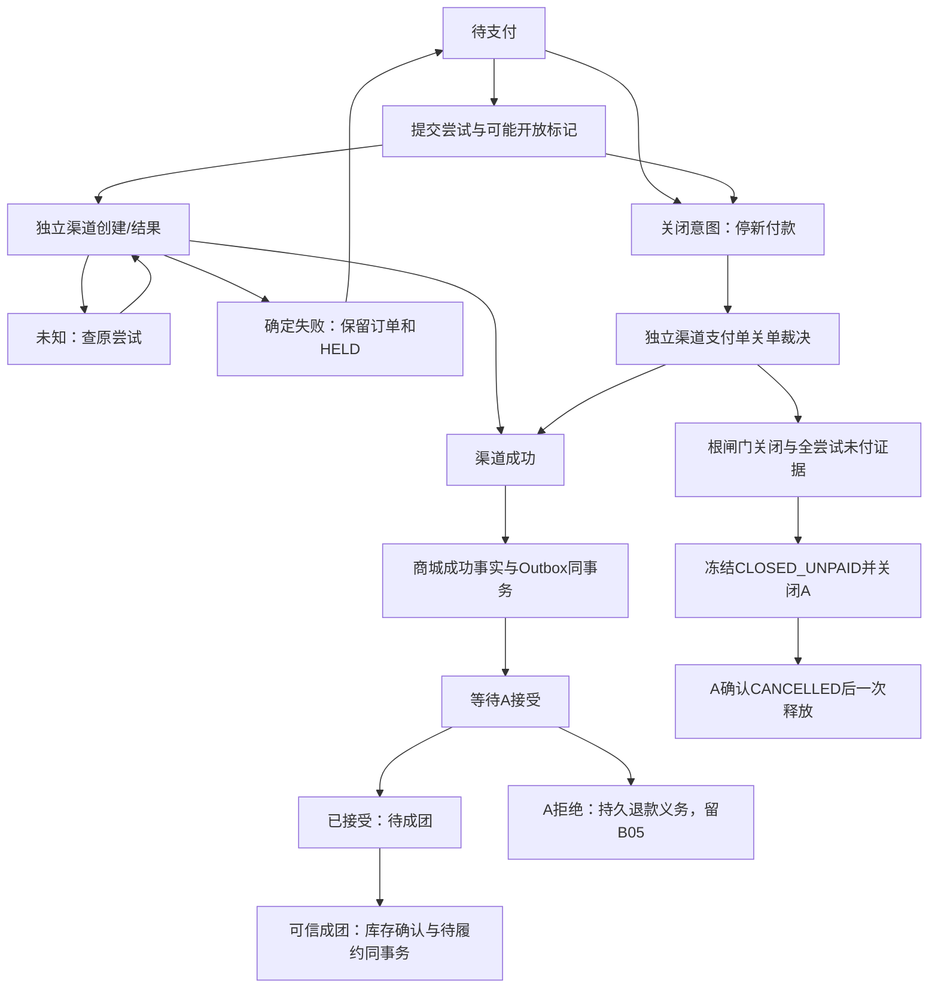

# B-04.1 支付与关闭联合设计

更新：2026-10-10（Asia/Shanghai）。工作树D:/Java/zj-market-b-04，b-04，代码基线7cef241。本文保持联合设计规格；B-04.2基础已编码并执行V10，V10.1收尾补充受理快照摘要；普通入口默认关闭，.3～.5的实现按过程与路线图区分；选择和开发历史唯一维护于[B-04过程](b04-development.md)，阶段以[路线图20.3](development-roadmap.md#203-小阶段与验收门槛)为准。HTTP增量见[b04-http-api.json](b04-http-api.json)，A协议仍以[A/B契约](../../group-buy-market/docs/ab-api-contract.md)为唯一权威。

## 1. 决策与代码差距

D1失败仅终结尝试，D2渠道/商城分开持久事务，D3成团转已售并待履约，D4一商城支付单多渠道尝试；D5仅verification注入故障，D6本阶段持久承担B-05工作，D7创建尝试/选择结果前查A、数据库时间记录资金并验证窗口，均已由用户确认。下面的状态名称、表分配及参数是据此形成的实施规格，不新增业务选择。

以下为.1设计时的差距归档（.2/.3实施以过程第11/12节为准）：当时代码只有V1～V9，OrderController.paymentEnabled恒false；TradeRepository仅NEVER_OPENED可关闭/释放，遇PAID/COMPLETED进入核对；ReservationEvidence仅记录payment/refund存在布尔值；SyncResultReader仅支持商品结果；MqSettings尚无交易Topic及独立结果/团队消费者组；InventoryAccount.confirm仅纯领域规则。必须分别扩展，不能放宽旧保护后宣称资金已接通。修改现有HTTP订单响应时扩展B-03契约，不把本文JSON当作已实现。

## 2. 标识、事实和对象

| 对象 | 稳定标识及事实 | 唯一/冻结约束 |
| --- | --- | --- |
| 商城订单 | orderId=A.outTradeNo，既有购买快照和A成交证据 | 不换外部单号，不改旧价格/期限/团队 |
| 商城支付单 | paymentId，唯一关联orderId；A PAYMENT_SUCCEEDED.paymentId也用该值 | UNIQUE(order_id)，只发一份成功资金事实 |
| 渠道尝试 | attemptId及支付单内递增attemptNo，模拟渠道另生成channelTransactionId | UNIQUE(payment_id,attempt_no)，原尝试未知不创建新尝试；渠道流水不充当A paymentId |
| 本人操作 | operationId，actor+动作+订单+尝试+请求摘要，保存受理快照/终结拒绝 | UNIQUE(actor_id,operation_key)，同键异动作/订单/结果也冲突；requestId仅链路标识 |
| 模拟渠道支付单 | paymentId，独立渠道闸门、冻结应收、成功attemptId和版本 | 支付单层面最多一笔成功；关闭标记阻断未来迟到创建 |
| 支付成功事实 | paymentId+orderId+amount+CNY+paidAt+成功attemptId/流水及摘要 | 商城本地事实与交易Outbox同事务；渠道/商城两次提交 |
| 渠道关闭证据 | stable channelCloseId、paymentId、闸门版本、全部尝试集合/终态/摘要及核验时间 | 包括尚未创建尝试的阻断证明，不以逐条NOT_FOUND代替 |
| A关闭请求 | 原closeId/reason/paymentDisposition/verifiedAt及hash | 取得证据后首次冻结，重试不改；旧NEVER_OPENED请求永不改成CLOSED_UNPAID |
| 待履约 | 单订单唯一记录，关联成功paymentId、A团队及确认库存事实 | UNIQUE(order_id)，不表示发货/收货 |

标识沿用UUID字符串（接口统一64字符以内）；金额精确两位小数字符串/数据库DECIMAL(8,2)，0.01～999999.99/CNY/quantity=1；时间UTC毫秒，数值版本正long字符串，所有运算/递增检查溢出。请求摘要含完整归属、动作、冻结条件；拒绝重复JSON键、未知字段、首尾空白和浮点金额。

## 3. 状态及页面含义

| 维度 | 状态 | 规则 |
| --- | --- | --- |
| 商城资金 | UNPAID、UNKNOWN、SUCCEEDED | 未知是无法证明资金结果；SUCCEEDED不可被失败/关闭/退款抹成未付；退款另表达 |
| 商城支付闸门 | OPEN、CLOSING、CLOSED_UNPAID、PAID | 关闭意图只停新操作，渠道裁决后才能关闭未付；PAID阻止新尝试 |
| 商城尝试观察 | CREATING、OPEN、UNKNOWN、FAILED、SUCCEEDED、CLOSED_UNPAID | UNKNOWN为观察结果，不是渠道可随意改单的终态；只有可信FAILED可按D1新尝试 |
| 渠道闸门 | OPEN、PAID、CLOSED_UNPAID | PAID与CLOSED_UNPAID互斥终态；关闭根记录持久阻断所有后续创建/结果 |
| 渠道尝试 | OPEN、FAILED、SUCCEEDED、CLOSED_UNPAID | FAILED/SUCCEEDED/CLOSED_UNPAID不可反转；请求同参重放返回原结果 |
| A接收 | NOT_SENT、PENDING、ACCEPTED、REJECTED、REVIEW_REQUIRED | 发送ACK只改投递状态；资金成功不等于A接受，不等于成团 |
| 后台工作 | READY、LEASED、WAITING_DEPENDENCY、DEFERRED_B05、REVIEW_REQUIRED、DONE | DEFERRED_B05不伪装为DONE，重启可见且B-05可认领 |

订单保留PROCESSING/WAITING_PAYMENT/CLOSING/CLOSED；新增PAYMENT_PROCESSING、PAID_WAITING_A、PAID_WAITING_TEAM、GROUP_COMPLETED、WAITING_REFUND。证据冲突使用review_required/errorCode，不把所有异常混成一个可自动放行的状态。资金未知显示“付款结果待核对”；渠道成功未入商城显示“结果同步中”；A未接受显示“已支付，营销确认中”；已接受未成团显示“已支付，待成团”；GROUP_COMPLETED同时展示履约PENDING。

支付失败后回WAITING_PAYMENT，只在期限有效、没有关闭/核对且原尝试确定失败时显示重试；UNKNOWN不显示新付款按钮。canCancel表示能受理关闭意图，不承诺最终未付关闭；已有成功资金不能取消。支付/查询独立开关下，关闭入口后仍必须恢复既有资金事实，不能关掉页面同时关掉恢复任务。

## 4. 事务、原键恢复及并发裁决

### 4.1 创建和选择

1. HTTP先鉴权及查本人旧操作；已持久同键操作直接返回原受理/拒绝快照，不因A离线阻断读取重放。无旧操作时在事务外查询本人A原单，严格校验成交归属/版本/金额/期限和D7时间凭据；新付款要求A记录RESERVED、团队FORMING、无已接受支付/退款，本地WAITING_PAYMENT且HELD，其他状态先恢复核对，不新收款。
2. 商城事务M1按第5节锁序重新检查订单/关闭/HELD/guard、A证据版本及时间。首次建立paymentId；第一次previousAttemptId必须null，重试必须等于当前可信FAILED的attemptId；不同键并发只允许一个匹配前驱的新尝试。保存操作、尝试原请求、持久任务，订单支付可能开放标记先于任何渠道调用提交，资金观察为UNKNOWN。新尝试不续期、不改价。
3. M1提交后worker认领、再次锁后验证租约/intentVersion及取消意图，再事务外调用独立模拟端口。首次创建/选择及任何尚未执行的原键重发均需新查A；恢复已执行操作先只读查原渠道，不能因A不可用丢弃已发生资金事实。
4. 渠道事务C1只修改渠道记录/渠道操作/持久通知。创建校验不可变paymentId/attemptId/金额/原请求；已知同键返回原结果。选择成功前锁渠道支付单与尝试、锁后重新读取数据库时间及检查时间凭据/窗口；生成channelTransactionId、paidAt、唯一成功指针，并同事务建立通知。选择失败仅终结该尝试；失败也遵循同一准入和稳定操作键。
5. 回应/通知丢失：商城任务先query(paymentId,attemptId)，返回确定结果才应用；NOT_FOUND只能原键原参创建或在关闭意图下建立关闭标记，不能换attemptId。租约过期结果不据旧token直接推进，用新只读核对恢复。已知旧成功/失败的读取不重新按当前期限拒绝，历史paidAt不可重算。

HTTP写返回202表示持久受理，不表示资金已成功；同键原结果200。成功或确定业务拒绝保存操作结果；技术故障未受理时503，不写虚假的终结失败。已受理后A暂不可用保持可查询PENDING并原键后台恢复。结果选择以每尝试第一个已受理选择为准，不同选择拒绝；同事实不同operationId绑定原选择作业，不产生第二次渠道动作：原作业未完成则202受理观察，已得到同终态则200并记录APPLIED观察；相反选择始终409。

### 4.2 关闭全过程

未开放路径继续D27/旧A close→query→释放；若已有冻结NEVER_OPENED请求，则支付创建、选择和任何发送前检查均拒绝开放。已有支付可能开放标记不得回退NEVER_OPENED，即使所有尝试暂时FAILED/NOT_FOUND。

商城Mclose先持久CLOSING，停止新尝试/新选择、提升意图版本并使旧worker令牌失效，记录稳定channelCloseId；本地不释放、不先冻结A未付请求。事务外调用closePaymentRoot，渠道事务锁paymentId根：若已PAID返回原成功事实；否则原子将根及所有OPEN尝试关闭、保存全尝试证据和关闭标记。即使初始create尚未执行/根不存在，也建立同paymentId阻断标记；迟到create不能穿透。

结果UNKNOWN只查原根/closeId，继续HELD/guard；PAID先接收原资金事实并撤销“待未付关闭”推进，不调用A未付close、不改写已冻结请求。渠道确认CLOSED_UNPAID后，商城锁内核对关闭覆盖的最新尝试序列及正文/归属，将证明及首次verifiedAt冻结，再生成A CLOSED_UNPAID原请求。A close成功仍需原Trade.query确认CANCELLED，随后库存/订单/流水/guard/任务原子结束。鉴权/同版本异事实等进入核对，不能人工强制释放。

| 竞争 | 唯一裁决点 | 最终行为 |
| --- | --- | --- |
| 新尝试与取消 | 商城同订单锁及前驱/意图版本 | 取消先提交则不创建；尝试先提交则关闭必须覆盖该尝试 |
| 已在途成功与渠道关闭 | 渠道支付单根行锁 | 成功先提交返回PAID；关闭先提交保留阻断标记，迟到成功拒绝 |
| 未到达create与关闭 | 渠道根关闭标记 | 即使query为NOT_FOUND也先建立关闭根，不漏迟到请求 |
| 失败后重试与迟到结果 | 原尝试终态＋单根成功指针 | 确定FAILED不能迟到改成功；未知不允许换键；新成功不能被旧失败覆盖 |
| 成功通知迟到/重复与A取消 | 关闭证据的渠道终态互斥 | 正常实现不能同时产生有效成功/未付关闭；若故障造矛盾，持久隔离及退款义务，不履约或释放 |

### 4.3 资金入账及A结果

通知/查单都调用同一资金事实服务，校验channel记录、payment/attempt/order/owner/source/channel、amount/CNY/paidAt和成功流水；商城M2按全锁序保存唯一成功指针、成功事实/摘要、订单PAID_WAITING_A及独立交易Outbox，提交后才ACK渠道通知。失败只终结尝试，不生成PAYMENT_SUCCEEDED。不在渠道C1顺手写商城表，不在M2回写渠道；拒绝参与外层商城事务的模拟适配器调用，使用独立TransactionTemplate，不能依赖同类自调用的REQUIRES_NEW注解。

窗口内事实可靠投递；窗口外或矛盾收款仍保存SUCCEEDED与持久REFUND_OBLIGATION，禁止伪称未付款，不发送冒充正常支付的事实。A确定拒绝同样保留成功与退款义务，不能靠换eventId重算已拒绝结果。A已接受但团队FAILED时保存WAITING_REFUND及唯一B-05义务；RECONCILING时已支付继续HELD并持久待核对工作。其他可恢复依赖按原Outbox/原事实补查，是否需退款以权威证据决定，不把网络/未知统一当拒绝。

## 5. 统一锁序与时间判定

商城业务事务顺序：用户→商品→guard→库存账户→商城订单→库存预留→既有交易协调→商城支付单→渠道尝试观察（attemptNo递增）→本人操作→交易Inbox→交易Outbox→团队游标/持久工作→待履约。只锁所需的子序列，禁止先锁Inbox/Outbox/团队游标再反向锁订单。已有商品同步仍使用其独立表；不修改商品锁序。

任务认领/消息接收可以先短事务保存租约或原始Inbox/工作，但该短事务不得推进订单。业务worker下一事务先锁商城链、最后校验任务令牌和Inbox状态。多订单团队事件先持久拆成每订单工作，每单独立事务确认库存；不持有一个订单锁再锁第二个用户/库存。团队事件整体完成由各订单工作完成后汇总，不能半批失败却标整个事件DONE。

渠道事务仅为其数据域：首建根的长期关联FK检查/共享锁按payment父记录→渠道支付单→渠道尝试（attemptNo）→渠道操作→渠道通知。渠道不读商城当前取消状态来假装原子提交，只依靠渠道根闸门裁决；商城持锁期间不调用渠道端口，也不在任何渠道事务内回调商城，因此FK父共享锁不会形成“商城持父等渠道、渠道持根等父”的循环。各表保留B库核心外键；运行普通角色仍仅按表DML。

D7细化：记录A签名查询前后数据库时间t0/t1、A serverTime S及单调耗时；默认最大查询往返2000ms、证据有效期2000ms、允许时钟偏差2000ms，均为正long且开启功能时校验。S须落在[t0-偏差,t1+偏差]，数据库时间不得倒退，壁钟与单调耗时矛盾即拒绝新动作并核对。消费已发生资金事实不因当前凭据过期丢弃。参数分别为B_PAYMENT_MAX_QUERY_RTT_MILLIS、B_PAYMENT_TIME_EVIDENCE_TTL_MILLIS、B_PAYMENT_MAX_CLOCK_SKEW_MILLIS，默认均2000；单调时钟/本轮凭据不可跨进程直接复用，重启只读查原结果，确实未执行才重新查A取得新凭据。

商城接受操作及渠道真正选择时均锁后取时间t，要求凭据仍新鲜，且保守区间[t-偏差,t+偏差]完整落入A冻结[reservedAt,paymentDeadline)；因此临近开始/截止时暂拒新付款。排队/锁等待令凭据过期则退出事务重新查A，不将旧serverTime或排队起始时间写成paidAt；paidAt为渠道成功写入当下数据库UTC毫秒。A查询不可用不阻止只读查原资金、渠道关单和恢复成功通知；PAYMENT_TIMEOUT声明须新查询A证明到期，用户主动取消不依赖“已到期”理由。

A当前代码reservedAt/paymentDeadline及支付未来时间判断使用数据库now(3)，serverTime来自V2Format系统时钟；本机A/B共用MySQL并不能消除serverTime与DB偏差，仍执行上述核对。跨主机/换库仍须独立时间验证；A终局拒绝不能改paidAt重投。参数收紧可以少接一笔临界付款，不能放宽A窗口。

## 6. 交易消息、事件接管与履约

独立交易Outbox发布A契约PAYMENT_SUCCEEDED；信封/签名、256KiB上限、source/channel、producer/keyId、正文摘要、原eventId/occurredAt保持。独立result组订阅EVENT_PROCESSING_RESULT并只处理原类型PAYMENT_SUCCEEDED（B-05扩展退款），商品reader仍严格只接商品；订阅同一结果Topic的独立业务组须在验真后有意忽略非本业务类型。商品消费者入站同样增加公共信封/签名验证后的originalEventType分流：仅商品类型交现有SyncResultReader.parse，已知支付/退款类型交独立业务组承担、商品组不隔离有效交易事件；未知/破损公共结构仍隔离。商品正文校验保持严格，不把支付字段加进商品解析器，也不将商品结果认成支付确认。

新增外部B_MQ_TRADE_TOPIC、B_MQ_TRADE_RESULT_GROUP、B_MQ_TRADE_TEAM_GROUP；Topic物理名称按既有dev映射B_TRADE_EVENTS-dev/A_INTEGRATION_RESULTS-dev/A_TEAM_EVENTS-dev，组建议B_TRADE_RESULTS-dev/B_TRADE_TEAMS-dev。既有ACL须实测授权；缺权限拒绝启用，不使用A凭据发B消息、不扩大公共权限。团队消费者仅交易域接管一次，不为B-05另复制全量消费组。

先验原字节HMAC及Topic/tag/信封一致，再严格检查schema、未知/重复字段、归属、金额/版本和嵌套payment。支付结果APPLIED/IGNORED要求code=0000、完整result，校验原eventId→Outbox→payment/order→Aorder/team关联及全部支付事实；REJECTED要求code非0000且result显式null。同事件异正文、同payment异资金事实持久隔离/告警，隔离失败不得ACK。Inbox键(consumer_business,producer,eventId)且保存hash，业务键另保障payment唯一成功，不能只按eventId去重。

商城先保存已支付、A确认待定。发布Broker成功只PUBLISHED；丢结果先queryEventResult原eventId，再Trade.query核对完整payment，不以NOT_FOUND判拒绝；任何“已接受”必须有严格匹配A payment证据。扩展ReservationEvidence为独立完整资金证据，旧历史布尔快照需兼容读取/回源核对，不造paidAt/paymentId，不放松旧版本校验。

D6：TEAM_RECONCILIATION_REQUIRED/TEAM_FAILED与可信消息Inbox/版本/每订单工作同事务持久，随后ACK；任务状态DEFERRED_B05，保存原名单、reconciliationId/rosterVersion/原因、原始正文/hash及关联，不截断/只存摘要。缺本地订单创建WAITING_DEPENDENCY工作并查A；不能以业务表FK拒绝记录原事件。可信团队变更影响新支付准入；已付保持HELD/guard，未付也不能仅凭失败事件自动释放。B-05按这些工作接续完整核对/退款；本轮不发REFUND_STATUS_CHANGED或伪造退款完成。退款义务按(paymentId,orderId)唯一合并原因，不因失败事件及窗口外收款创建两笔退款。

TEAM_COMPLETED早于支付回执：Inbox保存并拆分每订单WAITING_DEPENDENCY工作，后端查渠道/A恢复资金和A接受；满足本单支付成功、A支付匹配且可信成团名单包含该单后，以商城同事务HELD→CONFIRMED、reserved-1/sold+1、唯一CONFIRM流水、清除当前订单guard、创建PENDING待履约及GROUP_COMPLETED。重复确认先检查reservation/fulfillment幂等，不能清除后来新订单的guard。确认中途任何写失败全部回滚。

团队版本按正long单调比较，同版本异名单/状态隔离；旧消息不可覆盖新状态，但仍检查其所需库存/履约动作是否已完成。列表完整且不重复、最多100、归属/团队/活动一致；A团队查询补偿不能独自代替本单Trade.query支付校验。TEAM_COMPLETED/FAILED矛盾查A并核对，不能用新版本号倒退已履约事实。版本缺口可补查，无需等待每个中间版本才恢复。

## 7. 迁移设计计划（V10/V10.1及V11已分阶段执行，后续仍待实施）

| 迁移/阶段 | 表或变更 | 关键约束/索引 |
| --- | --- | --- |
| V10/.2 | b_payment、b_payment_attempt、b_payment_operation、b_payment_task | payment UNIQUE(order_id)、同订单/用户/币种FK关联；attempt UNIQUE(payment_id,attempt_no)、UNIQUE(payment_id,attempt_id)；payment active/success指针复合FK回本payment的attempt，首建先null再同事务写指针；成功指针一次写入及CHECK金额/状态完整；本人操作UNIQUE(actor_id,operation_key)、请求hash/受理快照hash；任务UNIQUE(payment_id)、due/lease索引 |
| V10/.2 | b_sim_payment、b_sim_attempt、b_sim_operation、b_sim_notification | root PK(payment_id)并FK商城支付单，attempt FK渠道root；root成功指针FK同root尝试；attempt成功由generated nullable列＋UNIQUE(payment_id,success_slot)兜底；root CLOSED_UNPAID阻断新尝试；operation全作用域稳定键/请求hash；通知UNIQUE(attempt_id,fact_version)、due/lease索引 |
| V10/.2 | b_market_order扩展 | 新CHECK允许第3节订单状态，限制payment_exposure为NEVER_OPENED/POSSIBLY_OPENED；旧行默认保持，不重写旧快照/close；payment字段保存完整快照/hash，租约/版本正数及原子fencing |
| V11/.3 | b_trade_outbox、b_trade_inbox、b_trade_quarantine、b_trade_work、b_team_cursor | outbox UNIQUE(event_id)、UNIQUE(payment_id,event_type,fact_version)；inbox UNIQUE(consumer_business,producer,event_id)及hash；work按(kind,business_key)去重并含可恢复状态/租约/依赖；团队游标UNIQUE(source,channel,team_id)，不必FK缺失本地订单；原始证据可持久承担后才ACK |
| V12/.4 | b_payment渠道关闭操作/证明字段、b_market_order关闭证明关联 | 关闭ID/请求hash/证明JSON/hash/覆盖attemptNo/closedAt，空值成组CHECK；A verifiedAt首次冻结；扩展旧关闭验证而不改写V8/V9或旧close；复用既有CLOSING/原A任务 |
| V13/.5 | b_fulfillment及确认关联 | order PK/FK、payment FK、Ateam/snapshot/hash、status=PENDING、confirmedAt；唯一order保证一份履约；保留现有reservation CONFIRMED和库存唯一CONFIRM流水，不重复造库存表 |

支付单核心列冻结orderId/userId/goodsId/source/channel、AorderId/teamId、reservedAt/paymentDeadline、amount/CNY与snapshot/hash；尝试保存前驱/attemptNo/createRequest/hash，任务保存当前阶段/意图/令牌；商城和渠道各保存独立成功指针/事实版本/paidAt及核对证据。指针复合FK创建顺序为先建父/子表再ALTER加循环引用；success_slot生成规则为SUCCEEDED时1、否则NULL，唯一(payment_id,success_slot)。V10的前驱及成功相关约束须同时验证重放/并发/回滚；不依赖前端版本保证唯一。

所有核心长期B内关联保留FK/唯一/CHECK；Inbox/quarantine缺失业务关联可null，后续可关联，不能拒收原事件。商城成功指针、渠道成功slot、服务事务三层防多成功；DB不能跨表CHECK的规则在统一锁内断言。团队/退款工作正文保留字段后B-05扩展，不提前建退款执行表。精确索引/约束名在新增SQL落地时查询information_schema验证，不能猜旧匿名CHECK名称删除。

表通用字段：ID ASCII精确比较、created/updated毫秒、request/evidence规范正文及SHA256、正long版本；task/outbox/notification含intentVersion/leaseToken/leaseUntil/nextAttempt/failureCount/alerted/pause。原始隔离正文仅后台受控，不进入普通订单响应；日志不打印凭据/JWT/完整秘密。

## 8. HTTP与页面恢复

新增6项本人HTTP，完整字段/枚举/错误及示例以b04-http-api.json为准：

| 操作 | 输入/用途 | 恢复 |
| --- | --- | --- |
| GET /orders/{orderId}/payment | 本人资金摘要，无支付单返回payment=null | 只读，不创建渠道单 |
| POST /orders/{orderId}/payment-attempts | operationId、previousAttemptId（首次null，重试原FAILED尝试） | 202受理，200同键原受理；未知先查原操作 |
| GET /orders/{orderId}/payment-operations/{operationId} | 原受理/拒绝快照及当前进度 | 404不证明旧写未执行，可手动原键原参重试 |
| GET /payments/{paymentId} | 本人支付单、尝试摘要及允许动作 | 无远端网络副作用 |
| GET /payments/{paymentId}/attempts/{attemptId} | 本人单次尝试及结果 | 不自动换键/重发 |
| POST /payments/{paymentId}/attempts/{attemptId}/simulated-results | operationId、result=SUCCEEDED/FAILED | 只本人有效尝试；202仅受理，随后读原操作/尝试 |

PaymentView.attempts只给最近20条概要，不能当全尝试关单证明；旧尝试可按本人attemptId读取，activeAttemptId/successAttemptId稳定保留。普通用户不能提交金额、用户、币种、paidAt、A状态、故障/延迟或渠道凭据。跨用户与不匹配payment/attempt组合统一404，无凭据401、角色不许403、未知/错型字段400、状态/同键异参409、技术不可用503；A鉴权错误不伪装浏览器401。所有读写no-store、X-Request-Id与ApiResponse保持一致，写沿用现有Origin与访问令牌验证。

扩展现有GET/orders/{id}及本人列表/取消返回：新增paymentSummary（可null）、fulfillmentSummary（可null），paymentEnabled改为实际准入，status增加第3节枚举，canCancel按关闭意图准入；既有offer/ID保持。运营异常列表可显示脱敏资金/待处理状态，既有PAUSE/RESUME/CHECK仅相应原任务，不增加强制成功或释放入口。未来资金任务运营写控制单独设计，不能让旧交易CHECK绕过渠道证据。

收银台/orders/{orderId}/payment明确“模拟支付，不产生真实扣款”。localStorage只存按用户绑定的订单/操作/尝试ID、原参数，不存登录令牌；刷新/跨标签/浏览器重开先GET原结果，自动只读查询，人工原键重试写。已受理的请求在浏览器失去响应时不能自动创建新operationId；失败后显式新付款才用新操作键且previousAttemptId保持前驱。订单页轮询生命周期沿用既有可见/离页规则。

## 9. 端口、任务与开关

domain新增payment模型/服务/仓储和ISimulatedPaymentPort（create/query/choose/close/queryClose）；纯Java参数/结果，不依赖A DTO/Spring。模拟实现infrastructure.adapter.port.payment，仓储/DAO按payment与trade分包；A支付结果校验、团队消费、Outbox发布也独立于product。trigger放本人Controller/恢复任务，app负责装配/配置和同启动入口，verification保留专用故障注入；frontend跟随后端落地。

模拟退款/查退款端口语义先冻结：全额、原成功paymentId及渠道流水、稳定refundId/请求hash，PENDING/FAILED/SUCCEEDED/UNKNOWN，未知查原键，失败不改变成功支付事实，成功事实与通知同渠道事务；B-05再实施，B-04普通入口不提供退款结果选择。不能把UNKNOWN退款当FAILED或释放HELD。

支付创建/查询/关单恢复节奏沿用B-03：扫描2秒/20条、逐条租约30秒、外部调用最长10秒，失败2/4/8/16/30秒加抖动，第5次告警后继续原键核对。Outbox遵守A契约1/2/4/8分钟、其后8分钟重试，第5次告警，PUBLISHED长期缺结果先查不盲目重发；消费者显式maxReconsumeTimes=8并验证死信。通知/业务依赖任务可2秒扫描，版本/令牌均锁后取时校验。DB不可用返回失败，不catch后无条件ACK。

拟新增B_PAYMENT_ENABLED、B_PAYMENT_SIMULATED_ENABLED、B_PAYMENT_CHECKOUT_ENABLED、B_PAYMENT_SCHEDULER_ENABLED、B_TRADE_EVENTS_ENABLED及D7三个时间参数；默认关闭，启用收银台须依赖身份/订单/交易/数据库、D7配置和模拟渠道启用。恢复与新付款开关分离：停checkout不停止旧事实恢复。启动时明确验证依赖，禁用状态不监听本人结果选择入口。

.2/.3/.4/.5分步实现但不得提前在普通环境开放不完整链路：.2隔离验证渠道/收银台，可能开放后旧关闭必须保守拒绝，不让旧worker把它当NEVER_OPENED；.3交付资金/消息及D6持久接管；.4完善渠道关闭证据；.5交付确认库存/待履约；.6才声明整个B-04成功链路通过。任何阶段保护路径必须先于对应资金入口一起落地。

## 10. 故障矩阵与设计验收

| 场景 | 持久事实/期望 | 实施验收阶段 |
| --- | --- | --- |
| 创建M1提交前/后崩溃 | 前无受理，后原操作+attempt+可能开放+任务齐备 | .2 |
| 渠道create成功响应丢失/未到达 | 查原attempt，NOT_FOUND原请求恢复，关闭根可阻断迟到create | .2/.4 |
| 同/异键双击、失败后重试、旧请求迟到 | 同键同参原受理，异参409，前驱校验，一支付单最多一成功 | .2 |
| 成功/失败并发或不同结果选择 | 本人选择一次受理；渠道根/尝试终态不能被覆盖 | .2 |
| 超时/丢通知/渠道与商城间崩溃 | 两次事务可独立观察，UNKNOWN保留HELD，原键通知/查询恢复 | .2/.3 |
| 商城M2提交后ACK丢失 | 唯一成功+一份原Outbox，通知重复不多记账 | .3 |
| 发送/结果丢失、NOT_FOUND/WAITING_DEPENDENCY | 原event/body不变、PUBLISHED≠ACCEPTED、查结果+Trade核对 | .3 |
| 同eventId异正文、同payment异事实、毒消息/隔离失败 | 隔离/告警；失败不ACK；不覆盖已知成功 | .3 |
| 团队失败/待核对与缺本地订单 | Inbox+可恢复工作，DEFERRED_B05/WAITING_DEPENDENCY持久，不丢不释放 | .3/.5 |
| 支付选择与取消、create迟到、渠道关单未知 | 根行锁单裁决；无全根阻断证明不A close，不释放 | .4 |
| 老NEVER_OPENED请求重放、CLOSED_UNPAID原键重试 | 请求hash/verifiedAt不变，禁止资金开放，B-03回归保持 | .4 |
| 锁等待跨证据TTL/租约/截止、时钟偏差、A离线 | 新支付保守拒绝/重新核对，历史成功照常恢复，不改paidAt | .2/.4 |
| 截止前成功通知迟到/窗口外异常收款/A拒绝 | 前者按原paidAt发送，后者保存成功及唯一退款义务，不履约 | .3/.6 |
| 成团早到、重复/乱序/同版本异事实 | 等资金/A接受，旧状态不倒退且未完成本地动作仍恢复 | .5 |
| 确认库存任一步骤失败、guard已给新单 | 本单确认同事务回滚；重复CONFIRM不清新单guard | .5 |
| 开关/本人权限/刷新跨标签重开/普通包边界 | 后端拒绝越权/禁用写，恢复只读，无verification故障入口 | .2/.6 |

本阶段验收是模型/场景审查、HTTP JSON解析/引用/字段/示例校验、原契约对照及文档链接/Git边界检查；没有资金实现可运行，不能把.0的46项测试重新计作.1业务测试。不建资金表、不执行迁移、不发送支付/退款/团队事实。实施阶段按矩阵补真实A/MySQL/MQ/浏览器、进程重启和并发证据。

## 10. B-04.2实施对应（2026-10-10）

V10实现商城/渠道8表与原订单CHECK扩展；已执行V10不重写，新增V10.1补receipt_hash。渠道终态每attempt恰有一份通知，现用UNIQUE(payment_id,attempt_id)等价实现单终态事实去重，不引入不存在的多fact_version。六项HTTP、本人收银台和持久渠道任务已实现；APPLIED仅表示该操作的渠道动作可观察，不表示商城资金成功或A已接受。普通入口默认关闭，已开放订单保守保持HELD；联合设计的交易消息、关闭证明和成团履约依次在.3/.4/.5落实。详细实现/验证/失败原因仍唯一维护过程第11节。

## 11. B-04.3实施对应（2026-10-10）

V11新增独立交易Outbox/Inbox/隔离/工作/团队游标五表，原始消息与成功事实用LONGBLOB保持字节摘要；新增通知租约/失败计数，运行角色34表DML。ChannelFact绑定原根闸门/成功尝试/冻结快照hash/尝试hash/金额/期限，通知正文与query事实均核对；资金服务M2在完整业务锁序内保存SUCCEEDED及原paidAt/流水并生成一份固定签名信封，随后独立ACK渠道。异常窗口或订单矛盾仍保留成功资金与唯一B-05义务，不生成正常支付事实。临时核对标记本身不推导退款。

首次READY资金可在A RPC离线时可靠发布MQ；发送未知重试前查询原event，RPC离线仍可重投原字节；PUBLISHED只查询补偿，持续缺结果第5次告警并按原事件重新进入READY，采用1/2/4/8分钟失败间隔、其后8分钟。通知采用2/4/8/16/30秒加抖动、租约令牌及第5次持久告警工作；实际数据库不可用不ACK。消费者maxReconsumeTimes=8，原文持久/隔离成功后ACK。

交易配置明确使用本机已有ACL授权、与商品组分离的B_INTEGRATION_RESULTS-dev及B_TEAM_EVENTS-dev；.1的B_TRADE_RESULTS-dev/B_TRADE_TEAMS-dev是建议名称，未扩大ACL或改A。B_MQ_TRADE_TOPIC=B_TRADE_EVENTS-dev。团队工作业务键按source/channel/team/version/order的SHA256，退款义务按paymentId/orderId唯一；同版本异事实隔离，不截断名单。团队完整名单和查询补偿取得的本单A证据都保留原始类型，不凭本单查询捏造团队名单。

A已接受必须匹配原Outbox及order/payment/金额/CNY/paidAt/Aorder/team/版本；独立保存完整支付result，旧ReservationEvidence布尔快照继续兼容，校验后按版本更新既有订单展示快照/hash。旧版本合法回执不能回退快照或覆盖终局处理。缺本地订单或缺A占位证据先WAITING_DEPENDENCY；无用户归属时不得猜用户查询A，已映射订单由后续扫描恢复，B-05核对查询随其工作接续。TEAM_COMPLETED只保存等待.5的每订单工作，不确认库存。

本节描述.3范围；最终验收、失败记录、完整配置和接续限制唯一维护于B-04过程第12节，.4/.5/.6仍不得视为完成。

## B-04.4 实现接续（2026-10-10）

完整关闭链路已按4.2实现，验收/边界以[B-04过程第13节](b04-development.md)为准。V12使用既有三表新增列，34表授权保持；原渠道closeRoot/queryClose为后台领域端口，不新增浏览器渠道关闭HTTP。早期reason在不可变渠道请求中保存，证明核验后才与A close_request/close_reason/verifiedAt原子冻结，保持V8 ck_close_frozen。渠道证明包含全尝试集合，列表最近20条不参与证明。开放后关闭随资金恢复装配，复用原交易任务/扫描；普通checkout关闭不停止既有恢复。旧NEVER_OPENED请求不改写，UNKNOWN不释放。D1～D7不变，.5/.6及B-05继续独立。

## B-04.5 实现接续（2026-10-10）

第6节逐单库存确认/PENDING已实施并按.5范围验收；运行证据及实际范围唯一见[B-04过程第14节](b04-development.md)。新增V13与35表授权；保持原团队Inbox和每订单工作，外部完整Trade.query在事务外，原消息/最新名单/本地成功资金/A接受及版本齐备后原子确认。订单摘要独立于消息/checkout写开关；正常入口不增加故障注入、物流或退款操作。.6总验收与B-05接管保留。

## B-04.6 实现与联合验收接续（2026-10-10）

.0～.6按模拟资金成功链路/取消安全边界完成；当前事实、最终同包证据与故障范围唯一见[B-04过程第15节](b04-development.md)。新增恢复调度隔离补修和迟到事实验收；D1～D7、旧迁移/A契约保持。B-05接管持久工作、证据/去重/稳定refundId及未实现核对/退款边界见[b04-b05-handoff.md](b04-b05-handoff.md)，不能把DEFERRED_B05或Inbox DONE当退款完成。普通写仍默认关闭，不自动开始B-05。
