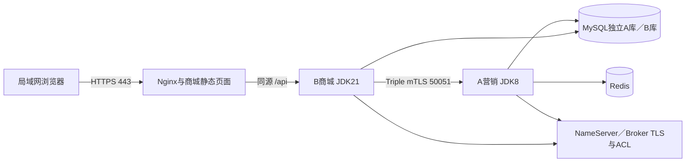

> 最新交付（2026-10-12）：B-06.0～.7已完成Windows＋Docker范围。最终固定B065候选在新项目/五个空卷/独立网络从B066封存备份复现，24项严格HTTPS真实Edge浏览器、11组双库/渠道/库存/名额核对、40项本轮恢复/重复消息/兼容包装回退检查通过；33项普通镜像、9项维护一致性及6项公开交付保护检查通过。原七服务open/READY、无活动告警，原资金/渠道/库存/名额/Inbox及共享范围保持，所有恢复意图为空。D51～D53见路线图25.17，过程17、最终证据tests/b06-final-acceptance.json、候选b06-final-release.json、交付索引b06-delivery-manifest.json及deploy/b06/DELIVERY.md接续。公开源文件ZIP与私有数据/密钥/镜像备份分开；111项JUnit为B065历史执行，本轮只复核产物。Linux及其他LAN客户端未验，Windows专属控制器需移植复验；模拟资金、兼容包装回退与本机冷备边界保留。全部成果未提交/合并/推送或上传镜像；下方旧记录保留历史。

> 最新收口（2026-10-12）：B-06.6已完成Windows＋Docker范围。02冷备/空卷恢复40项、03已有封存备份独立恢复/渠道资金/包装回退39项、04子进程退出73后独立recover 11项实际检查通过；16项备份保护与1项真实Windows ACL回归通过，12个私有目录/关键文件DACL核验通过。五冷卷、双库/Flyway、原渠道/MQ进度、完整配置/密钥/初始化输入和镜像已备份；新项目/空卷/网络恢复，原卷未覆盖；原签名事件重复消费幂等、严格HTTPS购买/取消、兼容包装切换/失败关门/原镜像回退已实测。D45～D50已保存路线图；最新证据tests/b06-backup-acceptance.json、发布b06-backup-release.json、过程16与deploy/b06/BACKUP-RECOVERY.md。原七服务健康open/READY、无活动告警、所有逆操作为空；原资金、共享容器、hosts、默认context和原网络保持。备份是本机NTFS限制权限的未加密档案；回退仅认证相同已验业务jar的不同镜像包装；RPO仅停写一致性点，不宣称未知旧业务版本、在线/PITR、异机或宿主断电容灾。全部B06成果未提交/合并/推送；B-06.7和Linux未验，下方旧记录保留历史时点。

> 最新收口（2026-10-12）：B-06.5已完成Windows＋Docker范围。最终b065-20261012-07的112项真实故障/资金库存/名额检查、9项恢复工具测试、111项JUnit、33项镜像和9项维护一致性通过；另独立子进程退出后的NameServer恢复、B重建缺失→保留日志拒绝→受控open→recover均实测通过。补修原协议rosterVersion不透明ID解析，真实A通知原字节Inbox接收通过；冻结A/前端/资金规则/旧迁移保持。新B/维护及退款工具已发布，指纹b06-fault-release.json，证据tests/b06-fault-acceptance.json，过程15及deploy/b06/FAULT-RECOVERY.md。七服务健康open/READY、无活动告警；全部逆操作已收口，旧失败/隔离/历史审核保留。方案D36～D44已保存路线图；下一步B-06.6，Linux及B06.6～.7未验，全部B06成果未提交/合并/推送。下方旧记录保留历史时点。 只读观测D44把严格已收尾迟到交接单列历史，3项关系回归（30反例）及7项原观测回归通过。

> 最新收口（2026-10-12）：B-06.4已完成Windows＋Docker范围。最终b064-20261012-03通过39项真实观测/权限/日志/关联/告警故障恢复检查；7项工具测试、109项应用测试、33项普通镜像和9项维护镜像一致性通过。专用SELECT-only/TLS观测账号、12队列指标、六种业务ID关联、结构化请求日志及本地告警轮转/手册已交付。B/网关和配套维护镜像已更新，冻结A镜像保持；七服务健康open/READY，无活动告警，资金/库存/团队指纹及共享容器/hosts未变。三条全退关闭及一条未曝光关闭审核按D31/D35单列历史，不清原投影。watch需显式运行，重启不自动启动；MQ broker lag未采集，Linux和B06.5～.7未验。D32～D35见路线图25.14及过程14，摘要tests/b06-observability-acceptance.json，操作deploy/b06/OBSERVABILITY.md；全部B06成果未提交/合并/推送。下方旧收口/暂停状态保留历史时点。

> 最新收口（2026-10-12）：B-06.3已完成Windows＋Docker范围。最终b063-20261012-02的24项真实Edge浏览器检查与11组渠道/B/A资金、库存、名额核对通过；当前用户web CA严格HTTPS、独立域名入口、首页选购/开团参团/模拟付款、成团待履约、自然失败全额退款及A同步/释放、未付取消、权限/续期/刷新无写已验。七服务健康、open/READY；应用镜像沿用B062同内容ID，未修改普通业务代码或旧迁移。D29～D31见路线图25.13、过程13.3，摘要tests/b06-normal-acceptance.json。失败退款关闭后既有TEAM_FAILED审核及所属阻断投影仍保留，不能当作待退款数量；订单里的A团队状态是既存证据快照，最新状态以团队查询/核对结果为准。B-06.4～.7及Linux VM仍未验；全部B06成果未提交/合并/推送。下方暂停及旧阶段状态保留历史时点。

> 用户暂停接续（2026-10-11）：用户要求暂时暂停，保存进度，明天继续；等待明确“恢复工作”。B-06.3未完成。用户已安装web CA，真实Edge严格HTTPS/安全上下文通过。03/04保留失败批；05验收进程已停止，最新可见通过项及fixture见tests/b06-normal-progress.json和.local/b06/browser/b063-normal05/pause.json。商城容器/既有恢复任务保留运行，不再创建测试交易。恢复后先核对Git、05原日志与实际资金/库存/A状态，不覆盖旧批次，不将中断视为失败资金或完成验收。全部变更未提交/合并/推送。

> B-06.3当前进度（2026-10-11）：进行中，尚未验收完成。独立浏览器入口、真实页面闭环验收与只读守恒汇总脚本已准备；新商品/库存/A活动已落地，但尚未创建订单或支付/退款。严格Edge实测ERR_CERT_AUTHORITY_INVALID，当前用户CA安装等待Windows系统确认，后台安装进程已结束，不留悬挂进程；未忽略HTTPS校验。下一步用户在交互式PowerShell执行scripts/open-b06-browser.ps1 -ConfigureOnly并确认专用证书，再用新批次完整验收。D29～D30及过程第13节、tests/b06-normal-progress.json记录当前事实；B062摘要保持历史，不把新脚本语法检查冒称业务通过。全部改动未提交/合并/推送。

> 最新收口（2026-10-11）：B-06.2已完成Windows＋Docker范围。专属A净DDL/B V18、22/48表精确运行权限、锁定迁移账号、独立演示种子与Topic/组、维护/开放显式重载和就绪门禁已实现。最终b062-startup03的35项联合验收、33项普通镜像检查和9项维护工具一致性检查通过；七个常驻服务健康，当前受控open/READY，仅127.0.0.1:443。原17个共享容器和A工作区保持；测试容器/网络已清理，测试卷/私有证据保留。摘要tests/b06-startup-acceptance.json、发布指纹b06-startup-release.json、过程12.2与路线图25.12为当前事实。下一步B-06.3真实浏览器闭环；Linux及.4～.7仍未验。全部B06成果未提交/合并/推送；下方旧状态保留历史时点。

> 当前接续（2026-10-11）：B-06.1已按Windows＋Docker替代Linux服务器的本轮范围完成。A/B/前端固定镜像、专属Compose五网、HTTPS／RPC双向TLS／MQ强制TLS及ACL、外部秘密和健康配置已实现；107项JUnit／前端42模块、33项镜像检查、30项真实容器检查、Windows宿主严格HTTPS和同指纹重复构建通过。D15～D20见路线图25.11，公开证据tests/b06-images-acceptance.json及b06-image-release.json，过程11.2。所有自有测试容器／网络已清理，专属测试卷保留；原共享容器和A外部改动保持。完整数据初始化、48表权限、完整能力启动与容量准入归B-06.2；.2～.7未开展。全部成果未提交／合并／推送；下方旧状态保留历史时点。

> 当前接续（2026-10-11）：用户重启后已明确恢复。B-06.0基线与部署设计按D13的Windows Docker先行范围已收口：Linux Engine24.0.7／Compose2.23.3-desktop.2实际可用；本轮Windows可用约3.90GiB、Linux引擎可用约5.05GiB，满足镜像／Compose开发准备门槛；冻结A交付及B包hash保持，来源清单明确使用B05已验二进制、不冒称源码可重复构建。完整服务启动容量仍须.2按实际配置和宿主余量复核。证据见tests/b06-baseline-closeout-20261011.json及过程第10节；.1～.7未开展，全部改动未提交／合并／推送。旧暂停／资源不足记录保留历史时点。

> 暂停接续（2026-10-11）：用户要求保存进度并暂停，准备重启电脑，等待用户说“恢复工作”后继续。B-06.0未完成：Windows Docker Desktop已启动，Linux Engine24.0.7／Compose2.23.3-desktop.2已核验；A已验二进制及契约／文档已按摘要冻结，来源清单b06-a-release-manifest.json，未从脏A工作区重建。当前Windows可用内存约0.7GiB，资源门槛未通过；恢复后先复核内存、引擎、既有容器及冻结包hash，再收口.0。全部改动未提交／合并／推送，.1尚未开展。

> 最新实施顺序（2026-10-11）：按用户本轮意图，B-06先在Windows＋Docker Desktop的Linux容器环境跑通完整商城，再迁移到专属Linux虚拟机复验。B06-D13补充D1／D4／D12的执行顺序，最终Linux部署门槛保留；VM升级不再阻塞Windows准备／容器配套开发。先核对本机Docker服务端／Linux容器模式／Compose／资源，再开展镜像、编排、专属初始化和浏览器闭环；目前没有新增部署实现或运行验收。

> 最新机器接续（2026-10-11）：用户已通过FinalShell连接现有VMware Linux，网络截图为DHCP地址192.168.238.254/24、网关192.168.238.227、ens33 UP/LOWER_UP。用户命令输出确认CentOS Linux7 x86_64、2 vCPU、内存3.7GiB／available2.8GiB、根分区46G／剩余37G、Asia/Shanghai且NTP synchronized=yes、Docker客户端26.1.4；Compose命令被Ctrl+C中断，daemon／Compose未确认。现有机器已可连接，不再按“VM尚未准备”描述当前事实；但不符合D4的目标系统／资源预算，B-06.0仍进行中。推荐保留该VM另建Ubuntu Server24.04 LTS目标VM（4 vCPU／8GiB／80GiB），不自动重装或删除。过程第7节及路线图25.7为最新接续，旧未准备记录保留历史时点。

# B-06部署设计与基线

2026-10-11，B-06.0设计交付。工作树D:/Java/zj-market-b-06，b-06／2eae6a23a23a505fd19a70a7de037d6ed07e9cbb。过程入口[b06-development.md](b06-development.md)，总计划[路线图25节](development-roadmap.md)，业务边界以[b05-b06-handoff.md](b05-b06-handoff.md)为准。

**当前：B-06.0～.2已完成Windows Docker范围。** 镜像安全证据见过程11.2，完整空库/权限/受控启动及35项联合验收见过程12.2和tests/b06-startup-acceptance.json；.3～.7及Linux目标仍待验。

## 1. 模块、依赖与基线

七个Maven模块仍部署为一个B服务。api／types／domain边界不变；infrastructure承载MySQL、RPC／MQ及持久事务；trigger／app承载HTTP、任务和装配；verification只用于显式迁移／验收。前端Vue静态产物由Nginx承载。现有根Dockerfile只是普通B包模板，没有完整商城Compose、健康检查、TLS和初始化实现；不能直接作为本阶段验收交付。

B：JDK21、Boot4.1.1、Dubbo3.2.16、RocketMQ4.9.7、Netty4.1.118.Final；A：现有Java8／Boot2.7.12兼容包。版本来自当前POM与历史已验组合，本轮不升级框架；JDK镜像发行版／补丁与镜像digest在.1单独固定并复验。前端按package-lock安装，本机构建工具链与最终镜像分别记录。

新工作树clean package：106项JUnit，失败／错误／跳过均0；类型检查及前端production build通过。普通包字节码major65，A/B实际嵌入契约逐字节相同、契约类major52；普通exec排除verification／Flyway。所有旧迁移与HEAD规范LF内容一致。实际hash及文件清单见[本轮持久摘要](tests/b06-baseline-acceptance.json)。B本轮包hash不同于B05历史包，不重写旧证据或称已重跑B05真实故障矩阵。

A现有JAR与B05交接hash相同；A工作区仍有三个环境YAML、TagService外部修改及未跟踪比较文档。目标使用已验兼容JAR，不把A HEAD当该JAR完整构建来源；.1前补交付来源说明／归档兼容源码的可重复构建路径，不从脏工作区直接构建替换。若旧包必须改造才能满足容器TLS／初始化，先隔离来源并评估，不覆盖外部改动。A SQL含一次性ALTER和等待依赖复合主键补迁移，当前开发Compose公布127.0.0.1，只适合原宿主开发环境。

## 2. 已选方案

B06-D1～D3继承用户已确认的Linux VM／局域网、单机必过、轻量监控选择；本轮新增选择如下，并已同步路线图。

| 编号 | 推荐方案（本轮用户授权采用） | 影响与约束 | 来源／落实状态 |
| --- | --- | --- | --- |
| B06-D4 | Ubuntu Server 24.04 LTS amd64；专属VM初始4 vCPU／8GiB RAM／80GiB磁盘，磁盘文件优先D盘 | 宿主实测约16GB总内存／16逻辑处理器；资源是建议而非已分配，创建前确认实时可用内存和余量；不自动安装 | 2026-10-11推荐授权；设计已记录，用户明确VM尚未准备 |
| B06-D5 | 优先复用现有VMware并用桥接网卡＋稳定租约IP，SSH限宿主、HTTPS面向局域网 | 只检测到VMware目录，未确认软件／授权／桥接可用；桥接不可用再设计NAT映射，不静默缩成仅宿主可访问 | 2026-10-11推荐授权；目标设计，机器条件待补 |
| B06-D6 | 固定A历史兼容JAR和B本轮源码构建包，分别记录内容hash；发布前再固定镜像digest | A工作区有外部修改，不从脏目录重建；旧A JAR可追溯源码尚需交付说明；B本机构建不代替Linux兼容验收 | 2026-10-11推荐授权；JAR／契约静态核验通过，镜像与容器待.1 |
| B06-D7 | 专属Compose项目zj-market-b06、分离入口／后端网络、容器服务名寻址，只发布443 | 不复用开发卷／网络／端口；Broker公布地址与证书必须从实际A/B容器可达，VIP通道和NameServer TLS也须验证 | 2026-10-11推荐授权；拓扑／端口设计已保存，配置待.1 |
| B06-D8 | 本地CA签发商城／RPC／MQ证书，外部只读秘密文件；商城使用zj-market.test并显式客户端信任 | HTTPS同源与Secure cookie；RPC mTLS、MQ TLS／ACL不允许以关校验或明文开发例外验收；每服务最小文件可见范围 | 2026-10-11推荐授权；规范已定，证书／兼容验证待.1 |
| B06-D9 | 新专属A/B空库、显式初始化／迁移账号、最小运行权限、最少新演示数据 | B原迁移追加不改；A SQL需证明完整有序初始化，不盲跑历史ALTER或整库导出开发资金；Linux迁移工具与普通镜像分离 | 2026-10-11推荐授权；初始化职责已设计，脚本和空库验收待.2 |
| B06-D10 | 先维护模式和旧任务恢复，再开放新购买／支付／核对退款接管 | 明确各enabled、recovery、scheduler职责；关闭新入口不能终止原退款／同步；未通过schema／配置检查不开放 | 2026-10-11推荐授权；发布顺序已设计，容器执行待.2 |
| B06-D11 | 用新部署批次验证成功／无人付／部分付／最后支付竞争及专属组件故障，原业务键守恒；首轮仅有限并发观察 | 历史106项和B05故障是回归证据，不替代部署新团队；不设无依据生产QPS；备份恢复必须A/B/MQ一致停写点 | 2026-10-11推荐授权；验收矩阵已设计，实际执行归.3～.7 |
| B06-D12 | 现有CentOS7 VM保留用于网络诊断，B06目标仍采用D4的Ubuntu24.04 LTS及4核／8GiB／80GiB预算 | CentOS7已于2024-06-30结束维护；Docker已安装不代表daemon／Compose及新镜像兼容；不覆盖旧VM数据，不自动重装；系统／资源替换后重新核验 | 2026-10-11按此前用户推荐授权记录；目标设计，尚未创建／部署 |
| B06-D13 | Windows＋Docker Desktop（Linux容器）先行，随后以同一基础Compose／固定镜像迁移Linux VM | 用户2026-10-11提出先本机跑通；补充D1／D4／D12执行顺序，不取消Linux最终验收；两环境独立项目／卷／秘密和证据，不复用开发库或硬编码Windows路径 | 已采用为接续计划；Windows引擎／Compose／资源待核验，容器配套尚未实现 |
| B06-D14 | 资源证据分为.0镜像／编排开发准备和.2实际整套服务启动准入 | 当前准备门槛为Windows可用≥3GiB、Linux可用≥4GiB、C空闲≥20GiB／D≥80GiB；按当前实际资源只证明可进入.1。完整服务预算约5GiB仍是设计值，.2须按实际限制、共享负载、宿主余量另行核验，不能以WSL虚拟总量冒充物理容量 | 2026-10-11按推荐授权记录；本轮准备核验通过，完整容量未验 |

## 3. 机器准备与资源预算

本节保留.0初始机器观察；当前实际环境与.1结果以顶部接续、第8节及过程11.2为准。

推荐Ubuntu Server 24.04 LTS amd64、4 vCPU、8GiB内存、80GiB虚拟磁盘，磁盘文件放D盘；优先VMware桥接，稳定局域网IP。宿主实测总内存16342126592字节、16逻辑处理器，D盘当时约171.7GB可用；这不是虚拟机已获分配的证据。Docker CLI24.0.7存在，但daemon不可达；WSL仅列出停止的docker-desktop及data。用户确认目标VM未准备；不启动Docker Desktop或把WSL当已确认Linux目标。

初始内存上限预算（建议值，.1按实机修订并记录）：A768MiB（heap384）、B1024MiB（heap512）、MySQL1024MiB、Broker1536MiB（heap768）、NameServer384MiB（heap192）、Redis256MiB（maxmemory128，禁止挤占业务持久事实）、Nginx128MiB，总约5GiB，为OS／page cache／native／临时管理工具留余量。JVM必须预留direct／metaspace／线程等native空间，不能heap等于容器上限；并发构建放宿主或单独构建阶段，不与故障批次争用8GiB。启动前实测可用资源，不足则减少无关负载或重新定预算，不以OOM自动重启算验收通过。

机器交接清单：虚拟机软件可用性、Linux版本／架构、CPU／内存／磁盘实配及余量、桥接网卡／IP／网关／DNS／访问名、SSH公钥连接和受限sudo、宿主和第二台局域网客户端可达443、NTP／数据库UTC毫秒及偏差、Docker Engine／Compose插件实装版本、镜像仓库及离线导入路径。SSH私钥／sudo密码不写文档或聊天。规划机器名zj-market-b06；尚无实际IP，不填写虚假地址。

## 4. 网络、服务与入口

| 服务名 | 容器内地址／端口规划 | 持久数据与权限 |
| --- | --- | --- |
| web | 443；唯一发布到VM局域网的业务端口 | 静态文件／Nginx配置／HTTPS证书只读；入口网络 |
| market-b | 8080；Nginx保留/api原路径，不误删前缀 | B运行库账号、身份／RPC／MQ配置；入口＋后端网络 |
| marketing-a | RPC50051；HTTP8080仅内部必要管理／健康用途 | A运行库账号、Redis、RPC服务证书／MQ配置；后端网络 |
| mysql | 3306；A库group_buy_market_b06，B库zj_market_b06 | 独立卷；A/B运行／迁移账号分离，schema名称待核对A兼容性 |
| redis | 6379；A专用 | 独立卷、密码／受控命令，按A依赖确认持久化与可重建边界 |
| namesrv | 9876 | 自有网络及日志；名称服务TLS是否与4.9.7实际客户端兼容须实测 |
| broker | 10911；若SDK VIP实际启用，10909亦须内部可达；10912只按角色需要 | 独立store／consumer offset／日志卷、ACL及TLS材料 |

固定Compose项目名zj-market-b06；入口网络仅web/B，后端网络为A/B/数据库/MQ，数据库／MQ不发布宿主端口，不使用host网络或开发external网络。服务名用于内部寻址，拒绝容器配置复制localhost、127.0.0.1或开发端口13306。Broker公布地址不是NameServer地址：.1须证明实际返回路由从A/B容器可解析可达；若4.9.7要求IP则在专属网络中设计稳定分配，不凭服务名假设通过。连接重建需重新解析DNS。

访问名推荐zj-market.test，由局域网客户端受控hosts／DNS映射到VM稳定IP；HTTPS证书SAN匹配该名。本地CA仅分发公钥给客户端信任，CA私钥与普通运行容器隔离；RPC证书SAN匹配marketing-a，启mTLS；MQ证书匹配公布地址并关闭SDK测试信任模式。NameServer、Broker、客户端TLS配置分别记录并负向验证。Broker证书／ACL支持只是设计门槛，当前setUseTLS不等同已验证证书身份检查。

Nginx提供SPA路径回退但/api错误保持后端语义；原样传Origin、Host及正确转发协议信息，B_IDENTITY_ORIGIN=https://zj-market.test，B_IDENTITY_SECURE_COOKIES=true。B已有严格来源校验和相对/api请求；新入口不得用关闭来源校验／Secure cookie完成演示。保护旧A HTTP和DCC管理接口，不让其经公开入口构成新交易旁路。健康端点／探针现状不足，.1实现最小无业务副作用检查，.4完善业务观测。

## 5. 配置、证书与初始化责任

目标目录分离：公开版本化配置在仓库后续deploy/b06；实机/opt/zj-market-b06下只读配置及secrets，运行卷由Compose管理；备份存于另行指定受控位置，不能只保存在待模拟丢失的唯一卷。此为路径设计，当前未创建这些实机目录。普通镜像只含A/B运行包或前端静态产物，verification／Flyway／SQL管理工具使用显式tools profile或独立一次性工具，不默认启动。

密码／签名密钥／身份私钥／证书外部只读按服务最小挂载。B可用Spring外部properties文件承载已有B_*映射的对应配置键；Compose secret文件不会自动变成环境变量，必须在.1设计明确加载／configtree映射，不能假设支持任意*_FILE。A按既有Boot2配置加载机制外部覆盖，不改其源码环境文件。模板仅含键和示例路径，不含真实值；普通包、构建上下文、Git和脱敏报告排除秘密。MySQL连接计划验证CA与主机名（VERIFY_IDENTITY及受控信任配置），不照搬开发sslMode=DISABLED；Redis先内网隔离及认证，是否需传输TLS按实际A客户端能力记录，未验证不宣称已加密。

B初始化执行原V1～V18（含V10_1），先schema／迁移校验再精确48表DML授权；运行账号禁止DDL／history／A库／system／grant。当前PowerShell provision固定回环端口和开发／测试schema，不是Linux容器迁移器。A初始化在.2审计原始建表与20260926／27／20261002系列增量，明确完整有序集合和每步适用前提，再生成新库初始化清单与成功指纹；有一次性ALTER不得盲目重复。镜像entrypoint仅首次初始化不足以代替版本校验和重启安全；禁止整库复制开发资金／密钥。

初始化最少独立A活动与B用户／商品／库存；管理员／运营账号受控引导，业务商品通过B原同步到A；不直接伪造支付／退款／Inbox／Outbox或拼接旧A团队。统一source/channel和生产者、四Topic、独立商品结果／交易结果／团队消费组及A/B最小ACL，值需符合现有长度和身份规则；新环境避免消费开发MQ。旧v1新锁单关闭，不混跑旧HTTP结算／通知路径。

## 6. 启动、恢复及发布门槛

先检查主机时间／秘密／镜像digest→启动数据库／Redis／MQ并检查ready→显式初始化／迁移／权限／Topic→A/B维护模式启动→证书／鉴权／原任务恢复核验→同源身份／商品试算→开放新购买与支付。depends_on只是编排，服务healthy和业务schema就绪分别核验；不能让普通B执行迁移。初始新库无旧任务，故障及备份演练后必须能恢复先前持久工作。

按当前application.properties：基础DB／身份／商品／库存／order／trade／trial／RPC／MQ／sync与payment／trade.events组合启用；新付款由payment.checkout-enabled控制，新核对／退款接管由reconciliation.enabled／refund.enabled控制。各recovery-enabled及scheduler负责既有义务，trade.events-scheduler负责退款A同步；refund.scheduler负责退款资金和库存收尾。关checkout不终止旧退款。维护时阻止新购买／新付款，保留必要查询／原取消和恢复；没有独立订单新建准入开关时用明确网关写路径准入策略，不能把所有后台一并停掉。完整开关清单和维护动作在.2验证。

回滚只选择认识当前V14～V18且完成兼容验证的应用包；数据库不自动降schema。停写并等待在途结束，协调停生产者／worker／消费者、记录一致性点，再备份A/B库、模拟渠道、MQ存储／消费进度、必要Redis和配置版本。独立空卷恢复后先核对资金／库存／名额与原事件，再开放流量；.6实测停写窗口、数据损失边界与恢复耗时。自有故障项目才允许停止组件，禁止操作开发共享实例。

## 7. 新环境验收矩阵与交接缺口

| 阶段 | 必须新增证据 | 通过判据 |
| --- | --- | --- |
| .0补齐 | Linux实配、SSH、时钟、LAN可达及工具版本 | 机器条件明确；B05/A兼容交付来源可追溯 |
| .1 | 固定镜像／依赖／构建指纹，容器地址／实际TLS／ACL与错误证书拒绝 | 普通镜像无秘密／verification／迁移工具；未授权RPC／越权MQ失败，不能仅连通NameServer |
| .2 | 空库初始化、重启不重复、运行权限负向、schema不符拒启、维护开关 | 新环境不借开发库／凭据；未知资金保持原键；已有义务继续恢复 |
| .3 | 实际HTTPS浏览器新建完整团队：成功／NONE／PARTIAL／取消 | 同一批新单逐笔金额、原attempt／refund、A名额和唯一CONFIRM／RELEASE／PENDING守恒 |
| .4 | 订单／team／payment／refund／event／task日志关联、最老积压／重试／隔离与告警 | 故障和恢复可见；指标低基数、不泄露秘密，本地告警不假称外部通知 |
| .5 | A/B退出、MySQL／Redis／NameServer／Broker不可用、网络／认证失败、最后支付与到期竞争 | 资金未知不释放，原ID重放，无重复扣／退／库存；失败后恢复不靠清表 |
| .6 | 一致备份、空卷恢复、兼容发布／回退，重复消息恢复 | A/B/MQ事实一致且原键继续，实际计时／数据边界；不声称HA |
| .7 | 固定候选的清单、新环境复现与脱敏报告 | 单机门槛逐项通过；未覆盖／限制保留，跨主机后续扩展 |

当前缺口按依赖排序：VM和LAN／SSH／时钟；A兼容包可追溯来源；镜像与4.9.7 NameServer／Broker TLS、证书SAN／ACL实测；A初始化完整性；Linux迁移／权限与健康工具；同源入口与维护；监控／故障／一致备份。限制路径CANCELLED_LATE_PAYMENT／ALREADY_RELEASED继续按B05交接保守隔离，不靠扩大业务范围通过B06。有限并发先以目标3成员完整团队及小批订单测资源与收敛时间，再按实机证据定上限；不虚报生产性能。

## 8. 资料来源与验证边界

版本基线以仓库POM、配置及实际包为准；平台／Compose设计参考[Ubuntu官方发布周期](https://ubuntu.com/about/release-cycle)、[Docker服务名网络](https://docs.docker.com/compose/how-tos/networking/)、[启动健康依赖](https://docs.docker.com/compose/how-tos/startup-order/)、[Compose秘密挂载](https://docs.docker.com/compose/how-tos/use-secrets/)。RocketMQ客户端useTLS配置见[4.x官方文档](https://rocketmq.apache.org/docs/4.x/parameterConfiguration/01local/)，它不是本仓库容器TLS验收证据；实现仍需检查固定4.9.7实际SDK与镜像。

本轮未部署、未连接数据库／RPC／MQ、未迁移、未安装VM／Docker或启动外部服务。只读工具与本地构建日志见过程第6节；新的Linux证明到达后补齐.0，再进入依赖它的实际阶段。

## Windows Docker先行的接续安排（2026-10-11）

用户希望先在Windows＋Docker跑起来，再部署到Linux，采用该顺序。商城B01～B05既定模拟资金业务已实现并按各阶段验收；本轮新工作树106项JUnit和前端构建通过。当前只有B普通包Dockerfile模板，尚无本项目完整Compose、A／前端配套镜像、跨平台初始化／迁移入口与容器TLS／ACL证明，不能说已经能够一键运行。

| 目标 | 仍需实施的内容 | 状态 |
| --- | --- | --- |
| 首次本机完整运行 | Docker Desktop Linux引擎／Compose／可用资源核验，A/B／Nginx镜像、专属MySQL／Redis／MQ网络及卷、外部配置／证书、空库初始化／最小权限、启动顺序／维护开关与真实浏览器购买付款成团／失败退款 | 主要对应.1～.3，尚未实施 |
| 最终完整交付 | .4观测告警、.5组件故障与恢复、.6一致备份／恢复／兼容回滚、.7汇总交付，以及Linux目标同包复验 | 尚未实施；不把首次打开商城等同B06完成 |

执行顺序：补.0 Windows引擎和资源／A兼容交付来源→.1镜像与基础Compose→.2专属初始化／权限／受控启动→.3 Windows实际浏览器闭环→完善.4～.6并准备Linux→同包Linux部署复验与.7最终交付。Linux相关门槛仍保留在最终验收；未准备Linux不再阻塞Windows阶段的可逆开发。旧.0待机器描述按各次历史观察保留，不修改旧报告为新环境通过。

普通运行仍全容器化（不是只把中间件放Docker而A/B继续宿主启动）：A Java8、B Java21、前端Nginx、MySQL、Redis、NameServer／Broker。Windows Docker应运行Linux容器，使用容器内部服务名、命名卷、相对配置目录与环境覆盖；基础Compose共用，Windows／Linux入口地址、秘密来源／文件权限和端口绑定分别定义，禁止localhost指向宿主假设。Windows本机可先用受信HTTPS本地入口，最终LAN域名／证书按目标重新验证，不静默降级TLS。环境项目名称不同，所有初始化只作用专属新库；迁移旧运行数据如有需要，单独制定一致备份恢复方案，不直接复制Windows运行中的卷目录。

当前Windows Docker daemon此前不可达，不能把虚拟机Docker26.1.4当本机服务端版本；后续需确认当前实际服务端／OSType=linux、Compose、可用内存与磁盘及现有容器清单。宿主约16GB内存，避免VM与Docker同时争用资源；不停止用户进程或共享中间件。A仍固定兼容包，不从外部脏源码目录重建。容器内SDK／证书／原初始化和运行权限实际验证仍是必须工作。

资料依据：[Docker Desktop Windows／Linux容器说明](https://docs.docker.com/desktop/setup/install/windows-install/)、[Compose跨环境部署](https://docs.docker.com/compose/how-tos/production/)。本轮仅核对现有文件并调整接续计划，未启动Docker／创建容器／迁移数据库／修改业务代码或提交推送；进度仍为.0进行中。

## 8. B-06.1 实施选择

当前Windows Docker先行，选择D15～D20详见路线图25.11及过程11。实际配置入口deploy/b06/compose.yml、images.lock.json和config目录；秘密由prepare-b06-secrets.py创建于独立忽略目录。原始A包不直接进入分发镜像，prepare-b06-images.py移除环境配置并编译已版本化的两项适配，派生包与镜像独立hash。MQ身份使用服务证书固定信任而非宣称SDK有DNS主机名验证；Redis内网认证明文边界明确保留。

第8节收口：D15～D20已实现并通过Windows Docker实际验收，固定镜像输入及本地ID见b06-image-release.json，公开摘要见tests/b06-images-acceptance.json。B外部配置追加覆盖，不丢包内自动装配排除/默认安全值；A外部配置替换已删除的环境配置。普通健康探针仅存活，不是业务ready；实际B数据库/身份/任务等能力仍要.2空库/schema/权限门槛。30项容器安全、33项镜像内容、107项JUnit、前端、同指纹重建和Windows严格HTTPS补验通过。失败修正/测试隔离范围和清理见过程11.2，原始A源码提交未知、Redis内网认证明文、MQ固定叶证书身份和后续浏览器/Linux限制均保留。

## 9. B-06.2 受控初始化和启动

D21～D28见路线图25.12及过程12。新增独立Java21维护镜像、A可追溯净DDL及逐条执行记录、B原Flyway显式迁移/历史校验、精确表级账号和锁定迁移账号、原领域服务种子事务、Topic/组显式创建；普通镜像不加入迁移或故障工具。初始化输入冲突/未明确的DDL中断均拒绝自动继续。

实际启动由scripts/b06-deployment.py管理：先网关维护门禁，再schema/历史/权限/资源检查，A依赖就绪、显式重建B加载模式，真实商品同步、HTTPS身份及签名试算成功后才开放。失败保持门禁关闭；只修改挂载配置再compose up不能证明B已重载。维护模式继续旧订单/支付/核对/退款恢复，关闭checkout及新发现；具体命令和异常状态见deploy/b06/README.md。

当前是本机演示环境4.5GiB常驻上限，192MiB只读校验纳入额外256MiB预算，迁移/种子512MiB另按实时可用门槛串行执行。Windows资源、宿主实际磁盘、全新环境及原卷重启须本阶段实测；最终Linux UID/权限/容量与浏览器闭环仍不由本阶段代替。

第9节收口：B06.2已实际完成Windows Docker范围。35项最终联合验收/33项普通镜像/9项实际维护镜像一致性通过，七服务open/READY；schema/权限/迁移/种子及原卷/新空卷验证见过程12.2与tests/b06-startup-acceptance.json。当前本地发布指纹b06-startup-release.json，原.1指纹不覆盖。B明确重建加载能力，不能靠文件内容变化证明重载；已绕过网关负向证明。浏览器/Linux/后续阶段仍按既定门槛接续。

## 10. B-06.3 同源可信浏览器与正常交易

D29～D31见路线图25.13及过程13.3。Windows用户web CA信任＋独立Edge解析到127.0.0.1，保持VPN hosts/其他浏览器不变；用户入口scripts/open-b06-browser.ps1，可精确撤销本轮信任，普通HTTPS不绕过校验。最终b063-20261012-02已完成真实首页→报价确认→开/参团→模拟付款→成功待履约或自然失败全额退款/A同步/释放，以及未付取消、运营查询、归属/来源/cookie续期/刷新无写。真实渠道/B/A及库存/名额/唯一流水相互验证，摘要tests/b06-normal-acceptance.json。

应用镜像沿用B062发布，无新业务配置或资金资格扩展。TEAM_FAILED关闭订单的审核/所属block投影及订单A快照仍按既有实现保留，B06.4观测必须综合终态任务/退款/当前团队查询，不能仅数review或历史paidCount。Windows范围已完成；Linux及.4～.7仍待各自验收。

## 11. B-06.4 轻量观测

D32～D35保存于路线图25.14/过程14。使用独立SELECT-only/TLS账号及本地once/watch/status/trace，不开放公网指标/诊断接口。12队列真实持久状态、年龄/重试/隔离、支付A接受和退款三状态；六类ID标量关联，无消息正文/用户/证明。B请求及网关JSON关联，A冻结包保留原日志。三类私有JSONL有轮转，UNKNOWN不误解除告警、90秒心跳避免旧快照冒充当前。运行入口/边界见deploy/b06/OBSERVABILITY.md。

最终39项真实验证、7项工具/109项应用/33项镜像/9项维护工具一致性通过，B/网关/维护发布已加载，A不变；资金/库存/团队及共享环境保持。历史全退及未曝光关闭审核按完整证据单列；真实隔离仍告警。健康不等于完整业务准入，broker消费lag未采集，watch非自动开机服务，本地告警无外部通知。当前Windows Docker完成，Linux及B06.5～.7仍须各自验收。

B-06.5最新接续（2026-10-12）：最终07 112项真实故障/守恒检查及两项中断恢复（NameServer 03、B缺失02）、9项工具/111项JUnit/33镜像/9维护通过。当前b-06/2eae6a2＋全部未提交成果，普通发布以b06-fault-release.json为准（旧B064/B065-06 pin为历史）；A/前端不变，B/维护及退款工具已随rosterVersion原契约修复更新。详细过程15.3、tests/b06-fault-acceptance.json和deploy/b06/FAULT-RECOVERY.md。原所有失败、隔离、审核和未来Inbox事实保留，恢复日志全部为空；七服务open/READY无活动告警，watch仍需手动。缺失B时先受控open再recover；不运行要求零付款的旧B062套件、不清数据、不从脏A源码重建、不自动重放旧隔离。下一步仅用户授权后B-06.6停写一致性/独立卷备份恢复及兼容回滚，Linux尚未验。

B-06.6最新接续（2026-10-12）：Windows Docker一致冷备及独立空卷恢复/兼容包装回退已验收，原五卷不覆盖。02/03/04分别40/39/11项实际检查、16＋1工具回归及12实际DACL证明通过；档案、完整密钥/初始化输入/镜像清单均私有，源/恢复运行副本分离。最后原七服务open/READY、无活动告警、全部恢复意图为空，原资金/共享容器/hosts/context/原网络保持。详情过程16.3、路线图25.16、deploy/b06/BACKUP-RECOVERY.md及b06-backup-release.json、tests/b06-backup-acceptance.json。ACL帮助函数静默失败已按D50补修并核验；普通应用/旧迁移/协议规则不变。未知旧业务二进制回退/数据库降级、在线/PITR、异机、断电/损盘及Linux未验；下一步B-06.7仅用户授权后开展，全部B06成果未提交/合并/推送。
