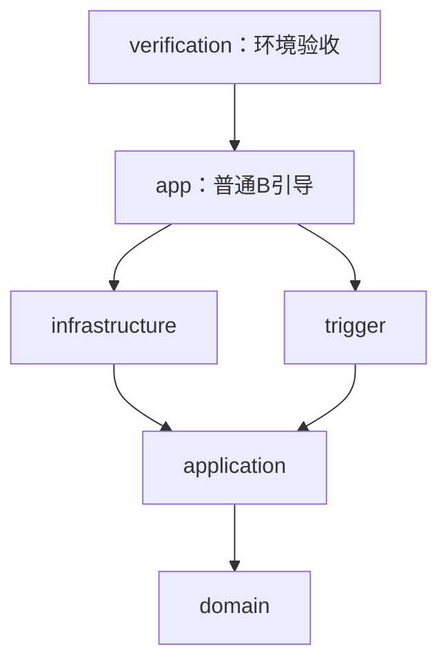

# B-01：DDD模块与配置边界

更新：2026-10-03。状态：**本次模块拆分与配置边界已完成并验证**；业务聚合、B实际数据库/表结构和完整商城流程不属于本次实现。

## 模块组织

项目保持一个商城服务，根POM改为聚合/版本管理POM。业务职责仍沿用CONTEXT.md和路线图，Java模块拆分表示依赖层次，不表示拆成六个业务微服务。

| Maven模块 | 职责 | 允许的项目依赖 |
| --- | --- | --- |
| zj-market-domain | B的实体、值对象、领域规则；目前只有领域包边界 | 无 |
| zj-market-application | 用例协调及出站端口；目前只有应用包边界 | domain |
| zj-market-infrastructure | A契约/SDK、签名编解码、RPC/MQ客户端工厂、数据库配置 | application（传递包含domain） |
| zj-market-trigger | HTTP、消息用例入口和任务触发的适配位置 | application |
| zj-market-app | 普通B启动、Web运行时及依赖装配 | infrastructure、trigger |
| zj-market-verification | 独立环境验收入口和断言 | app（复用普通B引导及全部运行依赖） |



domain/application不依赖Spring、A共享契约、Dubbo、RocketMQ、Jackson或MySQL。基础设施只能向内依赖，trigger不直接依赖基础设施或A DTO，app禁止依赖verification。每个模块的Maven Enforcer规则检查这些传递依赖；根POM统一管理Java21、Boot4.1.1、Netty4.1.118、Dubbo3.2.16及RocketMQ4.9.7。

尚未引入业务实体或虚构聚合；用户访问、商品、库存、商城订单、支付/退款、履约在后续阶段按业务包实现。出站业务端口应在application/domain定义，基础设施实现并转换A DTO；此时已有的SDK工厂仅供集成边界及验收使用，不把SDK对象透传到应用或领域层。

## 产物与入口隔离

| 用途 | 入口/产物 | 行为 |
| --- | --- | --- |
| 普通B | cn.zj.zjmarket.ZjMarketApplication；zj-market-app/target/zj-market-app-exec.jar | 仅引导真实B；默认不创建RPC/MQ工厂或DataSource |
| B引导的普通依赖包 | zj-market-app/target/zj-market-app.jar | thin JAR，供verification复用同一引导类 |
| 环境验收 | cn.zj.zjmarket.verification.ZjMarketVerificationApplication；zj-market-verification/target/zj-market-verification.jar | 使用普通B配置类及基础设施，加上验收Runner，自动启用environment-probe，完成后以验收退出码结束 |

普通可执行包不含verification模块、EnvironmentProbe类或application-environment-probe.properties。普通main不再读取验收开关、运行测试商品发布或按验收结果System.exit。即使给普通包传environment-probe和验收开关，也不会添加验收行为。

verification使用 `SpringApplication(ZjMarketApplication.class, EnvironmentProbe.class)`，没有维护第二套B运行配置；其JAR包含同一app thin JAR和基础设施。它是开发验收入口，不随Docker普通运行产物分发，也不是生产Inbox或业务消费者。

## 配置归属

普通app的application.properties负责服务名称及导入以下三个基础设施资源。配置通过[Spring Boot结构化外部配置](https://docs.spring.io/spring-boot/reference/features/external-config.html)绑定到专用Settings对象，凭据没有默认密钥、没有进入源码或文档。

| 位置 | 配置前缀 | 类型/构造实现 |
| --- | --- | --- |
| infrastructure/rpc.properties | b.infrastructure.rpc | RpcSettings、integration/rpc/RpcClientFactory |
| infrastructure/mq.properties | b.infrastructure.mq | MqSettings、integration/mq/MqClientFactory |
| infrastructure/database.properties | b.infrastructure.database | DatabaseSettings、InfrastructureConfiguration的DataSource装配 |
| verification模块的application-environment-probe.properties | b.verification及本机验收覆盖 | 仅在验收产物中使用 |

InfrastructureConfiguration装配Settings及独立ContractCodec；三个外部适配器有独立enabled开关，默认false。RPC/MQ工厂只负责设置SDK连接/认证参数，调用方显式创建、启动并关闭客户端；普通启动不自动发布测试消息。

### RPC外部参数

- B_RPC_ENABLED显式启用。
- B_RPC_URL、B_RPC_GROUP、B_RPC_TIMEOUT_MILLIS配置TLS Triple地址、组和超时；service version固定2.0.0，不自动框架重试。
- B_RPC_CLIENT_ID、B_RPC_KEY_ID、B_RPC_SECRET、B_RPC_SOURCE、B_RPC_CHANNEL注入认证身份及渠道。
- B_RPC_CLIENT_CERT、B_RPC_CLIENT_KEY、B_RPC_TRUST_CERT注入mTLS证书/密钥文件路径。
- 为复用已有验收环境，身份/签名和客户端证书项可回退到既有AB_V2_*变量；没有密钥常量。缺少必要配置时，在客户端创建前失败。

### MQ外部参数

- B_MQ_ENABLED显式启用。
- B_MQ_NAMESERVER、B_MQ_ACCESS_KEY、B_MQ_SECRET_KEY配置连接及Broker ACL凭据。
- B_MQ_PRODUCER_ID、B_MQ_B_KEY_ID、B_MQ_B_SECRET、B_MQ_A_KEY_ID、B_MQ_A_SECRET配置信封身份、B发送签名及A消息验签。
- B_MQ_SOURCE、B_MQ_CHANNEL、B_MQ_PRODUCT_TOPIC、B_MQ_RESULT_TOPIC、B_MQ_TEAM_TOPIC、B_MQ_RESULT_GROUP配置渠道和Topic/消费组。
- 默认B_MQ_USE_TLS=true。只有显式B_MQ_ALLOW_PLAINTEXT_LOOPBACK=true且NameServer为回环地址时才允许明文开发配置；验收profile沿用已有本机例外。不能据此声称Broker TLS已验收。
- 凭据可沿用已有AB_V2_ROCKETMQ_*、AB_V2_MQ_*变量，工厂不提供空凭据降级或默认账号。

### B数据库外部参数

- B_DATABASE_ENABLED默认false；B_DATABASE_URL、B_DATABASE_USERNAME、B_DATABASE_PASSWORD必须外部提供。
- B_DATABASE_MAXIMUM_POOL_SIZE、B_DATABASE_CONNECTION_TIMEOUT_MILLIS配置连接池。
- 不绑定A的SPRING_DATASOURCE_*变量；MySQL schema限定独立的zj_market或zj_market_*，拒绝group_buy_market及其测试库。
- HikariCP7.0.2和MySQL驱动由Boot4.1.1管理；DataSource仅在B数据库显式启用且配置有效时装配，minimumIdle=0，不执行DDL或迁移。
- **模块拆分时仅配置数据源；后续独立数据库任务已完成。** 实际zj_market与两类账号、基础设施V1迁移和真实连接/权限验证见[数据库记录](phase1-database.md)，尚未设计交易业务表。

## 启动与复现

```powershell
# 构建全部模块及两个启动产物
./scripts/mvn.ps1 package

# 普通启动默认只构建app及其依赖，不构建verification
./scripts/start-b.ps1

# 原有环境验收脚本，改用独立verification产物
./docs/tests/run-b01-environment.ps1

# 已构建时复用产物
./scripts/start-b.ps1 -SkipBuild
./docs/tests/run-b01-environment.ps1 -RunName ddd-final -SkipBuild
```

两种入口都沿用scripts/b-runtime.ps1显式选择JDK21；A验收Provider单独选择Java8。A子进程启动后、B启动前，从B子进程环境移除A的SPRING_DATASOURCE_*变量；最终恢复调用终端的原始环境。

IDE共享运行配置指向zj-market-app模块，主类仍为ZjMarketApplication，JDK21。Docker及.dockerignore只包含app的exec JAR，JDK21基底不变。IDE GUI和Docker容器本轮未执行验收。

## 实际验证

- 六个子模块加根POM构建成功；所有JDK21和模块依赖规则通过。
- **8项测试通过，0失败/错误/跳过**：规范签名向量/消息防篡改2项；配置边界5项；普通引导及验收类/资源隔离1项。
- 实际普通B Web进程PID54084，JDK21.0.2，回环18092端口启动。根路径HTTP404（当前尚无首页接口）证明Web进程可接收请求；测试进程已停止。
- 普通启动脚本在故意提供验收profile/开关的情况下启动成功，没有执行EnvironmentProbe；普通包内容检查无验收类、模块或资源。
- 独立验收产物PID53140，2026-10-03 18:33:19（Asia/Shanghai），实际JDK21.0.2。签名TLS查询、AUTH_INVALID拒绝、MQ授权收发、A结果验签、PROCESSED/APPLIED查询及越权发布权限拒绝全部通过。
- RPC/MQ实际版本仍为Boot4.1.1、Dubbo3.2.16、MQ4.9.7、Netty4.1.118、Jackson2.21.5和Jackson3.1.5。
- 终端java仍为1.8.0_391，JAVA_HOME/PATH成功恢复；A/B临时进程停止，既有开发容器保留。
- 原B目录的暂存和未提交状态保留，未修改A代码或执行迁移，未提交本轮代码。

最终验收事件ID：`b01-da55f32f-223b-46a6-8f06-2654582d526f`。

产物SHA-256：

- 普通app exec：`00B90691033B890567A732DFD9FC23BA89CBF20F09CF5C5A145DCACC1DA1EE64`
- verification：`A148CFB54388F7BAFB86CCC0F514FCF5E945F8AD1DBB395EFBDD3816DBB98EEC`

证据位于被忽略的target目录：根target/environment-probe/modules-build.log、modules-normal-start.log、modules-normal-web.stdout.log、modules-packaged-libraries.txt、ddd-final/report.json；各模块target/environment-probe/dependencies.txt分别记录依赖树。历史单模块产物及原报告仅作历史证据，当前脚本不再启动旧根target JAR。

## 本次任务实施复杂度

**中等。** 需要同时保持六模块依赖、双启动产物、配置绑定、外部凭据、脚本/IDE/Docker路径与既有RPC/MQ行为一致。按“模块依赖约束 → 配置/工厂归位 → 验收入口隔离 → 构建和真实链路复验”四步完成；未扩展业务聚合或新增交易/支付流程。B整体项目复杂度仍较高，其后续阶段按已有路线图推进。

## 数据库边界增量与复杂度

2026-10-03：B独立数据库及访问边界完成，迁移SQL在infrastructure、Flyway执行器及依赖仅verification，普通启动不迁移。实施复杂度中等，真实连接、权限/认证拒绝、重复迁移与环境恢复均通过；详情见[数据库记录](phase1-database.md)。

## 重构后复验与复杂度

2026-10-03：当前六模块产物重新清理打包，8项测试、普通启动、实际RPC/MQ/签名及数据库访问全部通过，最新证据见[重构复验](phase1-revalidation.md)。本次复杂度低，复用固定版本与已有验收脚本，没有新增业务设计。
