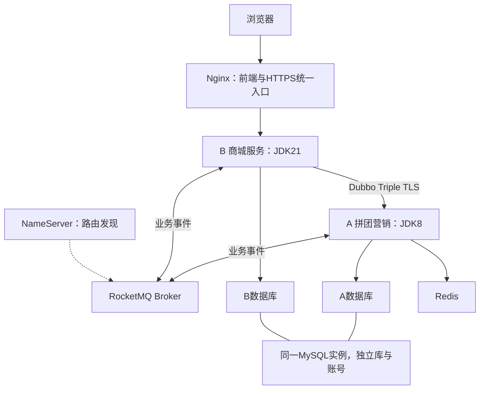
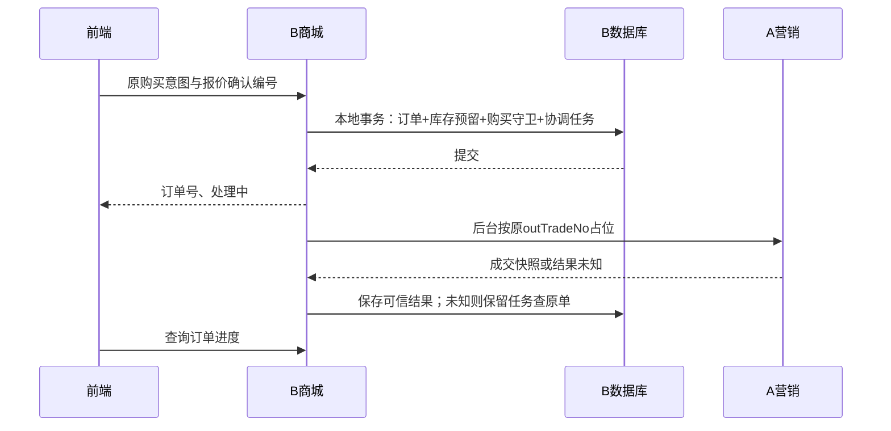

# 拼团商城微服务：快速入门、实现详解与面试问答

更新：2026-10-12。适用：项目A group-buy-market＋项目B zj-market，当前B-06 Windows Docker交付。

本文依据项目持久化文档整理。已实现事实以最新阶段报告、固定产物和交付范围为准；“选择原因”是结合约束给出的工程解释，不伪称每一项都是原作者逐字陈述。不是生产容量认证或第三方资金验收报告。

## 阅读路线

- **先用起来（约15分钟）**：第1～3节，了解当前运行位置、账号和业务体验。
- **理解系统（约45分钟）**：第4～7节，重点看数据责任、库存状态、支付未知及可靠消息。
- **回顾开发（约30分钟）**：第8～9节，按阶段理解选型与推进顺序。
- **准备面试**：第10～12节，先能解释一个失败场景，再背技术名称。
- **核查原始依据**：第13节是权威资料索引。历史文档中“待开发”“未使用MQ”“六模块”等有时间背景，不能覆盖后续交付。

## 1. 项目是什么，已经做到哪里

这是一个前后端分离的小型拼团商城：一个Vue商城前端，两个业务后端。B负责用户、商品、库存、商城订单、模拟支付退款和待履约；A负责营销优惠、资格、参团名额、团队及成团裁决。两服务独立运行，各自拥有数据库，通过Dubbo和RocketMQ协作。

首版范围：单SKU、数量1、CNY、一笔商城订单对应一笔支付业务；实付最低0.01元，不叠加B额外优惠。未支付可取消，支付后不主动退团，失败自动全额退款。团队最大100人，核对接口可一次返回完整名单。

**已经实现**：注册登录与运营权限、商品管理与版本同步、真实A优惠试算、入库/库存调整、开团和分享参团、订单占位恢复、模拟支付、成团待履约、到期完整核对、失败退款及库存释放、运营查单/重试、Windows容器部署、故障恢复和一致冷备演练。

**没有宣称实现**：真实第三方扣退款、购物车多SKU合单、部分退款、主动退团、实际发货收货、任意异常自动解封、高可用集群、生产QPS承诺、Linux/其他局域网客户端部署认证。取消后异常收款正向自动资格尚未开放；无可信资格的异常保留原资金和隔离状态。

截至本次文档整理：B-06实际成果在 `D:/Java/zj-market-b-06`，其交付记录为b-06/2eae6a2加未提交工作区成果；主目录相同HEAD不代表拥有这些文件。分支与运行状态后续可能变化，执行前核对实际目录。本文存主目录，原始报告优先链接到完整B-06工作树。

## 2. 本机快速入门

### 2.1 已部署环境的使用方式

以下适用于本机已经完成初始化、镜像和私有材料齐备的环境，不是空机器安装命令。Docker Desktop需使用Linux容器，项目控制器显式选择 `desktop-linux`，不要依赖终端默认context。

```powershell
cd D:\Java\zj-market-b-06
python -B scripts/b06-deployment.py status --context desktop-linux
python -B scripts/b06-deployment.py ready --context desktop-linux
.\scripts\open-b06-browser.ps1
```

- `status`显示项目状态；`ready`还核验schema、迁移历史、权限等，并非仅看容器是否running。这些控制器会写本地控制日志，不应称为完全无文件写入。
- 浏览器脚本配置当前用户对项目CA的信任，并打开专属Edge配置，将 `zj-market.test` 解析到127.0.0.1；不修改系统hosts。不要用忽略证书错误的方式绕过。
- 演示账号及密码位于私有 `.local/b06/control/demo-accounts.json`。只在本机查看，不复制到文档、Git或聊天中。
- 页面入口是 `https://zj-market.test`，当前web仅映射 `127.0.0.1:443`。另一个电脑不能直接访问。

只有栈确实停止，或需要受控重新开放时才使用：

```powershell
python -B scripts/b06-deployment.py start --context desktop-linux
python -B scripts/b06-deployment.py open --context desktop-linux
```

`start`按维护状态启动；`open`先关新入口，核对资源、schema和真实依赖，加载配置并验证后开放。它会改变运行状态，不是普通查询命令。不要用原始Compose启动绕过门槛，不要执行删除数据卷的操作。

### 2.2 推荐的体验顺序

1. 普通用户登录，浏览在售商品并试算优惠。
2. 运营账号查看商品与库存，必要时通过运营功能入库；不要直接改库存表。
3. 用户甲开团，选择模拟支付失败，再在原期限内重新尝试成功。
4. 用户乙通过分享链接加入同一团队并付款，达到该活动实际目标人数后观察成团及待履约。
5. 另建一团只支付部分成员，等待自然到期核对，观察退款成功、库存释放及订单关闭。
6. 新建未支付订单后取消，观察确认关闭后库存恢复。
7. 在运营页面分别观察资金、A同步、库存状态；CHECK查单，RETRY只在符合条件时唤醒任务。

每次使用新订单，团队目标人数和期限以当前活动为准。测试商品库存和活动窗口可能耗尽/过期，应走正常管理流程准备新样本，不复用历史失败订单拼装成功闭环。

### 2.3 观测与常见问题

```powershell
python -B scripts/b06-observability.py once
python -B scripts/b06-observability.py status
# 持续观测需显式运行，终端结束后不再承诺持续告警
python -B scripts/b06-observability.py watch
```

| 现象 | 首先检查 |
| --- | --- |
| 域名打不开或证书报错 | 是否使用专属浏览器入口、项目CA和正确域名；别直接改成IP绕过SAN |
| 首页可开但下单503 | 网关是否维护模式，B能力是否启用，schema/依赖是否ready |
| 已付款但仍待确认 | 查看独立渠道事实、原Outbox、A结果/查单；不要创建新支付键 |
| 退款成功但A未同步 | 分别查看渠道成功、同步任务与收尾，A离线不会把已退款改回失败 |
| 数据库恢复后结果异常 | 先保持新入口关闭，核对A/B/MQ一致性点，不能直接清任务或重置状态 |
| curl/Python拒绝而Edge正常 | 本机curl曾遇本地CA吊销状态未知，Python3.13严格校验曾提示缺Authority Key Identifier；Node链和域名校验及Edge验收通过，客户端兼容仍须分别核实 |

### 2.4 空机器部署不是复制源码后直接启动

完整接续需：Docker/Compose与资源核验 → 固定镜像或受控构建输入 → 外部证书与秘密 → 专属空卷/网络 → A schema与B原迁移 → 最小权限 → 维护启动 → 真实依赖验证 → 开放新入口 → 新团队验收。

公开源码ZIP不含镜像、数据、密钥及固定A二进制，不能直接离线运行。现有私有冷备含可运行镜像和完整秘密，只限受控本机使用；它不等同可公开分发的安装包。当前脚本还有Windows路径/context/ACL约束，迁往Linux需要移植与重新验收。

详见[最终交付手册](../../zj-market-b-06/deploy/b06/DELIVERY.md)。

## 3. 架构与技术栈



| 层面 | 项目实际采用 | 理解重点 |
| --- | --- | --- |
| A运行基础 | Java8 / Spring Boot2.7.12 | 保留旧项目运行边界，新增兼容契约 |
| B运行基础 | JDK21 / Spring Boot4.1.1 | 独立环境实测，不能把早期文档的Java17规划当最终运行环境 |
| RPC | Dubbo3.2.16、Triple、直连 | 无需首版额外注册中心；后续可扩展 |
| MQ | RocketMQ4.9.7 | 普通消息＋持久Outbox/Inbox与业务补查 |
| 网络依赖 | 固定Netty4.1.118.Final | 当前组合TLS实测通过；不表示所有4.2版本均不兼容 |
| 编解码 | B HTTP Jackson3；契约签名独立Jackson2 | 签名字节边界不能随HTTP序列化升级漂移 |
| 持久化 | MySQL、MyBatis／显式事务；相关资金仓储使用JdbcTemplate | 核心是事务和约束，而不是所有SQL必须使用同一封装 |
| 前端 | Vue3、TypeScript6.0.3、Vite | 同一商城工程含用户和简易运营页面 |
| 部署 | Windows Docker Desktop，Linux/amd64容器，Compose | 两个业务服务，不是高可用集群 |

以上版本是本项目固定验收组合，不是最新版推荐。Redis不是B库存余额的第二权威来源。

## 4. DDD职责边界与代码阅读

### 4.1 数据归谁所有

| 业务事实 | 权威所有者 | 另一侧如何使用 |
| --- | --- | --- |
| 用户身份、角色、商品基础价与商品版本 | B | A接收授权范围内带版本商品快照 |
| 可用、预留、已售库存 | B | A不直接操作商品库存 |
| 活动、优惠、标签资格、参团名额、团队终局 | A | B通过RPC/可信事件读取 |
| 渠道付款、退款事实 | B的独立模拟渠道记录；商城另存确认事实 | A接收并核验B发送的事实，不执行资金操作 |
| 待履约记录 | B | 必须满足可信成团和资金条件 |

**商品库存不等于团名额。** A的占位防止人数超员，B的预留防止商品超卖。分库分账号；共享MySQL实例只是部署节约，不允许业务跨库查询、外键或事务。验收管理员只读核对A库是测试手段，不是B业务集成。

### 4.2 B最终七模块

| 模块 | 职责 |
| --- | --- |
| types | 共享异常与基础类型 |
| api | HTTP DTO与统一响应 |
| domain | 身份、商品、库存、订单、支付、核对、退款模型及业务服务、出站接口 |
| infrastructure | 仓储/SQL、模拟渠道、RPC/MQ、签名、外部配置实现 |
| trigger | Controller、任务调度等入站适配 |
| app | 普通启动与Spring装配 |
| verification | 迁移、隔离验收和故障注入工具，普通运行包不包含 |

依赖向内：trigger和infrastructure依赖domain；app装配两者；domain不直接使用A契约DTO。早期有application模块，B-02整理时已移除，业务服务归domain。七个Maven模块最终组成一个B服务，不是七个微服务。

建议顺序：API/Controller → domain service及端口 → infrastructure仓储事务 → 调度与配置 → verification中同场景断言。复杂性通常藏在“响应丢失后怎么办”，不仅在正常路径。

## 5. 核心流程与状态变化

### 5.1 商品同步与报价

B编辑商品 → 同一事务保存商品新版本、完整快照Outbox和同步目标 → 后台投递A → A幂等应用/忽略旧版本 → 返回处理结果 → B确认可用版本。

B所有有效编辑都递增一个商品版本，图片/描述也不例外。好处是规则统一，代价是非价格变更也产生同步。发布成功不是应用成功；未确认同步不直接拿旧价格购买。

试算时B调用真实A；报价确认记录放MySQL、默认有效5分钟，绑定用户和购买条件。下单仍核验版本和金额；价格或活动变化需用户重新确认。报价不是锁价承诺，A成功占位后的成交快照才用于付款。

### 5.2 建单与库存预留



购买守卫限制同用户同SKU一笔未结束购买，跨团队/活动也有效。它与请求幂等不同：同键防同一意图重复，多不同键并发则由守卫拦截。支付后等待成团仍持守卫，成团库存确认或退款库存释放后解除。

本地预留提交后不持有数据库锁等待RPC；网络失败由持久任务恢复。商品后续改价/下架不覆盖已受理订单冻结条件。

### 5.3 库存状态与守恒

设available为可用、reserved为预留、sold为已售，首版每单1件：

| 事件 | 数量变化 | 预留记录 | 同事务附带动作 |
| --- | --- | --- | --- |
| 接受购买 | available−1，reserved+1 | HELD | 订单、守卫、协调任务、RESERVE流水 |
| 付款成功但未成团 | 不变 | HELD | 持久资金及可靠事件 |
| 可信成团 | reserved−1，sold+1 | CONFIRMED | CONFIRM流水、GROUP_COMPLETED、PENDING待履约、解除原守卫 |
| 确认未付关闭 | reserved−1，available+1 | RELEASED | RELEASE流水、关闭订单、解除原守卫 |
| 已付失败且全额退款成功、资格有效 | reserved−1，available+1 | RELEASED | 退款收尾证明、唯一RELEASE、关闭订单、原义务完成 |

入库/运营调整改变总量；在没有运营调整的区间，available+reserved+sold守恒。更一般的验证要对照全部已提交库存流水，不拿最初入库数套所有历史样本。

库存余额、流水和订单结果同事务。数据库唯一约束阻止一单重复确认/释放；操作先取得行锁再检查状态。重复旧订单收尾只能清本单守卫，不能删除后来新订单的守卫。

### 5.4 模拟付款与成团

1. 订单已有A可信占位、HELD和有效付款窗口，B先提交支付意图及“可能已开放”标记。
2. 独立模拟渠道创建payment根和attempt；用户只能为本人有效尝试选择成功/失败，金额、时间、流水号由后端确定。
3. 渠道事务持久结果及通知；商城另一个事务核验查询结果，保存成功事实和PAYMENT_SUCCEEDED Outbox。
4. A只对首次有效支付增加人数，并在本地事务内判断成团；重复事实不重复计数。
5. B接收A处理结果和TEAM_COMPLETED，核对本地资金、完整成员及单订单支付证据，原子转已售并建立待履约。

同一paymentId可以多次attempt，只有明确失败才新尝试；UNKNOWN查原尝试。用户点失败保留订单/库存，期限内可以再支付。成团事件早于支付回执时持久等待依赖，而不是丢弃或直接履约。

### 5.5 取消、到期核对与退款

**未支付取消**：严格证明从未发送到A且原子阻断worker时可本地关闭；可能已发送则冻结关闭意图，确认A关闭后释放。已开放支付还须先阻止新尝试、关闭渠道根并核对全部尝试。付款与关闭争夺渠道根的唯一裁决，未知状态不声明未付。

**团队到期**：进入RECONCILING。B用queryReconciliation取冻结完整名单，逐成员停止支付、查渠道及A，最终以稳定completionId提交不可变完整结果：

- PAID_ACCEPTED：原支付已被A接受，不能用Broker ACK替代。
- CLOSED_UNPAID：已确认关闭并有匹配closeId。
- PAID_OUTSIDE_WINDOW：原异常资金事实及已持久退款义务/refundId。

缺成员、资金UNKNOWN、版本冲突都不伪造完整名单。核对期间最后一笔窗口内支付可以促成COMPLETED；迟到核对不能反转成团。rosterVersion是**不透明字符串**，不能当数字自增或强制解析。

**退款**：义务先持久化，再核验执行资格；稳定refundId绑定原payment，内部尝试可重试。渠道退款结果和通知独立事务，商城确认退款及版本事件同事务。明确失败自动退避，5次告警后仍恢复；UNKNOWN只查原attempt。

退款资金成功、A同步、库存释放是三件事。A暂不可用不能阻止已具资格的退款及合法收尾；已知证据冲突则隔离。只支持全额，渠道原支付根锁及累计金额校验防止超退。超窗核对要先有refundId，但不用等退款成功再核对，避免相互等待。

## 6. 难点、实现原理与项目亮点

### 6.1 RPC结果未知：为什么NOT_FOUND也不能立即释放

A可能已收到reserve，数据库尚未提交；B超时查单看到NOT_FOUND时，旧请求仍可能随后成功。如果此时释放库存，A最终占位和B库存会分叉。

做法是稳定outTradeNo、持久发送可能性、原键查单和不可变关闭意图。关闭先到也必须能阻断迟到占位。亮点是将“不知道”显式建模，代价是故障期间库存/守卫可能较长时间保持，需要恢复与观测。

### 6.2 Outbox/Inbox：不是“用了MQ就可靠”

生产端业务变化与Outbox同事务；提交后worker投递。发送成功但写回失败时重投原eventId和正文。消费端校验签名/结构/范围，同事务保存Inbox与应承担的工作后才ACK；同eventId异正文隔离。

若事件已接收而业务依赖尚未到达，保留WAITING_DEPENDENCY。超过Broker重试进入死信也不能消灭商城的待核对义务，继续业务查单补偿。Broker ACK、Inbox持久接收、业务应用、资金成功、库存收尾各有独立含义。

这实现的是至少一次传递下的幂等业务效果，不是网络全局exactly-once。A/B v2主链路用MQ；旧HTTP通知最多5次、HTTP200且正文success的规则只属于旧链路。

### 6.3 令牌＋租约＋锁后时间：避免过期worker写回

工作表持久保存lease_token、lease_until和intent_version。认领短事务分配租约，外部调用在事务外；写回先取得对应锁，再读数据库当前时间并核对令牌、状态及意图版本。

关键反例：worker在租约未过期时读时间，但UPDATE等待行锁，拿到锁时已过期。如果仍用锁前时间，就错误接受旧结果。项目曾在A通知与B模拟通知中补修这个边界。续租也不能代替提交时校验，调用超时也不证明渠道没执行。

### 6.4 业务键、尝试键与版本必须分开

| 标识 | 稳定范围 |
| --- | --- |
| purchaseIntentId/outTradeNo | 原购买意图/商城订单，结果未知保持 |
| RPC requestId/nonce | 网络请求认证与追踪；重试可以更新 |
| paymentId/refundId | 支付/退款业务事实，不因技术失败换号 |
| attemptId | 一次渠道尝试；UNKNOWN不创建新尝试 |
| eventId | 一个冻结消息事实，MQ重投不改变 |
| completionId | 一次冻结完整核对提交，同ID不得改名单/checkedAt |
| refundVersion | 退款状态事实版本，单调；SUCCEEDED不回退 |
| rosterVersion | A返回的名单标识，按契约原字符串保存 |

### 6.5 退款多版本与早晚消息

一次退款可能经历PENDING→FAILED→新版本PENDING→SUCCEEDED。每版事实、时间及原字节冻结，不能仅扫描当前最终状态而漏掉已提交版本。Outbox扩展保留支付唯一性，同时支持退款多版本。

A返回更高版本不能无条件信任：本地必须已知该事实，并通过完整查询核对绑定。低版本回执不降低当前水位，同版本不同状态隔离。真实钱已退不能因A拒绝而改回未退。

### 6.6 严格身份、价格与资格

A的标签资格从数据库精确成员记录判断，不能仅靠有哈希碰撞的位图放行；标识符须精确匹配，大小写/尾空格等不能导致跨用户订单泄露。金额以两位小数字符串过协议，内部BigDecimal，冻结A应付价，不接受浏览器自报金额。

B的JWT使用RS256，访问令牌存内存；刷新令牌用Secure/HttpOnly Cookie，库中保存摘要和轮换链。每次受保护请求还检查登录未撤销、用户状态与当前权限，所以它不是完全无状态JWT。Cookie认证端点仍需同源及CSRF保护。

### 6.7 部署验收也是工程实现

B-06不仅做了Dockerfile：镜像与证据绑定、普通包排除故障/迁移工具、运行/迁移账号分离、配置外置、维护门禁、真实ready、故障前持久恢复意图、独立空卷冷备恢复和严格HTTPS浏览器闭环。

A使用固定兼容包受控派生，移除内嵌环境配置并记录适配源码/新hash，不从有外部修改的A目录随意重建。原源码构建提交追溯仍有限，不能把派生镜像说成任意源码一键重建。

MQ4.9.7固定组合采用TLS及最小ACL，客户端信任固定服务证书，不把其SDK链校验宣传成通用DNS身份校验；Redis是专属网络密码认证明文，不宣称全链路TLS。

## 7. 一致性设计的代价与边界

| 选择 | 获得什么 | 付出的代价 |
| --- | --- | --- |
| 本地事务＋持久任务＋补偿 | 不让跨服务网络占住数据库事务，可重启恢复 | 状态更多，用户可能看到处理中 |
| UNKNOWN不释放 | 不在事实不明时超卖/重复退款 | 库存占用时间增加，需告警和运营查询 |
| 退款后才释放已付失败单库存 | 退款/库存收尾规则保守、容易说明 | 退款故障时可售库存下降；这是B选择，比A契约许可更严格 |
| 同用户同SKU一笔未完购买 | 降低重复下单与并发协调复杂度 | 暂不支持同商品多笔并行购买 |
| MySQL库存权威 | 易于本地事务、唯一约束和流水核对 | 单热点SKU吞吐受行锁限制，未证明高并发秒杀容量 |
| 一个MySQL实例分库 | 降低学习成本，保留数据责任边界 | 实例故障共同影响A/B，不是资源隔离或高可用 |

最终一致性有前提：依赖恢复、任务继续调度、证据可验证。真正冲突可能长期REVIEW，需要诊断与受控修复，不能承诺一切自动成功。

## 8. 从A修复到B-06的开发步骤与选型参考

本节选取决定架构的主要方案；所有细项D编号见各阶段过程与路线图，不把历史被覆盖方案列作当前方案。

### 8.1 A阶段：先修交易，再改集成接口

**步骤**：交易数据/唯一键/金额与资格审查 → 首次支付与事务内成团 → 旧通知可靠性 → 试算超时、严格标签和隐私 → v2 RPC/MQ契约、到期核对与退款事实 → 隔离回归与交付。

**关键选择与原因**：先保证幂等和状态正确，再引入集成，避免把旧Bug扩散到B；事务提交后通知失败不能把已提交支付响应变成失败；B同步带版本商品，A本地算价而不每次远程取价；到期先核对而不凭固定宽限期猜付款结果。备选方案更简单，但会牺牲版本明确性或迟到支付处理准确性。

### 8.2 B-01：先证明运行基础

**步骤**：JDK/构建固定 → 实际B引用A契约 → TLS认证与拒绝验证 → MQ授权/序列化/签名互通 → 模块及配置边界 → 独立数据库/账号 → 重构后复验。

**选择**：Boot4.1.1＋实际JDK21，A仍Java8；原始SDK独立装配，Java8兼容契约，固定已验Netty；HTTP JSON与签名编解码隔离。原因是两端无需同JDK/Starter，但共享协议必须兼容。先做真互通，可在交易代码扩展前暴露TLS与依赖冲突。

### 8.3 B-02：身份、商品、同步和试算

**步骤**：范围/模型/HTTP设计 → 注册登录及角色页面 → 商品CRUD/版本/Outbox → 真实A可靠同步/结果 → 优惠试算及商城展示 → 联合验收 → 七模块整理。

**选择**：JWT＋可轮换刷新令牌、RS256、Argon2id；Vue3/TS/Vite；匿名浏览、登录试算；商品图片用外部HTTPS地址，不先造上传服务；一个统一商品版本；5次告警后持续同步恢复，毒消息持久隔离。

**原因/替代**：JWT便于前后端接口，但撤销仍需服务端状态；Session可行而本项目未选。统一版本避免两套编辑/价格版本组合，但多发事件。首版进程内限流适合单实例，不能直接扩多实例宣称全局限流。

### 8.4 B-03：订单、库存和占位

**步骤**：.0接续 → .1订单/库存/未来支付联合设计 → .2运营库存与流水 → .3本地订单/预留/任务原子提交 → .4真实A占位/分享参团/未知恢复 → .5取消/超时关闭 → .6故障与资金交接。

**选择**：单仓单SKU数量1；运营入库页面；MySQL短期报价凭证；同用户同SKU购买守卫；建单先返回处理中；库存锁后检查；A确认成团才转已售；失败全额退款成功才释放。

**原因/替代**：比购物车多SKU和Redis库存双写更易建立可验证不变条件。报价变化让用户重确认，避免静默换价。后台协调允许RPC失败不阻塞请求线程。代价是状态查询和持久恢复工作更多。

### 8.5 B-04：模拟支付与成功成团

**步骤**：.0基线 → .1付款/关闭联合设计 → .2独立模拟渠道和收银台 → .3可信资金与可靠消息 → .4已开放支付关单竞争 → .5成团库存确认/待履约 → .6联合验收与B05交接；再补通知锁后租约边界。

**选择**：一个payment、多attempt；失败只终结当前尝试；模拟渠道独立事务/持久记录；故障仅verification；新支付前查A校验窗口；失败/核对事件先持久承担，交B05执行；不做实际物流。

**原因/替代**：直接按钮改订单很简单，却无法验证“渠道成功、商城没收到”的核心故障。独立记录保留了资金系统集成的主要难点，但不能替代银行/第三方验签、清算和真实争议处理。

### 8.6 B-05：核对、退款和运营恢复

**步骤**：.0环境/旧任务 → .1完整核对/退款联合设计 → .2名单逐单取证与稳定提交 → .3独立模拟退款 → .4退款多版本Outbox/A同步 → .5库存原子收尾及六HTTP/页面 → .6真实A三类团队、故障与守恒。

**选择**：每租约处理一个成员；冻结completionId和原请求；退款义务与资格分离；FAILED自动退避、UNKNOWN查原键；CHECK仅查询、RETRY仅受控唤醒；临时核对阻断有team归属；缺原义务在可信资格下按原业务键补建，旧证据不覆盖。

**原因/替代**：一次租约循环全团队容易过期并持锁过多。把REVIEW一键清空会误放行真正矛盾。把A退款ACK当退款前置会令A离线时资金无法退还。自动重试适合可恢复失败，但必须有上限退避、告警和冲突隔离。

### 8.7 B-06：从能跑到可交付

**步骤**：.0固定基线/资源 → .1镜像网络证书 → .2空库、权限和受控启动 → .3同源浏览器闭环 → .4轻量观测 → .5专属组件故障 → .6一致冷备/独立空卷恢复/兼容包装回退 → .7固定候选、最终浏览器及交付包。

**选择演进**：最初Linux虚拟机＋局域网，随后经阶段选择以Windows Docker先行并作为当前验收范围；单机必过，跨主机延期。只有443绑定本机；轻量监控，无Prometheus全套；A/B使用不同JDK容器；迁移工具独立；备份完整停写后覆盖A/B/MQ等五卷与秘密配置；兼容回退仅同业务JAR不同包装镜像。

**原因/替代**：优先利用可用机器完成闭环，避免在未准备VM时虚报部署。单机Compose足够学习网络/证书/恢复，但不提供HA。冷备比在线跨组件一致性方案简单，代价是停机；同JAR包装回退证据不足以证明任意旧业务版本可回退。

## 9. 最值得讲的真实问题与修复

| 问题 | 根因 | 修复／经验 |
| --- | --- | --- |
| 重复支付多加人数 | 重试与首次事实未隔离 | 在事务内判首次并计数，同事实回原结果，异事实拒绝 |
| 并发最后付款漏成团 | 事务外人数快照过时 | 根据事务内实际人数裁决 |
| 黑名单变化破坏已成功支付重放 | 将当前准入放在历史事实幂等之前 | 锁后先核对已有事实；待支付仍执行黑名单限制 |
| 哈希标签碰撞或成员缺失放行 | 把近似结构当资格权威 | 精确数据库成员校验，缺失拒绝 |
| 等锁时租约已过期仍写回 | 使用锁前时间 | 先锁行，再取数据库时间校验token/lease/intent |
| B-06核对协议解析失败 | 把不透明rosterVersion当数值 | 按契约保存原字符串，新增协议回归与实际恢复 |
| 晚到已结清交接被算成永久积压 | 仅用任务状态和next_attempt_ms=0判断 | SELECT-only观测验证完整收尾关联后单列历史项，不改原work或删告警证据 |
| Windows私有目录权限保护未生效 | PowerShell模块失败却非终止exit0 | 原生ACL处理、失败即停、写后读回验证真实授权主体 |

不要说“没有Bug”。更有价值的是说明如何发现、如何证伪旧假设、怎样补回归并保留失败证据。

## 10. 面试官追问与参考回答

以下为基于项目事实的回答要点，不代表用户个人经历。介绍时用自己能解释和演示的内容。

### Q1：只有两个服务，算微服务吗？

算小型微服务系统：A/B职责和数据所有权独立，独立进程与运行环境，通过明确契约协作。容器数、注册中心或K8s不是判定条件；首版也不是完整大规模微服务平台。

### Q2：为什么不把A和B合成一个单体？

A已有成熟营销逻辑，B负责商城交易与库存，业务责任不同；分离可以复用A并学习跨服务一致性。代价是通信、恢复和运维更复杂。若没有复用或学习目标，小商城做模块化单体也合理。

### Q3：DDD体现在哪里？

体现在限界上下文、事实所有权、领域服务/出站端口以及集成适配，而不是目录名字。A的参团订单与B的商城订单不是同一个聚合；A DTO在基础设施边界转换，B不跨库操作A。

### Q4：为什么Dubbo和MQ一起用？

试算、占位、查单、关闭和核对需要明确请求结果，用RPC；商品变化、支付事实、团队结果、退款状态用MQ解耦和恢复。RPC超时仍需持久任务，MQ仍需业务结果确认，两者不能互相替代全部职责。

### Q5：为什么不采用分布式事务框架？

项目用各服务本地事务建立不变条件，再以Outbox/幂等/查询补偿协调。支付通道本来就不能随数据库回滚，显式处理UNKNOWN更贴合问题。代价是最终一致而非立即全局提交，恢复逻辑需要更多设计。

### Q6：你怎样保证库存不超卖？

B是唯一库存权威。行锁后校验可用数，余额、预留、流水、订单同事务提交；唯一业务键防重复。A只限制团名额。证明应包括最后一件并发、事务回滚、重复释放和流水守恒，而不只展示一个正常订单。

### Q7：下单RPC超时了，能不能退款/释放？

不能由超时推断失败。保留原业务键查单；未付款是否释放取决于可信关闭，已付款还需符合退款资格和确认退款成功。NOT_FOUND也可能与在途请求并存，关闭协议必须阻断迟到写入。

### Q8：Outbox发送成功，但更新状态失败怎么办？

原消息再次投递；eventId和正文不变，消费端Inbox及业务唯一约束幂等处理。不能换eventId假装新消息，也不能把发送成功直接当A完成业务。

### Q9：消费者业务成功但ACK丢了呢？

重新消费同一事实，返回已应用结果，不重复记账。若只持久承担了依赖工作，ACK表示工作已可靠接管，后续业务由任务继续推进。

### Q10：是不是实现了exactly-once？

没有承诺端到端传输exactly-once。消息可重复，靠稳定键、唯一约束和本地事务实现一次有效业务动作；外部故障和人工冲突依然存在。

### Q11：为什么要模拟渠道独立持久化？

为了保留“资金成功但商城未知”的故障窗口。一个事务内同时改渠道和商城会把最关键的跨系统一致性问题藏掉。模拟只验证结构和恢复，不代表真实支付安全认证。

### Q12：支付失败和UNKNOWN有什么不同？

FAILED是渠道确定结果，可以在原业务下按规则新建attempt；UNKNOWN不知道是否已经扣款，必须查原attempt，不能再收一次。退款遵循同样区分。

### Q13：支付时间怎么判断？

原渠道记录服务端时间，校验A冻结的[reservedAt,paymentDeadline)和时钟偏差；消息晚到不重写paidAt。截止前已发生的支付可在核对期确认，不能用消息到达时间替代付款时间。

### Q14：团队满人为什么不能直接成团？

名额占用包括未付款，成团依赖有效支付人数。到期人数不足还需完整资金核对，不能仅凭墙上时间判失败。

### Q15：最后一笔付款与到期核对竞争怎么办？

B收集完整事实，A在事务内确定终局；符合窗口的最后支付可在RECONCILING中促成COMPLETED。后到核对不能反转终局，B只解除本团队临时阻断并接续履约。

### Q16：为什么退款成功还需要看资格？

退款义务是线索，不等于执行资格。A拒绝支付可能意味着暂缺依赖或事实冲突；需要可信失败团队/已落地异常核对等证据。不能因为一个错误码就退掉已成团订单或释放其库存。

### Q17：A离线时能退款吗？

已有可信资格和冻结金额时可以独立退款，保存待同步事件；确认全额成功且不履约依据有效后可以收尾。A暂不可达和明确事实矛盾不同，后者要隔离。没有资格时也不能凭A离线猜测退款。

### Q18：怎么防重复退款和超额退款？

稳定refundId绑定原payment，尝试编号独立；渠道锁定原支付/退款根，校验累计成功金额不超过收款；成功事实终态不可退回。重试先查询原键，原业务的不同失败原因合并为一个义务。

### Q19：租约到期会不会旧worker继续调用渠道？

网络调用可能已在途，租约不能撤销外部已发生事实。提交靠锁后token/intent/time校验，外部效果靠稳定键幂等，新worker查询原结果。续租只是减少重领，不是唯一正确性保障。

### Q20：为什么JWT还查数据库？

本项目需要退出/禁用及时生效和当前角色授权，所以验签后检查登录grant及用户状态。完全无状态JWT会有撤销延迟；本项目接受额外查询成本，不把它宣传成无状态认证。

### Q21：同源HTTPS有什么作用？

统一前端和B接口，减少跨域配置复杂度，保证Secure刷新Cookie和浏览器安全上下文；但HTTPS不代替权限/CSRF/业务幂等。A/MQ还有独立服务认证与消息签名。

### Q22：所有流量都加密了吗？

没有。已验证入口HTTPS、RPC mTLS、MQ固定证书TLS及数据库身份校验；Redis受原A客户端约束是专属内网密码认证明文。说明真实边界比笼统说“全链路安全”准确。

### Q23：如何证明部署成功，不只是首页能开？

比对镜像内容ID、schema/权限与真实依赖，再跑严格HTTPS浏览器成功/失败退款/取消场景，逐单核对库存、资金、名额和唯一流水。故障、恢复与备份另有证据，健康探针不替代它们。

### Q24：备份为什么要同时考虑A/B/MQ？

只回退B库可能丢失已发送事实，只回退A库可能丢失已接受结果，而MQ消费进度又处于另一时点。项目先停全部写入者建一致性点，再冷备五卷和配置秘密，恢复到独立空卷后核验再开放。

### Q25：能保证零数据丢失、任意回滚吗？

不能。RPO只针对完全停写的一致性点，点后交易不在旧备份保证；仅验证同业务JAR不同包装候选回退，未认证旧业务二进制或数据库降级，也没做异机、PITR、断电/损盘演练。

### Q26：如果扩多实例或高并发，你会先改什么？

先压测确认瓶颈，评估热点库存行锁/连接池/任务公平性、进程内限流的共享化、多个消费者和租约竞争、运维容量及观测。可研究分片/排队等，但这是未来方案，不能说项目已达到秒杀吞吐。

### Q27：项目最难的地方是什么？

把“请求成功/发送成功/资金成功/业务成功/库存完成”拆开，在丢响应、乱序、租约到期和进程重启后仍能依赖原事实收敛。可举“渠道退款已提交但B超时，原attempt查回并唯一释放库存”的具体例子。

### Q28：目前最明显的不足是什么？

单机资源与故障域共享；跨主机/Linux未认证；部分异常自动资格未开放；watch非常驻、MQ lag未采集；A固定二进制源码追溯有限；备份未加密且无异机。后续优先补部署可移植性、证书兼容和持续观测，再谈扩大业务范围。

## 11. 面试介绍示例与演示顺序

可用下面的结构组织自己的介绍，按真实参与范围调整，不虚报个人贡献：

> 这是一个A拼团营销、B商城交易组成的小型微服务系统，统一Vue前端访问B，内部通过Dubbo与RocketMQ协作。我重点关注的是跨服务交易一致性：B本地原子建单预留，再异步占A团名额；独立模拟渠道确认付款后，用Outbox发送事实，成团才转已售，失败全额退款后释放库存。未知结果保持原键查询，通过Inbox、租约、唯一约束和冻结事实处理重复、乱序及重启。部署已验证Windows Docker单机的真实浏览器闭环、故障与冷备恢复，真实资金和高可用不在当前范围。

建议现场演示：正常开团/参团 → 付款失败重试 → 成团待履约 → 自然失败退款 → 运营资金/同步/库存三种状态 → 原幂等操作查询 → 对应故障证据。不要为了演示手工改数据库状态或把受控测试结果说成真实外部支付。

## 12. 验收事实怎样引用

| 来源 | 可以说什么 | 不能推导什么 |
| --- | --- | --- |
| B05最终摘要 | 106项JUnit及真实A三类团队、独立模拟退款、守恒与恢复有记录 | 不等于B06最终镜像重跑了同一套全部用例 |
| B065 | 111项JUnit及固定候选故障矩阵记录 | 不等于生产压力容量或宿主断电测试 |
| B067最终交付 | 24项真实浏览器、11组账目、40项恢复；固定镜像与公开包 | 不等于Linux/其他LAN客户端已验收 |
| 本会话独立B06复核 | 7运行镜像与清单一致、健康；Node严格TLS首页/商品200；554文件交付包通过 | 不是当轮重新执行全部付款退款及破坏性故障 |

不同阶段测试数量不可相加成“总测试数”，重复回归、历史包与最终包要分开。完整SHA和失败批次保留在原报告，本文不复制成第二套证据账本。

## 13. 权威资料与定位索引

| 想查什么 | 原始资料 |
| --- | --- |
| A原始业务结构（有历史时点） | [全流程与难点解析](../../group-buy-market/docs/group-buy-market-全流程与难点解析.md) |
| A修复清单 | [A-TODU](../../group-buy-market/A-TODU.md)及其phase1～4报告链接 |
| A/B当前协议、金额/时间/幂等 | [ab-api-contract](../../group-buy-market/docs/ab-api-contract.md) |
| A接口交付 | [phase5-ab-v2](../../group-buy-market/docs/phase5-ab-v2.md) |
| 当前阶段与完整决策编号 | [完整工作树路线图](../../zj-market-b-06/docs/development-roadmap.md) |
| B01互通与环境 | [环境报告](../../zj-market-b-06/docs/phase1-environment.md)、[重构复验](../../zj-market-b-06/docs/phase1-revalidation.md) |
| 最终七模块 | [project-layout](../../zj-market-b-06/docs/project-layout.md) |
| B02身份、商品和同步 | [b02-development](../../zj-market-b-06/docs/b02-development.md) |
| B03订单库存设计 | [b03-joint-design](../../zj-market-b-06/docs/b03-joint-design.md)、[阶段过程](../../zj-market-b-06/docs/b03-development.md) |
| B04支付/关单/成团 | [b04-joint-design](../../zj-market-b-06/docs/b04-joint-design.md)、[阶段过程](../../zj-market-b-06/docs/b04-development.md) |
| B05核对/退款及选择 | [b05-development](../../zj-market-b-06/docs/b05-development.md)、[验收摘要](../../zj-market-b-06/docs/tests/b05-joint-acceptance.json) |
| B06部署演进与验收 | [b06-development](../../zj-market-b-06/docs/b06-development.md)、[最终清单](../../zj-market-b-06/docs/b06-final-release.json) |
| 实际启动与安全材料边界 | [DELIVERY](../../zj-market-b-06/deploy/b06/DELIVERY.md) |
| 故障与备份 | [FAULT-RECOVERY](../../zj-market-b-06/deploy/b06/FAULT-RECOVERY.md)、[BACKUP-RECOVERY](../../zj-market-b-06/deploy/b06/BACKUP-RECOVERY.md) |

代码入口位于完整工作树的domain/order、domain/payment、domain/reconciliation、domain/refund及infrastructure/adapter/repository下；重点类包括PaymentService、SettlementRepository、ReconciliationService/Repository、RefundService/Repository、RefundSyncRepository、RefundReleaseRepository及独立模拟渠道。HTTP机器契约分别为各阶段 `b02-http-api.json`～`b05-http-api.json`，具体字段不要仅按本文简化描述实现。

工作树归档或移动后，应一起更新本节相对链接；主目录代码未同步前，不能把示例工作目录替换成主目录就期待同样运行。

## 14. 本次文档任务复杂度与维护方式

本次文档整理复杂度中等，跨A修复、协议及B六阶段，需要识别历史方案、当前实现和验收范围；已按“资料核对→入门路径→交易原理→阶段取舍→面试问答→链接与边界校验”完成。系统交易与部署实现复杂度高，后续改动继续按基线/设计、局部实现、专项故障、真实集成、交付证据的小阶段推进，每阶段分别验收。

本文是学习入口，不代替原契约、阶段报告或运行手册。方案/状态变化先更新权威资料，再维护本文相关摘要；不把旧证据改写为新通过。本次仅新建文档，不修改A/B代码、配置、数据库或已有交付包，不提交或推送。
