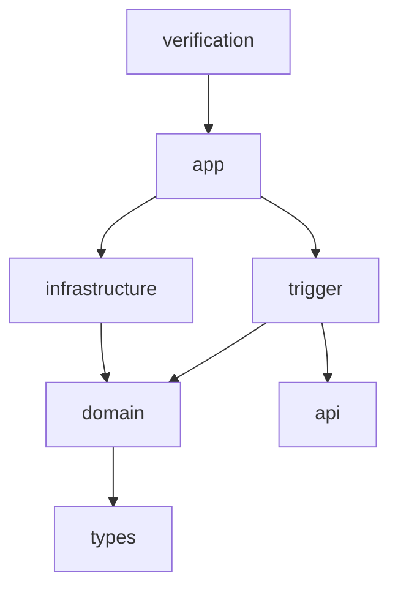

# B 的文件与模块规范

更新：2026-10-09。适用于 `b02-noFileUpdate` 分支，工作树 `D:/Java/zj-market-b02-noFileUpdate`。D19/D20 已由用户确认；决策见 [ADR-0001](adr/0001-domain-service-module-layout.md)，过程和验收见 [B-02第17节](b02-development.md#17-b-02文件管理优化2026-10-09)。B-01 六模块说明保留为历史基线。

## 模块边界

采用 A 的 api/types/domain/infrastructure/trigger/app 分层，另保留 B 独立的 verification 验收模块；共七个子模块，仍是一个商城服务。

| 模块 | 职责 | 直接项目依赖 |
| --- | --- | --- |
| types | 共享异常及基础类型，目前为 exception | 无 |
| api | 对外身份 DTO、统一 HTTP 响应包装；纯 Java | 无 |
| domain | identity/product 模型、业务服务及出站接口 | types |
| infrastructure | DAO、仓储和密码/JWT/RPC/MQ实现、外部配置属性 | domain |
| trigger | HTTP Controller、后台任务、入站适配接口 | domain、api |
| app | Spring 装配、身份过滤与普通 main | infrastructure、trigger |
| verification | 显式环境验收、迁移和故障恢复入口 | app |

application 模块已移除，用例协调归 domain 的业务服务。domain/api/types 不引入 Spring、A SDK 或中间件对象；trigger 不直接依赖 infrastructure。Maven Enforcer 约束向外依赖，根 POM 继续固定已有运行组合。A 的既有契约仍由基础设施消费，不新建或复制同名 RPC 契约。api 中 DTO 不强迫所有 Controller 改成 DTO 入参：商品接口原有严格字段检查保持。

## Java 文件归位

根包 `cn.zj.zjmarket`，main 保持 `cn.zj.zjmarket.ZjMarketApplication`。顶层接口与实现分包，公开模型单独成文件；局部实现细节可使用私有或受限嵌套类。

| 包位置 | 文件规则与现有示例 |
| --- | --- |
| domain.<业务>.model.entity | 实体：User、LoginGrant、Product |
| domain.<业务>.model.valobj | 独立值对象/业务返回模型：UserView、ProductFields、ProductView、SyncWork、TrialQuote |
| domain.<业务>.service | IIdentityService、IProductService、IProductSyncService、IMarketingTrialService |
| domain.<业务>.service.impl | 对应 IdentityService、ProductService、ProductSyncService、MarketingTrialService 实现 |
| domain.<业务>.adapter.repository | IIdentityRepository、IProductRepository、IProductSyncRepository |
| domain.<业务>.adapter.port | 密码、令牌、事件、RPC、结果订阅等出站接口；不放实现 |
| infrastructure.dao | MyBatis I*Dao 接口；SQL 保持原语义 |
| infrastructure.dao.po | UserRow、ProductRow、SyncInboxRow；数据库行模型不透传 HTTP |
| infrastructure.adapter.repository | 仓储实现与显式事务 |
| infrastructure.adapter.port.<业务> | Argon2Passwords、RsaAccessTokens、ContractProductEvents、DubboMarketingTrial、RocketMqSyncTransport |
| infrastructure.gateway.rpc/mq/codec | RPC/MQ 客户端工厂、结果 reader、独立签名编解码 |
| infrastructure.config.properties | 外部属性与配置校验，不装配业务服务 |
| trigger.adapter.port | IBrowserAuthPort 等入站适配接口 |
| trigger.http / trigger.job / trigger.config | Controller / ProductSyncJob / trigger 层配置 |
| app.config / app.security | 跨模块 Bean 装配 / 登录过滤、浏览器身份和限流 |
| api.dto.identity / api.response | 注册、登录、令牌 DTO / ApiResponse |
| types.exception | AuthFailure、ProductFailure、SyncTransportFailure |

事务仍在基础设施仓储实现中，后台任务通过业务接口与结果订阅端口运行；扫描、订阅启动、停止及重试参数保持。四组原测试归 app 的 `src/test/java/cn/zj/zjmarket/test/{app,config,identity,integration}`，用于装配和集成边界验证。verification 中受限验收辅助类按原验收包保留，避免把故障开关混入普通应用。

## 前端与配置

前端 `src/App.vue`、`main.ts` 为入口，页面放 `views`，身份请求放 `services`，公开类型放 `types`，错误类放 `errors`，样式放 `styles`。当前页面为 `views/Products.vue`；浏览器验收动态模块路径同步为 `/src/services/auth.ts`。

资源保持原位置：app 的 application.properties 导入基础设施配置；infrastructure 保存 RPC/MQ/数据库 properties 和 `db/migration/V1～V4`；verification 保存验收 profile。普通启动、数据库迁移、联合验收分别使用 `scripts/start-market.ps1`、`scripts/database.ps1`、`docs/tests/run-b02-acceptance.ps1`。JDK 由 B 脚本显式选择 21，终端和 A 默认 Java 8 保持。

`.local`、凭据 XML、密钥、target、node_modules、dist 和 IDE 本机配置继续忽略。新工作树不从 Git 获得本机秘密，启动时外部注入；不把实际密码或私钥放进示例、文档或日志。当前开发不增加迁移版本、不改变 HTTP 字段、业务规则、依赖版本或 A 源码。

IDE 打开此工作树根 pom.xml 并重新加载 Maven，移除缓存中的 application 模块，确认七个子模块。共享 B - JDK 21 运行配置仍指向 app 与原 main；不要切换主目录来验证尚未合并的整理结果。
