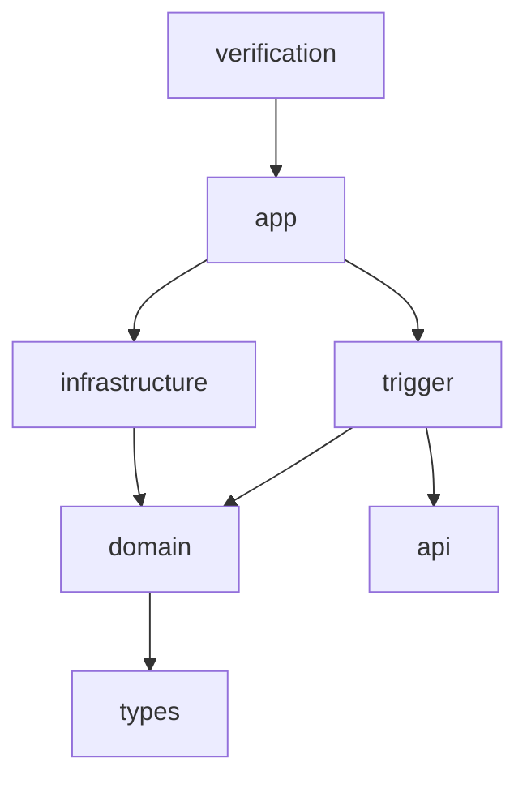

> 最新Git归档状态（2026-10-11）：B-05.0～.6支持范围成果已提交为 `3de9404776377f778d5f6930d3c5ae6fd754bf68`，已快进合并master并原子推送；origin/b-05与origin/master已远程核验一致。当前分支b-05已关联origin/b-05。本条及过程归档记录随随后文档提交同步两分支；下文旧HEAD、未提交／未合并／未推送等保留各次实施时点，不代表最新状态。验收摘要中的基线和包指纹保持原始证据；B-06尚未实施。

> 当前状态（2026-10-11）：B-05.6联合故障验收与B-06交接已完成支持范围内验收。最终同包106项JUnit/前端构建、新SQL及跨JVM/浏览器、真实A无人/部分付款停机退款释放/全付款最后事件成团竞争、逐单资金库存及A名额只读核验、原三专项/交接审计/普通启动均通过。推荐D26～D28已写双路线图，证据及边界见[b05-development.md第15.2节](b05-development.md)、[B-06交接](b05-b06-handoff.md)与[持久验收摘要](tests/b05-joint-acceptance.json)。取消后异常收款正向自动资格未开放，隔离验收通过；此限制不宣称全自动闭环。b-05/53ad32d，全部成果未提交/合并/推送，B-06未开展。下文旧阶段状态保留历史时点。

> 当前状态（2026-10-11）：B-05.5库存收尾及运营页面已完成本阶段验收。双B库V18/runtime48表精确DML；最终同包106项JUnit、SQL05及跨JVM、实际B HTTP浏览器04、真实A live02停机退款/释放/新B重放/恢复后同步、原关单/结算/履约回归、只读交接审计及普通启动均通过。推荐D21～D25已写双路线图，详情见[b05-development.md第14.3节](b05-development.md)。最终只读归档target/refund/b055-20261011-delivery-03/report.json；.6完整联合故障矩阵未开展。b-05/53ad32d，全部阶段改动未提交/合并/推送。下文带日期的旧状态保留历史时点。

> 当前状态（2026-10-11）：B-05.4可信退款事实与A同步已实现并通过同包业务验收；b-05/53ad32d，阶段变更未提交/合并/推送。双B库V16/runtime46表精确DML；103项JUnit、SQL03/跨JVM、实际A live-02停启/签名MQ/严格查询/新B进程、关单/结算/履约回归及普通启动通过。推荐D18～D20已保存双路线图；最终归档见target/refund/b054-20261011-delivery-02/report.json，过程见[b05-development.md第13.2节](b05-development.md)。付费HELD/guard保留；库存释放/HTTP/页面归.5、完整联合矩阵归.6。A外部并行改动保持，实际验收A包及契约不变。下列旧状态保留历史时点。

> 当前状态（2026-10-11）：B-05.3独立模拟退款已完成并验收通过；b-05/53ad32d，全部阶段变更未提交/合并/推送。双B库V15、runtime46表精确DML；99项JUnit、同包SQL/跨JVM、真实A完整核对资格及自有A停止后独立退款、关单/结算/履约回归和普通包默认启动通过。新增推荐D15～D17已保存双路线图。最终报告target/refund/b053-20261011-delivery-02/report.json；详见[B-05过程12.2](b05-development.md)。退款MQ/库存释放/运营及页面归.4/.5，.4～.6未开展；下列旧状态保留历史时点。

B-05.3新增domain/refund（Refund不可变模型/配置、IRefundChannel、IRefundRepository、RefundService）；infrastructure独立SimulatedRefundChannel与RefundRepository；app显式RefundConfiguration，trigger/RefundRecoveryJob。通知只唤醒，渠道查询在商城事务外；续租线程仅锁任务/通知，不反锁订单。verification的RefundCommands及ActualRefundCommands专属故障/两JVM/真实A资格验收，不进入普通包。V15及docs/tests/run-b05-refund.ps1、run-b05-refund-startup.ps1、collect-b05-refund.py为复现入口；run-b01-environment/run-b03-readiness支持自有端口参数。退款MQ/收尾/页面仍待后续阶段。

> 当前状态（2026-10-11）：B-05.2到期完整核对已完成并验收通过；工作树D:/Java/zj-market-b-05，分支b-05/53ad32d，改动未提交/合并/推送。双B库V14、41表精确DML；87项JUnit、最终同包真实A成团竞争/部分付款丢响应跨JVM恢复、SQL及关单/结算/履约回归通过。最终报告target/reconciliation/b052-20261011-delivery-03/report.json；详见[B-05过程11.4](b05-development.md)。退款义务已持久化，资金仍NONE、付费HELD保留；退款执行归.3，.3～.6未开展。下列暂停及旧阶段记录保留历史时点，以本条和11.4为当前状态。

新增domain/reconciliation独立模型、port/repository和service；infrastructure实现认证TLS核对RPC、持久核对仓库及OrderReviewBlocks；trigger/job/ReconciliationJob执行后台恢复；app显式导入ReconciliationConfiguration。verification的ReconciliationCommands与ActualReconciliationCommands隔离受控A/真实A测试，生产普通包没有故障接口。SQL位于infrastructure的V14，测试/归档入口位于docs/tests；过程b05-development.md与路线图持续维护。退款执行器/退款MQ/页面模块尚未实现。

> B-04.6最新模块接续（2026-10-10）：.0～.6按模拟范围已完成，b-04/7cef241，全部成果未提交；双库V13/35表、77项JUnit及同包联合验收通过。唯一详细事实见[B-04过程第15节](b04-development.md)，B-05从[b04-b05-handoff.md](b04-b05-handoff.md)接完整核对/退款。普通写默认关闭，原资金/HELD/guard及待处理工作保留；B-05/B-06待开展。以下旧增量保留其阶段时点。

# B 的文件与模块规范

> B-04.3当前增量（2026-10-10）：见[B-04过程第12节](b04-development.md)。V11及34张B表DML、可信资金/独立交易消息、D6持久接管已完成验收；普通支付写与交易恢复装配默认关闭。开放后关闭证明/待履约归.4/.5；以下旧阶段配置/表数保留历史时点。

> 历史状态说明（2026-10-10）：本文保留各实施时点的工作树、分支、未提交/未合并/未推送状态、验收批次和产物指纹；这些记录不代表当前 Git 状态。B-02、目录整理与补修、B-03及D6收尾均已包含在 `7cef241`；当前接续工作树为 `D:/Java/zj-market-b-04`，分支 `b-04`。最新进度见 [B-04开发过程](b04-development.md)及[路线图](development-roadmap.md)。历史 `.local`、`target` 和前端依赖不随 Git 复制，旧报告不作为新工作树重新验收的证据。

更新：2026-10-10。本规范适用于当前七模块工程；当前接续工作树 `D:/Java/zj-market-b-04`，分支 `b-04`。目录整理提交 `d9f12c7`、补修 `f93c861` 均已包含在当前基线 `7cef241`。D19/D20 决策见 [ADR-0001](adr/0001-domain-service-module-layout.md)，历史验收见 [B-02第17节](b02-development.md#17-b-02文件管理优化2026-10-09)；B-01 六模块说明保留为历史基线。

## 模块边界

采用 A 的 api/types/domain/infrastructure/trigger/app 分层，另保留 B 独立的 verification 验收模块；共七个子模块，仍是一个商城服务。

| 模块 | 职责 | 直接项目依赖 |
| --- | --- | --- |
| types | 共享异常及基础类型，目前为 exception | 无 |
| api | 对外身份 DTO、统一 HTTP 响应包装；纯 Java | 无 |
| domain | identity/product/inventory/order 模型、业务服务及出站接口 | types |
| infrastructure | DAO、仓储和密码/JWT/RPC/MQ实现、外部配置属性 | domain |
| trigger | HTTP Controller、后台任务、入站适配接口 | domain、api |
| app | Spring 装配、身份过滤与普通 main | infrastructure、trigger |
| verification | 显式环境验收、迁移和故障恢复入口 | app |

application 模块已移除，用例协调归 domain 的业务服务。domain/api/types 不引入 Spring、A SDK 或中间件对象；trigger 不直接依赖 infrastructure。Maven Enforcer 约束向外依赖，根 POM 继续固定已有运行组合。A 的既有契约仍由基础设施消费，不新建或复制同名 RPC 契约。api 中 DTO 不强迫所有 Controller 改成 DTO 入参：商品接口原有严格字段检查保持。

## Java 文件归位

根包 `cn.zj.zjmarket`，main 保持 `cn.zj.zjmarket.ZjMarketApplication`。顶层接口与实现分包，公开模型单独成文件；局部实现细节可使用私有或受限嵌套类。

| 包位置 | 文件规则与现有示例 |
| --- | --- |
| domain.<业务>.model.entity | 实体：User、LoginGrant、Product |
| domain.<业务>.model.valobj | 独立值对象/业务返回模型：UserView、ProductFields、ProductView、SyncWork、TrialQuote |
| domain.<业务>.service | IIdentityService、IProductService、IProductSyncService、IMarketingTrialService |
| domain.<业务>.service.impl | 对应 IdentityService、ProductService、ProductSyncService、MarketingTrialService 实现 |
| domain.<业务>.adapter.repository | IIdentityRepository、IProductRepository、IProductSyncRepository |
| domain.<业务>.adapter.port | 密码、令牌、事件、RPC、结果订阅等出站接口；不放实现 |
| infrastructure.dao | MyBatis I*Dao 接口；SQL 保持原语义 |
| infrastructure.dao.po | UserRow、ProductRow、SyncInboxRow；数据库行模型不透传 HTTP |
| infrastructure.adapter.repository | 仓储实现与显式事务 |
| infrastructure.adapter.port.<业务> | Argon2Passwords、RsaAccessTokens、ContractProductEvents、DubboMarketingTrial、RocketMqSyncTransport |
| infrastructure.gateway.rpc/mq/codec | RPC/MQ 客户端工厂、结果 reader、独立签名编解码 |
| infrastructure.config.properties | 外部属性与配置校验，不装配业务服务 |
| trigger.adapter.port | IBrowserAuthPort 等入站适配接口 |
| trigger.http / trigger.job / trigger.config | Controller / ProductSyncJob / trigger 层配置 |
| app.config / app.security | 跨模块 Bean 装配 / 登录过滤、浏览器身份和限流 |
| api.dto.identity / api.response | 注册、登录、令牌 DTO / ApiResponse |
| types.exception | AuthFailure、ProductFailure、SyncTransportFailure |

事务仍在基础设施仓储实现中，后台任务通过业务接口与结果订阅端口运行；扫描、订阅启动、停止及重试参数保持。四组原测试归 app 的 `src/test/java/cn/zj/zjmarket/test/{app,config,identity,integration}`，用于装配和集成边界验证。verification 中受限验收辅助类按原验收包保留，避免把故障开关混入普通应用。

## 前端与配置

前端 `src/App.vue`、`main.ts` 为入口，页面放 `views`，身份请求放 `services`，公开类型放 `types`，错误类放 `errors`，样式放 `styles`。页面已包括Products/Inventory/Orders/Team/OrderExceptions及B-04 Payment收银台；浏览器验收动态模块路径同步为 `/src/services/auth.ts`。

资源保持原位置：app 的 application.properties 导入基础设施配置；infrastructure 保存 RPC/MQ/数据库 properties 和 `db/migration`（当前V1～V11；V1～V4为B-02整理时基线）；verification 保存验收 profile。普通启动、数据库迁移、联合验收分别使用 `scripts/start-market.ps1`、`scripts/database.ps1`、`docs/tests/run-b02-acceptance.ps1`。JDK 由 B 脚本显式选择 21，终端和 A 默认 Java 8 保持。

`.local`、凭据 XML、密钥、target、node_modules、dist 和 IDE 本机配置继续忽略。新工作树不从 Git 获得本机秘密，启动时外部注入；不把实际密码或私钥放进示例、文档或日志。目录整理任务当时不增加迁移或改变HTTP/业务；本轮B-04按授权新增支付迁移/API，依赖版本和A源码保持。

IDE 打开当前 `b-04` 工作树根 pom.xml 并重新加载 Maven，确认七个子模块。共享 B - JDK 21 运行配置仍指向 app 与原 main；目录整理已合入 master，旧工作树路径只用于定位历史产物。

## 2026-10-10历史状态校正复杂度

此次文档维护复杂度低：依据Git归档修正当前入口并明确历史实施范围，保留原验收批次、路径和指纹；未改变业务规则或重新执行业务验收。后续详细过程维护于 [B-04开发过程](b04-development.md)，总体进度同步[路线图](development-roadmap.md)。

## B-05.4 退款同步位置（2026-10-11）

infrastructure/adapter/repository/RefundOutbox负责冻结事实→原交易Outbox，RefundSyncRepository负责退款回执/权威查询核验及单调接受高水位；由RefundConfiguration装配到原SettlementRepository。TradeMessageReader和RocketMqSettlementTransport增加严格退款分支，TradeReceipt携带独立typed authority；FulfillmentRepository只锁PAYMENT_SUCCEEDED，避免把退款事件当支付接受。V16无新表。verification的RefundSyncAssertions/ActualRefundSyncCommands及run-b05-refund-sync.ps1、collect-b05-refund-sync.py仅隔离验收使用，普通包不包含这些工具。

## B-05.5 收尾及运营位置（2026-10-11）

domain/refund/adapter/repository的IRefundView/IRefundOperations提供查询与运营端口；infrastructure的RefundReleaseRepository负责证明围栏/原子库存收尾/重放，RefundOperationsRepository负责一致快照、角色及冻结操作审计。RefundOperationsConfiguration随订单能力装配，RefundReleaseJob由RefundConfiguration负责后台；RefundController提供六项HTTP，OrderController增加refundSummary。V17/V18位于原db/migration。

前端components/RefundProgress.vue、views/RefundExceptions.vue和Reconciliations.vue、services/refunds.ts负责独立摘要/运营查询和原操作恢复，App增加/admin/refunds与/admin/reconciliations。verification的RefundReleaseAssertions/RefundBrowserCommands及实际A原命令的release模式只在隔离工具；docs/tests新增SQL/浏览器/串行回归/只读归档入口，普通包不含验收能力。当前IDE工作树b-05，所有阶段变更尚未提交。

## B-05.6 联合验收位置（2026-10-11）

verification/B05Conservation保存明确本批订单与商品流水守恒；ActualReconciliationCommands增加NONE与原提交新JVM恢复，ReconciliationCommands增加受控A取消/渠道已付安全隔离，ActualRefundSyncCommands输出实际链路逐单金额。docs/tests/run-b05-joint.ps1负责串行同包新批次；collect-b05-quota.py只读精确A名额，collect-b05-joint.py汇总检查及跟踪脱敏b05-joint-acceptance.json。B-06交接b05-b06-handoff.md；普通业务模块/已应用V18没有本阶段新增变更。
