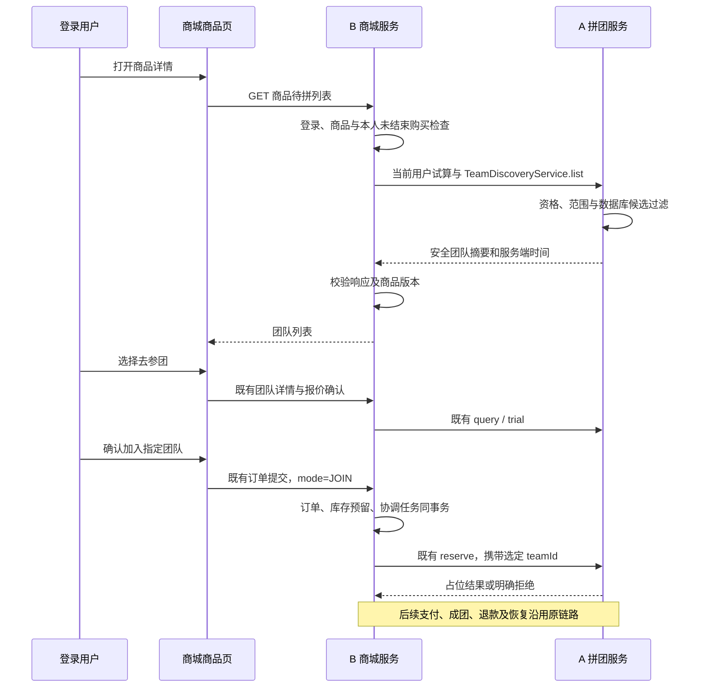

# 商品页待拼团队与直接参团开发方案

更新：2026-10-16。状态：**TD-00～TD-06.4 已完成本机 Windows 范围的功能、主站交易验收与归档；源码／镜像未远程发布**。适用：项目 A `group-buy-market` 与项目 B `zj-market` 的现有 v2 Dubbo／RocketMQ 集成。当前交付事实与范围见第 19 节及[TD-06发布清单](team-discovery-td06-release.json)。

目标：用户在商城商品详情页发现其他人正在进行的拼团，选择一团后直接进入既有参团确认流程，无需先从他人处取得分享链接。A/B 的 `codex/team-discovery-td00` 分支已完成契约、A 查询、B HTTP、商品页、真实双库／MQ 联合验收、新容器候选交付和主商城443真实交易验收；功能现于本机 `https://zj-market.test` 使用。`https://zj-market.test:8445` 保留TD-05隔离候选和历史演示证据。范围与历史过程见第 13～19 节。

## 1. 参考交互与本项目范围

### 1.1 联网参考

2020 年 China Channel 与拼多多合作发布的 [Defining Interactive E-commerce 白皮书](https://jefftowson.com/wp-content/uploads/2020/08/Interactive-Ecommerce-Whitepaper-2020.08.10.pdf)第 34 页介绍了用户选择加入现有团队或自行发起团队的购买路径。本文只借鉴“发现现有团队—选择参团”的交互模式，不照搬其期限、价格及履约规则；该资料不能证明拼多多 2026 年客户端的全部实时规则。

据此设计商品页的待拼团队区：展示真实人数、剩余时间与“去参团”按钮，同时保留“自己开团”。这是本项目的产品方案，不宣称复刻拼多多内部接口、推荐算法或支付机制。不调用拼多多接口、不采集真实用户头像或订单。

### 1.2 已确认选择

| 编号 | 用户于本轮确认的规则 | 实施含义 |
| --- | --- | --- |
| TD-D1 | 至少一人支付成功后展示 | A 已接受的 `paidCount >= 1` 才进入待拼列表；B 渠道付款但尚未被 A 接受时不提前展示 |
| TD-D2 | 登录后查看列表 | 公开商品浏览不变；团队列表、详情及参团均要求有效登录 |

以下为首版实施方案：商品详情页默认显示 3 团，“查看更多”每次加载 10 团；按到期时间升序、teamId 升序排列；不展示头像、昵称、手机号、其他人的订单号或支付记录。采用普通列表，不增加个性化推荐系统。若实施时需要调整这些产品选择，先记录变更，不改已确认的支付与库存规则。

首版不增加自动选团、满团后自动换团、失败后自动开团、跨活动推荐、跨渠道拼团、购物车、多 SKU 或真实支付。分享链接参团继续保留，完全未付款的团队仍可通过分享链接加入。

## 2. 当前基础与需补齐的部分

现状依据主目录源码及 B-03／B-06 交付文档；`D:/Java/zj-market-b-06` 为现有部署验收工作树，本文存于 `D:/Java/zj-market/docs`。不得把本次文档写入误认为部署已升级。

| 部分 | 已有能力 | 本次新增 |
| --- | --- | --- |
| A 团队接口 | `TeamService.query`、到期核对；支持指定 teamId 占位 | 按商品、活动、渠道和当前用户查询待拼团队 |
| A 数据 | v2 `ab_team`、`ab_trade_order`，包含状态、人数、期限 | 有界只读查询、索引和新增 RPC 授权 |
| B 下单 | `mode=OPEN/JOIN`；JOIN 必须携带 teamId；报价确认与原键恢复 | 新增团队发现领域查询与前端 HTTP 入口 |
| B 前端 | `Products.vue` 商品详情；`Team.vue` 分享参团；`PurchasePanel.vue` 确认购买 | 商品详情接入待拼列表，链接到既有团队页 |
| 交易链路 | 库存预留、支付、成团、退款与补偿 | 复用，不另建一套参团交易流程 |

不能直接复用 A 旧 v1 推荐团 HTTP 接口：当前商城集成使用 v2 契约和 `ab_*` 事实，历史接口的数据来源、权限及响应字段不能当作当前系统的契约。

## 3. 业务语义与筛选规则

### 3.1 两种人数必须分开

- `reservedCount`：有效占位，包含已付与未付；`availableSlots = targetCount - reservedCount` 才是还能新占用的名额。
- `paidCount`：A 已接受的支付人数；`remainingPaidCount = targetCount - paidCount` 才是还需付款的人数。
- 满位未成团可能是其他成员尚未付款，不能因 `paidCount < targetCount` 就展示“去参团”。
- “列表中可加入”是查询时快照，最终仍由 A 的 `TradeService.reserve` 在事务内裁决。

卡片示例：`3 人团 · 已付 1 人 · 还需 2 人付款 · 可加入 1 位 · 剩余 01:25 [去参团]`。不要把“还需付款人数”统一标成“剩余名额”，也不承诺点击后立即拼成。

### 3.2 A 的候选过滤

同一 SQL 查询按一次 A 数据库时间 `serverTime` 筛选，全部满足才返回：

1. `source/channel` 与认证调用方授权范围一致，不能接受浏览器自报渠道。
2. `goodsId/activityId` 匹配当前用户本次有效试算；重新验证商品版本、活动有效性、可见性和参与资格。
3. `teamStatus = FORMING`，且 `validStartTime <= serverTime < validEndTime`。即使到期调度尚未运行，也排除过期团。
4. `1 <= paidCount <= reservedCount < targetCount <= 100`。
5. 当前用户不在该团拥有未取消的有效 `RESERVATION`。比较用户 ID 必须精确区分大小写；取消记录不永久阻止重新发现，最终还受现有资格规则限制。
6. 当前试算目标人数与团队 `targetCount` 一致；不推荐同商品的旧活动或条件不匹配的团队。

B 若已有同 SKU 未结束购买，优先展示本人原订单入口，不引导再创建参团购买；前端本地还存在结果未知的购买意图时也先恢复原意图，不能只依赖列表中的“无原订单”。A 的本人过滤与 B 的购买守卫分别执行，彼此不能替代。

### 3.3 商品变更与安全展示

B 用当前商品版本和当前用户报价查询；查询后再次校验商品在售、同步水位和版本，变化返回版本冲突并要求重读。A 也校验本地商品版本，不放宽原有准入。

`ab_team` 当前没有团队商品版本字段，且已有契约允许同团成员保留各自成交快照、成交价不必相同。不要为了列表强行添加“所有成员版本／价格相同”的条件。旧团队是否仍可加入，以当前有效活动、目标人数、当前试算及既有 reserve 校验为准；页面展示当前用户价格，不读取团长原价作为自己的报价。

首版卡片使用“待拼团队”及序号，不引入团长资料同步。只返回团队摘要；后台完整核对名单与其他用户资金证据不得进入列表 DTO。

## 4. 架构与流程



新列表采用同步 Dubbo 查询：数据由 A 权威维护，刷新时需要最新人数和期限。首版不新增 MQ Topic、事件、B 团队投影、Redis 列表缓存或注册中心，避免为一个发现入口引入额外最终一致性链路。

列表 GET 不创建订单、报价确认记录、库存预留、支付或团队。RPC 鉴权 nonce 等基础设施记录不属于交易事实变化。网络调用不持有 B 本地数据库事务或行锁。

## 5. 新增服务契约

以下名称和字段已于 TD-00 冻结，A RPC Provider 已在 TD-01 实现并完成真实隔离 TLS 验收；B HTTP 已在 TD-02 实现并完成隔离真实 A 调用，现有部署未升级。正式扩展见 A 的 `docs/ab-api-contract.md` 第 14／15 节；机器定义为 [RPC／游标及错误映射](team-discovery-contract.json)、[HTTP OpenAPI](team-discovery-http-api.json)及 A 的 `docs/schemas/team-discovery-v1.schema.json`。TD-00 旧候选锁的 installed=false 保留冻结时点，本机发布状态见 [A候选清单](team-discovery-a-release.json)与[B候选清单](team-discovery-b-release.json)。

### 5.1 A 新增只读 Dubbo 服务

新增独立 `cn.bugstack.api.v2.TeamDiscoveryService`，不改已有 `TeamService` 方法签名：

```java
RpcResult<TeamDiscoveryPage> list(TeamDiscoveryRequest request);
```

`TeamDiscoveryRequest extends BaseRequest`，沿用 Java 8 POJO、序列化和签名规则：

| 字段 | 类型／约束 | 来源与含义 |
| --- | --- | --- |
| source、channel | 既有渠道长度与规则 | B 服务端配置，A 认证校验 |
| userId | string，1～64，精确匹配 | B 当前 Principal，必填 |
| goodsId | string，1～64 | 当前商品 |
| activityId | string，既有数值 ID 格式 | B 服务端当前有效试算，A 复核 |
| productVersion | string，既有合法版本格式 | B 当前同步完成的商品版本 |
| limit | integer，1～10 | 默认 3，查看更多使用 10 |
| cursor | string 或 null，最长 1024 字符 | 首屏 null，后续使用原响应游标 |

`TeamDiscoveryPage`：`source/channel/userId/goodsId/activityId/productVersion/serverTime/items/nextCursor/hasMore`。items 是独立 `TeamDiscoveryItem`，不复用含 `ownReservation` 的 Team 对象。

每项字段：`teamId/activityId/goodsId/teamVersion/teamStatus/targetCount/reservedCount/paidCount/validStartTime/validEndTime`。所有 ID、版本保持字符串；时间为 UTC 毫秒格式；`teamStatus` 只允许 FORMING。剩余名额和待付人数由 B 在验证计数关系后计算。无候选是成功空数组，不能用异常表示正常空列表。

排序固定 `(validEndTime ASC, teamId ASC)`，使用游标分页，每次查询 `limit+1` 条确定 `hasMore`，不返回总数、不采用 offset。游标编码到期时间和 teamId，并携带 goods/activity/productVersion/sortVersion 及当前 userId 的绑定校验；严格解析、限定长度，任一绑定与可信请求不符即拒绝。游标不是授权凭据，即使可解码或被修改，SQL 也必须重新施加所有身份、渠道和资格过滤；不能从游标取得可信 userId/channel。身份、商品、活动或版本变化后从第一页重查。游标无需为首版额外引入密钥体系。

每一页是最新快照，不保证整个翻页过程固定集合；页面按 teamId 去重，已过期项本地禁用，刷新回到第一页。取消后重新可加入的团队可能排在已翻过的游标之前，下次刷新再出现，不能因此绕过原交易恢复。

RPC 沿用 Triple TLS、请求签名、nonce 防重放、source/channel 授权；`retries=0`。新增发现调用单次初始超时 3000ms，A 查询语句设置相应上限；B 对“试算＋列表”设置最多 10000ms 的整体预算，剩余预算不足时失败，不串行无限等待。不修改既有交易 RPC 的超时和恢复规则。

新增服务必须同步加入 `V2Security.METHODS` 的 `TeamDiscoveryService.list` 白名单。契约包发布新不可变版本，A/B 锁定同一构建字节并保存 SHA-256，不覆盖原 SNAPSHOT 伪装成旧包。独立新服务使用现有 v2 协议版本／group，实际 Maven 版本号在功能基线冻结时登记。

### 5.2 B 新增前端 HTTP 接口

`GET /api/v1/products/{goodsId}/joinable-teams?limit=3&cursor=...`

- JWT 登录鉴权，USER／OPERATOR 可访问；Principal 和服务配置确定身份、渠道。不能接受 userId、source、channel、activityId、价格或任意排序字段作为额外查询参数。
- 使用现有 `ApiResponse` 外壳及 `requestId`，`Cache-Control: no-store`，避免 Nginx／浏览器共享用户相关结果。
- B 自行获取当前有效试算，不信任页面之前缓存的报价。响应摘要供展示，不能作为下单凭证；后续仍生成既有 confirmationId。
- 只在商品详情加载，商品列表页不为每件商品触发查询，避免 N+1 RPC。

成功 `data` 字段：

| 字段 | 约束／含义 |
| --- | --- |
| state | `AVAILABLE`、`ACTIVE_PURCHASE`、`UNAVAILABLE` |
| reason | UNAVAILABLE 时为 `NO_OFFER`、`INELIGIBLE`、`PRODUCT_SYNC_PENDING` 或 `OUT_OF_STOCK`；其他为 null |
| goodsId、productVersion | 当前商品与版本 |
| activityId | AVAILABLE 时的当前活动；不可见／不具资格时不泄露受限活动标识 |
| serverTime | AVAILABLE 使用 A 时间；其他状态可为 null，此时无团队倒计时 |
| items | AVAILABLE 时为安全摘要数组，其他为空 |
| activeOrderId | 仅 ACTIVE_PURCHASE 返回本人订单号，其他为 null |
| nextCursor、hasMore | 空列表／不可用状态为 null／false |

HTTP item 只含 `teamId/targetCount/reservedCount/paidCount/availableSlots/remainingPaidCount/validEndTime`。商品、活动、范围、版本已在 B 验证，不向浏览器暴露后台来源、完整成员或任意上游对象。

`AVAILABLE + []` 表示当前没有符合条件的团队；`UNAVAILABLE` 是已知业务条件不满足；上游故障必须返回错误，不能伪装成这两者。原订单恢复优先于发现功能，下架后的历史订单仍从既有订单入口恢复，不通过新列表绕过商品可见性。

### 5.3 错误与交互约定

| 情况 | HTTP／错误码 | 页面行为 |
| --- | --- | --- |
| 无登录／身份失效 | 401 `AUTH_REQUIRED` 或既有鉴权码 | 提示登录，恢复当前商品路径 |
| 无角色权限 | 403 `FORBIDDEN` | 不加载团队 |
| 商品不可公开访问 | 404 既有商品错误码 | 保留原商品可见性语义 |
| 非法参数／游标 | 400 `INVALID_PARAMETER`（复用或统一映射） | 不自动重放非法参数 |
| 翻页期间活动或版本变化 | 409 新增 `TEAM_DISCOVERY_CONTEXT_CHANGED` | 清空旧候选，重新试算并从首屏刷新 |
| A 无新服务／网络或查询超时 | 503 `DEPENDENCY_UNAVAILABLE` | 显示“暂时无法加载待拼团队”，允许手动重试 |
| A 鉴权／签名配置失败 | 502 `INTEGRATION_AUTH_FAILED` | 提示暂不可用并记录运维错误 |
| A 摘要结构／归属／计数异常 | 502 `UPSTREAM_RESPONSE_INVALID` | 拒绝整个响应，不渲染部分异常数据 |
| 查询频率超限 | 429 既有限流语义 | 遵循 Retry-After，停止自动刷新 |

A 新服务复用已有参数、权限、商品版本和资格错误码；为游标上下文变化新增明确业务码并由 B 映射上表。具体已有 A→B 错误码对照在 TD-00 冻结，不能把所有失败映射成空数组。

参团时继续使用既有错误：报价变化要求用户重新确认；满团、过期或活动不符返回既有 JOIN 拒绝；同 SKU 未结束购买引导原订单。reserve 结果未知保持原意图查询和补偿，不能刷新列表后替用户换团。

## 6. 数据访问与索引

只查询 A 的 v2 `ab_team`、`ab_trade_order`。B 不跨库读取 A 表，不建立外键，不在 B 保存第二份权威人数，不新增资金或库存表。

A 查询形态示意（资格和版本校验在查询服务内复用现有规则，SQL 参数化）：

```sql
SELECT t.team_id, t.goods_id, t.activity_id, t.team_version,
       t.team_status, t.target_count, t.reserved_count, t.paid_count,
       t.valid_start_time, t.valid_end_time
FROM ab_team t
WHERE t.source = :source AND t.channel = :channel
  AND t.goods_id = :goodsId AND t.activity_id = :activityId
  AND t.team_status = 'FORMING'
  AND t.valid_start_time <= :dbNow AND t.valid_end_time > :dbNow
  AND t.target_count = :currentTargetCount
  AND t.paid_count >= 1 AND t.paid_count <= t.reserved_count
  AND t.reserved_count < t.target_count AND t.target_count <= 100
  AND NOT EXISTS (
      SELECT 1 FROM ab_trade_order o
      WHERE o.team_id = t.team_id
        AND o.source = :source AND o.channel = :channel
        AND o.user_id = :userId AND BINARY o.user_id = BINARY :userId
        AND o.record_kind = 'RESERVATION' AND o.order_status <> 'CANCELLED'
  )
  -- 后续页追加 (t.valid_end_time > :lastEndTime
  --   OR (t.valid_end_time = :lastEndTime AND t.team_id > :lastTeamId))
ORDER BY t.valid_end_time ASC, t.team_id ASC
LIMIT :fetchLimit;
```

使用短只读事务的一致读取，固定一次 `dbNow` 并执行候选查询；不对团队加 `FOR UPDATE`，不触发过期状态迁移，不在查询里修改团名额。交易写路径继续负责最终校验。计数异常不能当成可加入，B 也必须做独立响应验证。

建议通过新增迁移建立以下候选索引，实施时先检查实际 schema 与 EXPLAIN，确认索引顺序和收益：

- `ab_team(source,channel,goods_id,activity_id,team_status,valid_end_time,team_id)`：缩小商品活动集合并服务稳定排序。
- `ab_trade_order(team_id,user_id,order_status)`：支持本人有效参团的 NOT EXISTS，保留渠道与 recordKind 残余校验。

现有迁移里团队只有 `(source,channel,team_status,valid_end_time)`，订单已有 team_id 和 user/activity 索引。新增索引必须使用新迁移，不改写已应用脚本、不删除旧索引或历史团队。B 首版无需新增数据库迁移；如实际设计发现必须新增字段，另列原因并审查。

## 7. 修改位置清单

路径相对各自仓库；“新增”为建议命名，实施时根据编码约定细化，保持职责而非为了命名重构旧交易。

| 所属 | 路径／组件 | 修改步骤 |
| --- | --- | --- |
| A 契约 | `group-buy-market-contract/src/main/java/cn/bugstack/api/v2/` | 新增 TeamDiscoveryService、Request、Page、Item；复用 BaseRequest/RpcResult，补业务码 |
| A 契约生成工具 | `docs/dev-ops/ab-v2/generate-contract.py` | 核对生成器对 DTO／业务码的管理边界，更新或明确停止重生成，避免后续生成覆盖新增契约 |
| A RPC | `group-buy-market-app/src/main/java/cn/bugstack/v2/` | 新增 V2TeamDiscoveryRpc 与只读查询服务，复用现有资格验证与 RPC 结果包装 |
| A 安全 | 同目录 `V2Security.java` | 精确加入新方法白名单，验证签名绑定接口／方法／body；不能整体放开 v2 方法 |
| A 数据 | `docs/dev-ops/mysql/sql/migrations/` | 新增独立索引迁移；核对实际表排序规则、查询计划及运行账号 SELECT 权限 |
| A 契约说明 | `docs/ab-api-contract.md`、相关维护清单 | 实施时登记新增查询、错误码、版本及兼容验收；保留原契约事实 |
| B domain | `zj-market-domain/.../domain/order/` | 新增 ITeamDiscoveryService、ITeamDiscoveryPort 及安全查询值对象，组织商品／报价／本人订单检查 |
| B infrastructure | `zj-market-infrastructure/.../adapter/port/order/` | 新增 DubboTeamDiscoveryPort，复用 RpcClientFactory、ContractCodec 和签名规则，验证上游响应 |
| B trigger／api | `zj-market-trigger/.../http/`、`zj-market-api` | 新增 GET Controller／DTO，白名单参数与主体校验，映射业务错误 |
| B 装配／鉴权 | `TradeConfiguration.java`、`IdentityHttpFilter.java` | 装配查询服务；新路径加入保护规则，Controller 二次验证角色；不能扩大匿名商品路径匹配 |
| B 依赖 | 根 pom／相关模块 pom | 锁定新契约包；独立新服务端口不强迫修改 ITradePort，减少现有付款／关闭测试影响 |
| B 前端 | `frontend/src/views/Products.vue` | 商品详情插入团队区，消费商品／身份／试算变化，运营编辑页不加载 |
| B 前端新增 | `JoinableTeams.vue`、`types/team-discovery.ts`、`services/team-discovery.ts` | 列表／分页／倒计时／错误与请求竞态处理 |
| B 既有参团 | `Team.vue`、`PurchasePanel.vue`、`services/orders.ts` | 优先原样复用，只在确有需要时补文案或错误刷新；保留指定 teamId、报价确认及原键恢复 |
| 验收与部署 | A/B 测试目录、B `verification`、`deploy/b06/` 与发布材料 | 新增真实链路与故障证据，更新候选镜像／契约指纹和门禁，不覆盖 B-06 历史报告 |

A 当前 v2 实现位于 app 下；本次按现有集成边界补只读能力，不借机重构整个 A。B 领域层继续不依赖 A DTO，转换放 infrastructure。

## 8. 前端行为

商品详情在现有试算／购买区域旁显示“正在拼团”，保留独立的“自己开团”。默认三条，查看更多展开／追加，分页不创建订单。卡片按钮跳转现有 `/teams/{teamId}`，该页面显示最新状态和本人报价，再经 PurchasePanel 明确确认 JOIN；不增加重复的下单表单。

| 状态 | 展示与行为 |
| --- | --- |
| 未登录 | “登录后查看可参与的拼团”，不请求受保护列表；登录后恢复商品页 |
| 加载中 | 明确 loading，禁止重复翻页，原商品仍可浏览 |
| 没有候选 | “暂无可参与的拼团，可以自己开团”，不伪造人数 |
| 同 SKU 已有购买 | “你已有进行中的订单”，只提供本人原单入口 |
| 已付款的本人团队 | 从本人订单查看／分享，不在候选里显示为他人的团 |
| 商品缺货／资格不符／待同步 | 区分已知原因，禁用新购买，仍允许查看本人原单 |
| 上游不可用 | “待拼团队暂时无法加载”，手动刷新；原开团是否可用仍由原试算／下单决定 |
| 过期／满位 | 立即禁用旧卡片；详情或下单被拒后提示重新选团，不自动切换 |

倒计时使用 A serverTime 与浏览器单调计时基准计算，不按用户系统时钟决定资格；本地计时仅用于展示。首次查询及手动刷新更新时间证据；页面重新可见时重查，倒计时到零禁用并触发一次去重刷新。

默认每 15 秒更新首屏，仅页面可见且无下单确认／未知购买、无在途请求时进行；一次浏览最多自动刷新 5 分钟，此后提示手动刷新。展开查看更多期间暂停定时刷新，手动刷新清空游标。切换商品、用户或商品版本时取消／忽略旧请求响应，清空列表和旧确认上下文；身份退出后不得闪现上一个用户的团队结果。429 停止自动刷新，其他失败有限退避，不无限重试。

为查询增加有界频率限制：单用户接口初始 30 次／分钟（配置化），单页 limit 最大 10，始终继承整体超时；实施时根据隔离环境观测调整。全用户突增时应有服务级并发门槛，但不为本功能新建网关或限流集群。

## 9. 分阶段开发步骤

### TD-00 基线与契约冻结

- [x] 核对 A/B Git 状态与实际 B-06 部署清单；新功能分支保留现有文档改动，冻结旧 A 包、B 包、契约及数据迁移指纹。
- [x] 登记 TD-D1／D2；固定 DTO、游标格式、状态／错误码映射、排序和时间边界，更新正式契约及 HTTP 机器定义。
- [x] 准备全新隔离商品、活动、账号和库存；使用新活动窗口与 120 分钟团队期限，不延长旧验收活动或篡改历史团队。
- [x] 定义交易前后只读核对口径；核对 SQL 本身零交易写入已验，实际发现 GET／RPC 的零写入验收归 TD-01／02／04。

通过条件：新旧接口边界可评审；方案中的名称／字段与机器定义一致。此阶段不以文档完成替代后续功能验收。

### TD-01 A 查询与安全

- [x] 发布新契约包到本机 Maven，实现只读 list RPC、资格复核、数据库时间筛选、本人精确排除、稳定游标。
- [x] 追加索引迁移，隔离库执行并验证实际 EXPLAIN ANALYZE、最小权限与真实慢查询取消；不修改旧迁移。
- [x] 将新方法加入授权白名单，完成真实 TLS／签名成功与错误签名／重放／越渠道拒绝。
- [x] 验证未付、满位、到期但仍 FORMING、核对中／终态、他商品／活动／渠道和大小写用户场景。

通过条件：真实 A 返回预期团队，列表无其他人的订单／资金字段；旧 query/reserve/payment/close/reconciliation 仍兼容。

### TD-02 B 后端查询

- [x] 更新契约依赖，增加独立领域端口与 Dubbo 适配器、HTTP DTO 和装配。
- [x] 完成登录角色、查询参数、原购买优先、当前报价／版本及上游响应验证；系统故障不返回空成功。
- [x] 实现预算、限流和最小可观测日志；GET 不创建 confirmation/order/reservation。
- [x] 实际 B HTTP 调用真实 A，验证鉴权、分页、异常响应、商品变更及依赖停机。

通过条件：前端可用的安全 HTTP 摘要就绪，B 不跨库查询，不破坏原购买守卫与恢复。

### TD-03 商城页面接入

- [x] 新增团队区组件和服务／类型；只放商品详情，接入首屏、分页、空／错／登录态与倒计时。
- [x] “去参团”进入既有团队页；确认过程固定 teamId，页面选择与实际订单 JOIN 一致。
- [x] 处理切换账号／商品、后台页面、慢响应覆盖、原单恢复和报价变化。
- [x] 检查桌面与窄屏、键盘操作、按钮语义，文案区分待付款人数与可加入名额。

通过条件：用户不复制分享链接也能从商品页加入指定团队；主动开团和分享参团均保持可用。

### TD-04 真实联合与并发故障验收（已完成）

- [x] 两账号：甲开团并付款，乙商品页发现甲团，JOIN 付款后成团；验证 teamId 相同、库存确认及待履约。
- [x] 三账号／最后一名额竞争：只能成功占用一次；失败者不进入替代团，B 原失败单按既有协议合法释放预留；独立 SQL 守恒报告已通过。
- [x] 团到期与 A 延迟付款事件竞态、占位响应丢失、刷新／重复提交、A/B 重启沿原业务键恢复；真实 MQ 延迟到期后 A 仍按窗口内渠道付款成团，重复业务键只返回原单。
- [x] 比对已执行场景的 A 名额／支付事实与 B 渠道金额、库存及唯一流水；25 次真实发现 GET 前后隔离 A/B 八组交易表行指纹一致。
- [x] 新受影响单元／隔离测试、现有关键交易回归、前端构建及真实浏览器通过，保留新批次原始失败与复验记录。

通过条件：第 10 节必过用例与守恒核对全部完成；无新超卖、重复支付计数、误退款或隐私泄露。

### TD-05 容器发布与交接（Windows 隔离候选已完成）

- [x] 使用已核实来源构建新 A／B／前端，保存契约版本、源代码／jar／镜像哈希；不得直接由脏 A 工作区替换旧固定包。
- [x] 迁移使用专用维护权限，运行账号不获 DDL；核验现有发布门禁／兼容清单后开启发现能力。
- [x] 先发布 A 查询能力，再发布默认关闭的新 B／前端，完成真实就绪探测后开启 `b.team-discovery.enabled`。仅检查配置和 TLS 端口不算新 RPC 可用。
- [x] 新 B 遇旧 A 缺服务返回明确暂不可用，发现功能关闭只隐藏列表，不改变原交易路由或资金行为。
- [x] 演示通过后更新新发布清单和交付说明；旧 B-06 验收、镜像与冷备保持历史，不改成新功能已覆盖。

通过条件：Windows Docker 的实际候选完整闭环通过。回退先关闭发现开关，再使用已认证兼容包；保留追加索引，不回滚业务数据或任意降库。新 A 仍保留旧接口，因此旧 B 可以先继续运行；新 B 对旧 A 不承诺发现功能可用。

> 2026-10-15 实施中时点：批次 `td05_20261015_01` 的 A 源码快照、镜像、克隆、索引、七服务及开关初验完成时，浏览器账目仍在核对。本段保留过程时点；最终结论见第18节。

## 10. 必过验收矩阵

| 编号 | 用例 | 必须结果 |
| --- | --- | --- |
| TD-T01 | 全员未付／甲已付但 A 未接受／A 已接受甲付款 | 前两种不公开；第三种且有名额才出现；未付分享参团不受公开门槛影响 |
| TD-T02 | 当前用户在团／仅有取消历史／CaseOwner 与 caseowner | 正确排除有效本人团；取消不永久排除；大小写不串人、不泄露原单 |
| TD-T03 | reserved 已满但 paid 未满 | 不展示为可加入，待付人数不得当可用名额 |
| TD-T04 | 到期未被调度／RECONCILING／COMPLETED／FAILED | 全部排除，到期判断不依赖 scheduler 先执行 |
| TD-T05 | 他商品／活动／source/channel／不具资格 | 严格过滤或既有准入拒绝，不暴露受限团队与其他人的订单 |
| TD-T06 | 同到期时间多团与游标篡改、非法 limit、跨用户复用游标 | 稳定排序；非法／绑定不符拒绝；合法游标不能扩大权限 |
| TD-T07 | 翻页间商品改价／下架／活动变化／同步未确认 | 清理旧上下文，按冲突或已知不可用处理，不沿用旧价格创建单 |
| TD-T08 | 匿名、过期登录、停用账号、无角色及缓存 | 登录／授权拒绝，no-store，无旧账号数据闪现 |
| TD-T09 | 甲付款，乙从商品页加入并付款 | 两单同 teamId，乙为 JOIN，达到人数成团；库存仅各确认一次 |
| TD-T10 | 查询后名额被抢／两个用户抢最后一位 | A 只接受合法名额，失败不自动换团，B 原预留合法收尾，无超卖 |
| TD-T11 | 双击／刷新／双标签／同 SKU 已有 OPEN 或 JOIN | 继续原购买或购买守卫拒绝，不多建库存义务 |
| TD-T12 | reserve 超时但 A 已提交／返回结果前断网 | 保留原 teamId 和业务键查单，库存不因前端超时释放 |
| TD-T13 | A 下线／TLS 或签名错误／摘要缺字段或计数非法 | 明确 503／502，不伪装空列表或渲染越范围信息 |
| TD-T14 | 团到期与最后一笔窗口内支付事件竞态 | 沿用完整核对机制，不因列表到零改变资金或误触发失败退款 |
| TD-T15 | 反复查询、翻页和 GET 刷新 | 交易数据、库存流水、支付事实与团队状态不因查询而变化 |
| TD-T16 | 前台暂停、后台恢复、切用户／商品及慢请求返回 | 倒计时正确刷新，旧响应失效；5 分钟自动停止，429 无重试风暴 |
| TD-T17 | 新旧 A/B 混合与能力开关关闭 | 已有开团／分享参团保持；缺新能力明确降级，不放宽鉴权 |
| TD-T18 | 已付款团无人继续加入并自然失败 | 沿原机制全额退款、唯一库存释放，发现入口不改变退款资格 |

性能验收使用隔离数据集验证索引与有界读取：例如同商品 1000 个候选及其他商品／渠道干扰数据，记录数据库查询耗时、扫描行数、列表 HTTP 延迟和 RPC 次数。该规模是测试样本，不是生产容量承诺；目标为候选 SQL p95 ≤ 200ms、健康本机查询 HTTP p95 ≤ 1000ms，实施时登记机器／样本／并发并调整，超出预算须定位，不通过添加缓存掩盖错误。

关联日志仅记录 requestId、接口／错误码、商品／活动和结果条数／耗时，遵循现有日志脱敏；不记录 JWT、Cookie、签名、完整游标或其他人的业务明细。新增查询调用数、错误／超时数及耗时统计，不把 teamId/userId 放成高基数指标标签。

## 11. 文档维护与完成定义

本文件为新功能唯一开发设计与阶段清单；[开发路线图](development-roadmap.md)只维护阶段入口与总体进度。实施中记录决定、变更和证据链接，不覆盖 B-03 或 B-06 的历史选择／验收数字。

参考项目文档：[B-03 联合设计](b03-joint-design.md)、[B-03 开发记录](b03-development.md)、[项目详解](project-guide-quickstart.md)、[B-06 交付说明](../deploy/b06/DELIVERY.md)。A 原契约为 `D:/Java/group-buy-market/docs/ab-api-contract.md`；本次新增查询需在 TD-00 正式扩展，不在设计阶段悄悄替换基线。

完成定义：TD-00～05 必要项完成，新契约／机器定义／实际实现一致，真实用户从商品页发现并加入他人团队，成功成团与失败退款均通过，库存／资金／名额守恒，部署候选与证据绑定。目前这一功能实现标准已在 Windows 隔离候选满足；日常主入口启用、当前数据衔接和最终交付归档按新增 TD-06 单独验收，不把隔离候选等同原商城已升级。

## 12. 本次更新复杂程度与阶段划分

本次文档更新复杂度：**中等**，涉及现状核查、公开交互参考、接口与验收设计；仅新增方案和路线图入口。

功能实现复杂度：**较高**，需协同 A 契约／安全／查询迁移、B 领域与 HTTP、前端以及双服务发布；既有交易链路可复用。拆分为 **TD-00 基线契约 → TD-01 A 查询 → TD-02 B 后端 → TD-03 前端 → TD-04 联合验收 → TD-05 容器交接**，逐阶段验收，不以页面有按钮代替交易正确性验收。

## 13. TD-00 实施与验收（2026-10-14）

### 13.1 范围、基线与决定

TD-00 四项完成；本节保留 TD-00 收口时点（当时TD-01～05未开展），TD-01新状态见第14节。本阶段复杂度**中等**：两个仓库／运行包基线 → DTO与机器契约 → 独立样本／只读核对 → 兼容检查与证据收口。该阶段没有启用新 Provider／白名单、更新 A/B运行依赖、执行索引迁移或构建／替换应用镜像；传输 DTO 开发不等于发现业务开发完成。

- A：`D:/Java/group-buy-market`，从 `A-TODO-1 / 4ee192b` 建立 `codex/team-discovery-td00`。原未跟踪 V1/V2 对比文档保留。
- B：`D:/Java/zj-market`，从 `master / f07c409` 建立同名功能分支。原路线图修改及本功能初稿均保留；没有 stash、重置、提交、合并或推送。
- 原部署：`D:/Java/zj-market-b-06`／`de242a4`。显式启动已有 Docker Desktop 后，真实七常驻服务 healthy，镜像与 `b06-final-release.json` 一致；只读核对实际容器 `/app/app.jar` 与冻结A/B包一致，不从当前 A 源码重建旧包。
- 旧A源包、部署A/B包及各自内嵌旧契约复制至忽略目录 `target/team-discovery/td00-20261014-02/artifacts`。旧A/B部署契约字节相同；全源码／POM／历史迁移原始SHA见该批 baseline.json，公开关键指纹见 [TD-00摘要](tests/td00-acceptance.json)。
- TD-D1／D2保持：登录后查看，A接受至少一笔付款才公开。排序、DTO、游标及错误映射以正式契约第14节／机器定义为准。

新增传输候选 `cn.bugstack:group-buy-market-contract:1.1.0-td.1`，Java8字节码；候选 SHA 与全部契约源文件锁在 [contract-lock](team-discovery-contract-lock.json)。输出时间固定，强制重新打包两次字节一致。未安装／发布候选，未覆盖旧 SNAPSHOT；TD-01再更新A消费者依赖并发布，TD-02再让B锁定同一字节。后续改变契约必须换版本。

初稿参数错误的概念名 `INVALID_PARAMETER` 冻结为 A `0002` → B `400 VALIDATION_FAILED`，复用现有B参数语义；`TEAM_DISCOVERY_CONTEXT_CHANGED`为新A/B上下文码。机器定义另固定SQL 2秒上限，发现RPC 3秒、整体10秒／retries=0；关系约束在Schema以x-invariants明确标注，不能冒称标准Schema会执行跨字段算术。候选请求签名字节、游标及HTTP状态黄金样例已保存。

### 13.2 隔离样本与只读守恒口径

可接续样本批次 `td00_20261014_03`：新A库 `group_buy_market_td00_20261014_03`、新B库 `zj_market_td00_20261014_03`，只写这两个新库。复制实际B06纯DDL，分别23／49表（B含空Flyway历史表）；**不是Flyway迁移验收**，不能将空history的克隆库当已认证运行库。TD-01／02真实能力启动前应使用正式迁移工具、新专用运行账号和权限核验，不复用B06运行凭据。

新商品 `ab4202d8-6173-4b9c-aea9-aa6db1e29902`，版本1，100元；活动714001／折扣71400001，直减10元，3人团，团队期限120分钟，新活动窗口为准备时前1小时至后30天。库存100可用、0预留、0已售，原入库操作／请求摘要／唯一流水齐备。新owner／viewer／rival／operator四账号，Argon2id沿用原参数（m19456／t2／p1），角色共5条；密码只在本项目受限ACL的 `.local/team-discovery/td00_20261014_03/accounts.json`，不进Git／报告。

商品Outbox／同步水位／A商品投影仍空，**未伪造MQ同步确认**。订单、报价确认、参团、团队、渠道付款退款及履约均零；正式发布商品事实及真实同步留TD-01／02，不将直接准备资料说成支付业务已发生。

核对脚本 `docs/tests/td00/read-only-a.sql`／`read-only-b.sql` 使用显式选定隔离库、READ ONLY短事务。A核对团队状态／占位／接受付款及Outbox，B核对订单／确认、库存／预留／唯一流水、支付／渠道／退款／guard／履约；原资金、订单、库存和团队表在样本准备前后按主键稳定导出哈希完全一致。运行中任务表可能自然更新，原**全库**字节观测为不同，保留事实，不宣称整个在线数据库静止。只读核对SQL前后隔离库全部行字节相同；这不替代未来真实发现GET／RPC零写入验收。

### 13.3 执行结果、失败批次及复现

当前证据：`target/team-discovery/td00-contract-20261014-03/`、`fixture-20261014-03/fixture.json`、`fixture-verify-02.json`；公开摘要 [td00-acceptance.json](tests/td00-acceptance.json)绑定原报告hash，候选jar／密码／原始包不公开。

| 检查 | 本轮结果 |
| --- | --- |
| 契约模块离线Maven构建及两次强制打包 | 成功，同SHA；40个类均Java8 major52 |
| Java8／Java21独立契约检查 | 两种运行时均通过；36旧类型字段／常量／方法形状及新POJO序列化、嵌套类型、签名字节通过 |
| Schema／DTO／游标／HTTP反例与旧源码保护 | 62项通过（含候选及源码不可变锁；最终数量以摘要为准） |
| 全DTO生成器 `--check` | 通过，不重生成历史源文件 |
| 真实隔离样本与只读基线／旧部署指纹 | 21项通过；七镜像健康且实际A/B jar与冻结包一致 |
| 旧交易Java／旧迁移／消费者POM | 原始字节保持；仅contract自身POM／V2Codes为授权扩展 |

失败来源完整保留：基线01受沙箱工作树权限阻断，02保存旧基线；初次runtime采集误将退出的一次性mq-permissions容器当第八常驻服务，修正为七服务加允许的原初始化器后真实核对通过。样本01缺V6 request_hash／V7 business_key被SQL拒绝；补齐原约束后样本02写入成功但全库字节断言失败，未标通过；样本03改为保留全库观测并严格保护稳定资金／库存／团队事实，完整通过。只读验证01误从b_sim_attempt取不存在的amount，改为关联b_sim_payment后02通过。失败库／报告不删除、不改写为成功；前两批不是接续样本。

复现契约检查（新RunName，原私有baseline需在本机）：

```powershell
./docs/tests/run-td00-contract.ps1 -Baseline D:/Java/zj-market/target/team-discovery/td00-20261014-02 -RunName td00-contract-<新批次>
```

只读样本核验：

```powershell
python -B docs/tests/verify-td00-fixture.py --fixture target/team-discovery/fixture-20261014-03/fixture.json --baseline target/team-discovery/td00-20261014-02 --output target/team-discovery/fixture-verify-<新批次>.json
```

准备器 `prepare-td00-fixture.py` 只接受全新 `td00_YYYYMMDD_NN` 库名，旧批次拒绝复用；创建新库需要维护权限。共享MySQL不停止、不清库，无旧活动延期或历史团队更改。本轮不重跑旧支付／退款故障矩阵、前端构建或TLS发现调用，因为未修改这些实现。下一步TD-01新A查询、安全白名单、索引及真实签名RPC验收。

## 14. TD-01 实施与验收（2026-10-14，已完成）

本节开头三段保留实施中时点；最终状态与证据以14.1～14.3为准。

沿用 A/B 的 `codex/team-discovery-td00` 功能分支及全部 TD-00 未提交成果，不重置原改动。计划：只读引擎／严格游标／精确白名单 → 追加索引和真实隔离库 → TLS签名／权限／旧交易回归 → 指纹、文档与交接。本阶段复杂度较高，主要风险为资格和时间快照不一致、游标身份漂移、满位误推荐、测试越界及新旧契约字节不一致。

已新增 A `V2TeamDiscoveryEngine`、`V2TeamDiscoveryCursor`、`V2TeamDiscoveryRpc`，白名单仅追加 `TeamDiscoveryService.list`。只读 REPEATABLE_READ 事务固定一次数据库时间，复用 V2MarketingEngine 的新增时间参数重载；原 quote(request,lockProduct) 行为保持。候选语句及事务各2秒，RPC3秒／retries=0。契约DTO和冻结候选字节保持，A根POM改为1.1.0-td.1，B依赖未切换。

追加迁移 `20261014-team-discovery.sql` 仅增加两索引，不改旧迁移；暂仅新建TD01隔离库应用，不动原B06库／镜像。测试专用最小装配导出实际五个RPC接口并使用真实MyBatis仓储、优惠算法、MySQL、Redis nonce和TCP TLS，不启动旧调度器／MQ工作器，故能覆盖“到期仍FORMING”；这不是正式容器发布。旧V2回归仅增加显式新库配置入口，默认历史测试库不变，本次只写新库。

首轮原生游标／鉴权／TLS门禁／签名向量编译测试通过。真实验收01在测试类路径复制阶段失败：末尾空类路径误识别仓库，递归副本仅生成于忽略target目录，已核对绝对路径后删除该批误生成classes副本；失败report保留。脚本已拒绝空项及编译目录之外的目录，02使用全新库重验；当前尚无真实查询通过结论，不提前关闭TD-01。

### 14.1 最终实现与新增约束

以上为最初实施记录；最终总批 `td01_20261014_04` 已通过。候选和证据分别见 [A发布候选](team-discovery-a-release.json)、[TD-01验收摘要](tests/td01-acceptance.json)。A根POM使用1.1.0-td.1，已安装至本机Maven；SHA仍为 `363A2CDF6B30B5936714D8481FEB3F984C8C0762F528E9BCF514B374EE39E7BE`，40类与TD-00冻结源保持。B根POM仍使用1.0-SNAPSHOT，未自动升级其后端。

V2TeamDiscoveryCursor 拒绝重复／未知字段、尾随正文、非规范Base64URL／JSON、错误排序版本、非法时间／ID／版本、跨用户／渠道或变更上下文；游标锚点只取最后返回项，不能授予权限。编码也校验768字节／1024字符上限，组合UTF-8身份过长时明确0002，不返回无法继续翻页的超长游标；单字段原上限未改变。黄金游标字节通过。

03批真实计划揭示MySQL选择旧idx_channel_state_end，LIMIT11前扫描2012行；不能把possible_keys误称实际命中。新增只读查询现显式绑定 `idx_ab_team_discovery` 和 `idx_ab_order_discovery_owner`，最终actual plan分别为商品活动范围扫描和team/user索引查找，扫描12行返回11行。**新查询运行前必须先应用新增迁移**；缺索引明确失败，不回退无界旧扫描，不影响旧查询／占位／支付路径。原B06库未应用迁移，旧镜像仍运行原能力。

### 14.2 真实隔离验收

最终批三个新A库：`group_buy_market_td01_20261014_04_1`（查询单元）、`..._04_2`（旧V2）、`..._04_3`（真实RPC）。以实际A纯DDL建新库后应用本次索引SQL，无旧数据复制；只准备新的活动／商品／成员／测试团队，不延长旧活动。运行账号REQUIRE SSL，逐业务表SELECT/INSERT/UPDATE/DELETE，无DDL、原A库或mysql.user访问；MySQL客户端VERIFY_IDENTITY。新临时Redis隔离nonce，无原Redis身份冲突。

| 本轮执行 | 结果与范围 |
| --- | --- |
| 新数据库／游标检查 | 13项通过：资格复核、paid/reserved区分、满位／过期仍FORMING／终态排除、跨范围、精确本人／取消历史、分页、时间、异常及真实SLEEP慢SQL在2秒预算取消 |
| 旧V2专项 | 44项全部通过：支付／成团／核对／退款／商品事件／Outbox恢复／鉴权／TLS门禁／旧入口保护；通过显式新库配置运行，原测试库不清理 |
| 实际TCP Triple TLS | 12项全部通过：生产查询与真实MyBatis／优惠／MySQL／Redis，remote调用避免injvm；签名成功、错签／方法绑定／重放／越渠道、非法游标／改版本、严格标签、明文拒绝／不可信证书拒绝、运行权限、旧reserve/query/close/团队核对兼容和零写入 |
| 新付款门槛 | 真实reserve原键重试后未付团不展示；真实V2EventEngine事务接受PAYMENT_SUCCEEDED后可发现该teamId。直接业务事件调用，不冒称新MQ传输验收 |
| 只读性 | 20次带签名列表／翻页调用前后，该隔离库所有业务表的稳定行快照相同；Redis鉴权nonce是允许的基础设施记录 |
| 查询计划／样本性能 | 1000候选＋2000更早到期的他商品干扰；20个EXPLAIN ANALYZE根迭代器样本p95=0.171ms，20次串行签名TLS RPC p95=15ms／max21ms；并发1，无HTTP或生产容量承诺 |
| 原资源保护 | 原A/B资金／库存／订单／团队核心表前后hash相同，原七服务健康且镜像ID保持；本批临时Java／Redis容器及网络已清理，隔离库和日志保留 |

最终Docker69项JUnit为13＋44＋12，0失败／错误。普通A Maven构建及14项原生游标／鉴权／门禁／向量检查通过，包含与69项重叠的检查，不相加冒称83项独立测试。冻结契约／已安装Maven字节、旧迁移及B全部源码／POM保护通过，具体计数和hash以摘要为准。

测试导出使用生产Provider／引擎及真实仓储的显式装配，不启动生产调度器／MQ发布器，避免测试“过期尚未调度”被背景作业改变；普通Spring Boot整栈／正式容器自动扫描发布、真实B HTTP／UI、MQ投递和新场景端到端资金库存仍归TD-02～05。本轮A正常jar候选SHA为 `373813C8AFF6DF1163182D10B9DDA55510CB415EF86BD3A5E7FF1D52856FA544`，与测试时同轮构建包／源码清单绑定，测试类不进入普通jar。

### 14.3 失败来源、复现与交接

01类路径复制失败如上；02的12项查询／游标检查及44项旧回归通过，但TLS测试因同一ApplicationModel使用两个应用名而装配失败，未运行RPC；03统一应用名、强制remote后13＋44＋11通过，但actual index gate失败，保留FAILED；04增加显式索引绑定及不可信证书用例，完整通过。过长编码保护已在03加入；失败报告、旧库和有限性能观测不改写；01仅删除本任务误生成的classes递归副本，其他原始证据保留。

复现先在A离线Maven构建普通包及测试类，并执行原生游标／鉴权／TLS门禁／签名向量检查，然后使用新批次：

```powershell
cd D:/Java/group-buy-market
python -B docs/tests/run-team-discovery.py --run-name td01_20261014_05
```

运行要求与清理边界见A的 `docs/dev-ops/ab-v2/README.md`。脚本只接受新批次，私有密码／证书位于忽略且受限ACL的 `docs/dev-ops/ab-v2/.local/<批次>`；公开摘要仅保存计数、hash和范围。原共享容器／数据卷不重建，默认Java8保持；无Git提交／合并／推送，无远程包或镜像发布。

下一步TD-02：B锁定已发布契约同一SHA，新增独立领域端口／适配器／HTTP／预算／限流／响应验证。B不得直接连接这些A表；若沿用隔离样本，使用新发布A候选并先核对索引及专用账号，不能指向尚无新RPC的原B06镜像。TD00历史样本仍保留；TD01性能计数为合成数据，不能当作B资金订单证明。

## 15. TD-02 B 后端实施与验收（2026-10-14，已完成）

### 15.1 实际改动

B 根 POM 锁定 `cn.bugstack:group-buy-market-contract:1.1.0-td.1`，本机 Maven 与新 B 可执行 JAR 内嵌契约 SHA-256 均为 `363A2CDF6B30B5936714D8481FEB3F984C8C0762F528E9BCF514B374EE39E7BE`。未改冻结的 A 契约源文件或版本；原 B-06 运行镜像仍使用旧包。B 源码候选 SHA 与逐文件指纹见 [B 候选清单](team-discovery-b-release.json)。

新增 `ITeamDiscoveryService`／`ITeamDiscoveryPort` 和独立安全值对象，按顺序执行：可信用户及参数和游标校验、公开在售商品、本人的同 SKU 进行中订单、同步与库存、当前用户试算、带签名发现 RPC、商品版本／在售／同步水位复核。原订单直接返回 `ACTIVE_PURCHASE`，不创建确认记录；本地未售或用户不可见仍按既有商品可见性语义拒绝。试算无公开优惠、资格不足、待同步及缺货分别映射已知不可用原因；翻页期间优惠失效返回上下文冲突。旧 `OPEN/JOIN`、资金与库存写路径未改。

`DubboTeamDiscoveryPort` 沿用 Triple TLS、现有 HMAC 正文与每次新 nonce，单次超时 3000ms、重试 0。错误码按冻结表区分 400／409／502／503 与已知 200 不可用；对错误信封、请求 ID、归属、人数、时间、排序、重复 teamId 和返回游标做整页拒绝。只向 HTTP 输出七个卡片字段，不透传 A 的后台 DTO。合法游标仍由 A 重新按当前身份／商品／活动过滤；B 在读取本地商品前检查其规范编码、结构与身份／商品绑定。

新增登录后 `GET /api/v1/products/{goodsId}/joinable-teams`，仅接受单值 limit/cursor、空请求体；USER／OPERATOR 可用。既有身份过滤器将新路由纳入受保护路径并保持 `no-store`、requestId；`b.team-discovery.enabled` 默认 false，关闭时原业务路径不变。局部限流默认单用户每分钟 30 次，最多 32 个并发工作，总请求预算 10 秒；工作人员占用直到实际远端调用结束，防止慢调用堆积。日志只记 requestId、商品、活动、状态、结果数与耗时，不记用户、token、签名、完整游标或团队成员。当前限流为单实例内存口径；跨实例总量门槛属于上线容量配置，不虚称全局限流。

### 15.2 验收与边界

[TD-02 验收摘要](tests/td02-acceptance.json)绑定离线 Maven `package` 全套 130 项（0 失败／错误／跳过）与隔离批次 `td02_20261014_07`。其中新增 11 项领域／上游映射、2 项限流／10 秒预算、5 项真实 HTTP 场景；两批共享这 18 个测试方法，真实 A 分支仅在隔离批执行，数字不相加。HTTP 测试覆盖匿名／过期／无角色、非法及重复参数／请求体、原购买、隐私字段、两页游标、A 停机返回 503；领域测试覆盖人数／归属／时序／错误映射、TLS 失败分类和商品变更。实际 A 是 TD-01 已测生产 Provider／引擎／真实 MySQL／Redis／TLS 的显式装配，B HTTP 通过生产 Dubbo 适配器访问；B 本地商品／订单／库存／试算读取在该批次用隔离固定夹具，不把它称为完整双库交易验收。

1000 候选加 2000 他商品干扰的保留 A 样本中，20 次串行健康本机 HTTP 请求 p95=34ms、max=63ms，并发 1，冷启动预热请求不计性能样本。第一次懒加载 Dubbo 引用曾在 3 秒超时并明确返回 503，后续健康请求成功；TD-05 就绪探针需要实际调用新 RPC，而不能只检查 TLS 端口。新列表查询前后隔离 A 库全部业务表行指纹均为 `07A8F1F8583B386103F984BE680774777B7FA11050F7AF948D033CA030D6A008`；原 B-06 A/B 核心业务表指纹仍分别为 `77301212775E85CC583666D12EA3BFCF3B3CCAA5A8E81C31393931F19FDD9B18` 和 `F09E3750DC195EB58A55523ADB2D36B109F868CF37AF9557D204587F7732A6B1`。没有 B 数据库连接参与隔离 HTTP 测试；代码查询路径只调用本地只读服务，完整 B 数据库零写入验证留 TD-04。临时 A／Redis 容器和网络按归属清理；原七服务仍运行，未发布新镜像或迁移原库。

失败批次 01～04 保留在忽略的 `target/team-discovery/`：01 测试进程 PowerShell 执行策略；02 临时回环端口与 Windows Dubbo 实际绑定地址不一致；03 连通后首个冷引用超时；04 测试夹具停止 A 时旧转发连接尚未关闭且日志 GBK 解码失败。05 实际联调通过；06 增加预算／限流和 HTTP 性能口径后通过；07 最终校验与全套打包通过。复现使用新批次名运行 `python -B docs/tests/run-td02-live.py --run-name td02_20261014_08`；需已有 TD-01 成功样本、私有证书／数据库账号、Docker Desktop 与 JDK21。脚本只启动自有临时资源，沿用旧隔离 A 样本并校验前后行指纹，不使用原 B-06 的旧 A 镜像冒充新 Provider。

下一步 TD-03 接入商品详情页面；TD-04 需做真实 B 数据库、MQ、浏览器、最后名额并发和资金库存守恒；TD-05 才构建新镜像、迁移目标 A 索引并开启能力门禁。本阶段源码和文档留在 `codex/team-discovery-td00` 工作区，未提交／推送／升级现有部署。

## 16. TD-03 商城页面实施与验收（2026-10-15，已完成）

### 16.1 页面与既有购买流程

B `frontend` 新增 `JoinableTeams.vue`、`types/team-discovery.ts` 和 `services/team-discovery.ts`，仅在普通商品详情挂载，运营编辑页、商品列表均不请求待拼接口。使用现有内存登录身份与受保护 `request`，首屏 limit=3，查看更多传原 cursor 并追加；正常空列表、本人进行中订单、无优惠／不符合条件／同步中／缺货、401／403／409／429／502／503 各有明确反馈。429 读取 Retry-After 秒数，阻止自动重试及倒计时内的手动请求；502／503 不伪装为空列表。对商品 ID／版本、用户身份和请求代次作响应隔离，分页 409 丢弃旧列表重新取首屏。账号退出、切换商品或商品版本后清空旧卡片；页面不可见时停自动刷新，恢复可见时重新取首屏。

倒计时以响应 `serverTime` 与浏览器 `performance.now()` 计算，只用于显示；到期禁用旧卡片并去重刷新，不作为购买资格判断。页面可见且没有购买确认／未知购买、没有展开分页时每15秒刷新首屏；自动刷新最多5分钟，之后只能手动刷新。团队卡区分“已支付／还需付款”与“已占／可加入”，到期不保留可点击入口。桌面和窄屏卡片、键盘焦点及链接／按钮语义均已配置。

“去参团”打开已有 `/teams/{teamId}`，该页重新读取团队、商品与试算，现有 `PurchasePanel` 继续以指定 teamId 请求 JOIN 报价确认与下单、优先恢复本人原购买；没有新建第二份购买表单或自动换团。原团队页修正百分号编码团队 ID 的二次编码，登录返回路径允许合法编码 ID。原开团入口和分享团队入口继续复用原组件。`PurchasePanel` 只向商品页报告是否处于确认／未知购买／忙碌状态，用于暂停发现自动刷新，不改变订单业务请求。

### 16.2 检查、范围与交接

前端 `npm run build`（`vue-tsc --noEmit`＋Vite）通过；`npm run test:discovery` 使用本机 Edge 无头浏览器及模拟 HTTP，5 项通过、0 失败：登录／分页／Unicode 团队 ID 固定 JOIN 入口及报价确认请求体中的原 teamId，切商品丢弃慢响应，429 Retry-After 无自动重试，团队到期停止点击并刷新，分页 409 清旧列表。测试脚本在 `frontend/tests/team-discovery.mjs`，新增 `playwright-core` 精确版本锁定在前端 lockfile，复跑需安装依赖及本机 Edge。模拟响应只验证浏览器页面逻辑，不等于真实 A/B 资金、库存、消息与最后名额竞争；这些仍为 TD-04。B 发现开关仍默认关闭，现有 B-06 镜像未升级，A 生产源码、数据库和新契约字节本阶段未改。本阶段源码及文档仍未提交／推送／部署。

## 17. TD-04 真实联合验收过程（2026-10-15，已完成）

在原 B-06 七服务和封存冷备之外建立独立 `zj-market-td04-20261015-01` 项目、五个新卷与 `:8444` 严格 TLS 入口。从封存备份恢复隔离 A/B/渠道库、Redis 和 MQ；只在隔离 A 库添加发现索引，只在隔离 B 配置开启发现及原结算／核对／退款能力。A 挂载本工作树当前源码构建包，B 挂载当前 TD-02 包，网页挂载 TD-03 构建结果。A 当前源码补齐 Redis 密码传递和内部存活探针，以匹配实际容器启动。未修改原 B-06 项目、卷、镜像或对外发布。准备脚本为 `docs/tests/prepare-td04-stack.py`，运行私有材料与原始证据保留在忽略的 `target/team-discovery/td04_20261015_01`。

真实 Edge 浏览器批次 `browser05` 通过 25 项检查：甲 OPEN 并支付、乙从商品详情发现指定团队后进入既有 JOIN 确认／支付、同团成团、两笔唯一库存确认及待履约；另有一人已付团自然到期退款和释放、未付取消、跨用户订单隔离、运营权限、移动视口、页面 GET 不发交易写请求。`browser05/accounting-report.json` 用隔离双库和模拟渠道事实核对三类订单的 A 名额、付款／退款、B 订单／库存／履约及唯一流水，结果为 `PASSED_REAL_BROWSER_ACCOUNTING_SUBSET`，明确 `stageCompletion=false`。批次 01～04 的失败日志与截图保留：初次能力门禁关闭，以及浏览器脚本旧订单恢复和等待时序问题；修复后未覆盖失败证据。

独立三账号最后名额批次使用 `docs/tests/td04-race.mjs` 与 `docs/tests/prepare-td04-race-activity.py`：甲付款后团队公开，乙与运营账号同时请求该团最后名额；实际 A/B/MQ 仅一单占位，另一单没有换团，胜者付款后原团完成。首次支付窗口返回 `PAYMENT_TIME_UNVERIFIABLE`，原失败报告保留为 `race-race-report-01.json`；脚本改为使用原业务操作 ID 有界重试，第二次运行 `race-race-report.json` 通过。`race-accounting-report.json` 对 A 精确人数、三单 A/B 状态、两笔渠道付款及库存 2 笔确认／1 笔释放核对通过。`verify-td04-readonly.py` 记录 25 次实际 HTTPS 发现 GET 前后 A/B 八组交易表行指纹相同。仅停止隔离 A 时 B 明确返回 503；隔离 A/B 重启后查询恢复，原竞态账目再核对通过。

响应丢失场景另建独立商品：客户端在 `/orders` 收到响应头后断开，不接收响应体，随后由原身份／商品主动订单查询恢复原订单及 teamId；隔离 B 重启后同一购买业务键重放仍返回同一订单，未付取消后唯一库存释放、A 原单及零资金经 `unknown-accounting-report.json` 核对通过。同一账号另用两个独立会话同时购买同 SKU，只有一单成为有效订单，另一请求获 `ACTIVE_PURCHASE_EXISTS`，随后唯一占位／库存释放经 `tabs-accounting-report.json` 核对。B 使用正确 JDK21 的 Maven 全套测试 129 项通过，A 游标单元测试 4 项通过，前端构建及 Edge 模拟 HTTP 浏览器 6 项通过（新增后台暂停、恢复及五分钟自动停止）。最初未提权的 B 全套测试因 JVM 自附加管道权限中断，日志保留；提权复验通过。

到期竞态保留两种不同事实：第一次隔离 A 停机时，B 明确拒绝付款结果提交为 `PAYMENT_DEPENDENCY_UNAVAILABLE`，未形成渠道收款；第二次 A 可用但临近截止提交结果，接口先接受意图，渠道最终关闭该尝试为未付款，已付款甲单全额退款、两单库存唯一释放，见 `expiry-race-accounting-02-report.json`。第三次仅停止隔离 MQ broker，乙的渠道付款时间比 A 团截止早约16秒，broker 在截止后恢复；A 团在截止约50秒后凭两笔窗口内付款事实完成，B 两单成团、两笔库存各确认一次、两笔待履约且零退款，见 `late-payment-accounting-report.json`。接口“付款结果已接收”不等于渠道已收款，故按渠道与 A 接受事实判断竞态。

混合版本通过在隔离项目暂用封存旧 A 镜像验证：新 B 发现接口明确返回503，恢复当前 A 后查询恢复；发现开关关闭时接口不注册、匿名仍被拒绝、原试算可用，随后恢复开关。首次恢复请求遇 Dubbo 冷引用短暂失败，失败原报告保留，脚本改为有界等待后复验通过。汇总脚本 `docs/tests/collect-td04-acceptance.py` 校验 [TD-04 验收摘要](tests/td04-acceptance.json) 所列 TD-T01～18 与前阶段已验查询／HTTP／页面证据，隔离及原 B-06 各七服务健康；浏览器真实交易25项、B 当前129项、A游标4项、前端Edge6项通过。TD-04 仅为 Windows 隔离候选验收；TD-05 才构建／交付新镜像、迁移目标 A 索引和开启目标环境能力。本阶段源码及文档未提交／推送，原 B-06 镜像／卷／配置不变。

## 18. TD-05 容器发布与交接（2026-10-15，Windows 隔离候选已完成）

### 18.1 固定输入、迁移与发布顺序

两仓仍为 `codex/team-discovery-td00`，既有 TD-00～04 工作树改动全部保留。A 的286个 Maven 模块源码文件从当前 Git 已跟踪及未跟踪工作树复制到批次独立快照，再以 JDK8 在快照内编译；冻结契约 jar SHA-256 与 TD-00 锁 `363A2CDF…E39E7BE` 完全相同。B 以 JDK21重新 `package`，前端重新 `vue-tsc`＋Vite构建；A／B／web 只从白名单构建上下文和旧 B-06 已锁基础镜像生成 TD-05 专属新镜像。完整源文件、构建上下文、jar、镜像 ID 和契约摘要见 [TD-05发布清单](team-discovery-td05-release.json)，旧固定 A 包及 B-06 镜像没有替换。新镜像只保留本机 Docker，未推送仓库。

封存 B066 冷备经原校验器验 SHA，恢复到 `zj-market-td05-20261015-01` 的五个新卷；默认 Docker 地址池耗尽后，为本项目五张网络单独指定 `10.250.40.0/24`～`10.250.44.0/24`，没有修改旧网络。A 的 `20261014-team-discovery.sql` 仅在新克隆 A 库由维护账号执行，两条索引合计10个索引列；A/B运行账号仅有逐表 DML、无 DDL。按原 B-06 标准 SQL 口径计算的新 schema 指纹见发布清单，B Flyway 历史 SHA 与原 B-06 相同；原 B-06 自身 schema 指纹、历史记录和七个镜像保持原状。

先启动新 A，再启动默认 `b.team-discovery.enabled=false` 的新 B/web；严格 HTTPS 登录后发现路由为404，原商品／身份／交易路径仍可用。最终启用前，使用候选 B 的实际 Dubbo/签名客户端库、隔离环境 TLS 证书和已有已付款用户／活动，在新 B 开关关闭状态直接调用新 A 的 `TeamDiscoveryService.list`，得到成功只读返回；证据为批次 `rpc-readiness-report.json`。随后仅重建隔离 B/web 打开开关，HTTPS商品发现请求经 B→A 返回200。此门禁证明新 RPC 可用，非仅端口或配置可用。

### 18.2 新镜像闭环与回退

新镜像上的 Edge 严格 TLS 浏览器完成25项检查：甲开团付款、乙从商品页发现甲团并固定 teamId 参团付款、同团成团，另有自然到期全额退款和未付取消；双库／模拟渠道／库存／名额逐单11组守恒检查通过。B 发现相关18项、A 游标4项、前端 Edge 模拟HTTP6项及两端构建通过。完整18类 TD-T01～18 的并发／故障矩阵已由 TD-04 在真实隔离栈完成，本阶段只对新镜像重复发布关键闭环，不把 TD-04 挂载式验收冒充镜像验收。汇总见 [TD-05验收摘要](tests/td05-acceptance.json)，原始浏览器、账目和操作报告留在忽略目录 `target/team-discovery/td05_20261015_01`。

回退实际演练先关闭发现开关并重建 B/web，公开发现路由404；暂切换到 [B-06.7固定清单](b06-final-release.json) 的原 B 镜像，配新 A 仍健康、登录和旧路由可用，镜像 ID 与原清单一致；再恢复新 B 且真实发现 RPC 返回200，Compose 文件恢复前后 SHA 相同。另以旧 A 镜像配新 B 测得明确 `503 DEPENDENCY_UNAVAILABLE`，恢复新 A 后有界重试返回200。旧 A 切回新 A 后初次 Dubbo 重连可能暂时503，最终门禁需等待实际成功；不把短暂健康状态当成 RPC 成功。回退只关发现功能或用此批已实测兼容包，不回滚新增索引／业务数据，也不任意降库。

复现和交接入口见 [TD-05交付说明](../deploy/td05/README.md)。本批次仅完成 Windows Docker Desktop 本机隔离候选；支付渠道为模拟资金，Linux／其他客户端／镜像仓库发布未验或未执行。两仓功能代码与文档仍未提交／推送；原 B-06 七服务继续健康且历史验收、冷备和镜像保持原状态。

## 19. TD-06 主入口接入与最终交付（2026-10-15启动，2026-10-16本机完成）

### 19.1 本轮独立审计结论

以下是TD-06.0时点的独立审计快照，后续实际发布状态以19.5为准。用户需求为“在商城直接参与别人的拼团”。当时功能已在 Windows 隔离新镜像验证，日常443尚未接入；未发现需要重新开发 A 查询、B 后端或 JOIN 下单主链路的缺失。交付拆成 TD-06.0～.4 五个小步骤，不重复 TD-01～05。

本轮读取源码、原始证据并独立只读核对实际容器，复跑有限检查；没有新开团、支付、退款、修改业务代码、迁移或切换原商城。

| 核查项 | 本轮结果与证据边界 |
| --- | --- |
| 功能代码 | Products 挂载 JoinableTeams，卡片固定 `/teams/{teamId}`，复用 Team／PurchasePanel／JOIN；A 要求至少一笔已接受付款、有效期内、有名额、资格和渠道匹配，精确排除本人有效参团 |
| 源码与构建 | A 冻结清单286文件当前字节无变化；B 的355个构建相关文件摘要与 TD-05一致；A/B/web构建上下文分别3／3／5项全部匹配 |
| TD-04证据 | 摘要绑定的18个证据文件全部存在且SHA-256一致；并发、迟到付款与守恒为原批次真实验收，本轮没有重跑这些交易 |
| TD-05证据 | 发布清单与摘要绑定匹配，构建、准备、浏览器、账目、回退、旧A、启用前RPC共7份原始证据哈希匹配；原浏览器25项、账目11组、页面错误0 |
| 当前候选 | `zj-market-td05-20261015-01`七服务健康，web绑定127.0.0.1:8445；A/B/web完整image ID与发布清单相同 |
| 本轮页面复验 | frontend下 `node tests/team-discovery.mjs`：6项通过、0失败；模拟HTTP，无真实资金交易 |
| 本轮实际查询 | `node docs/tests/td05-release-gate.mjs target/team-discovery/td05_20261015_01 on`：严格HTTPS登录后B→A发现请求200；不保证此刻仍有未过期团队 |
| 日常商城 | `zj-market-b06`七服务健康，443仍为旧A/B/web镜像，不能据候选8445成功宣称主商城已升级 |

已确认规则仍为登录后查看、至少一笔付款被 A 接受才公开。空列表不证明功能缺失：未付款、付款尚未同步、满位、过期、本人已有购买或资格不符均可能导致不展示。

另确认两项交付差异：现有 `open-b06-browser.ps1` 固定打开443，不能直接打开新候选；原方案建议“查看更多每次10条”，现有前端固定limit=3，后端支持1～10。后者不阻断直接参团，TD-06应统一方案与实现。

### 19.2 剩余工作量

| 小阶段 | 剩余工作 | 工作量判断 |
| --- | --- | --- |
| TD-06.0 | 主／候选基线、最新数据与回退清单冻结 | 已完成，见19.3；升级时仍须重采最新事实 |
| TD-06.1 | 日常操作入口、演示准备、分页约定 | 已完成，见19.4；新分页源码随TD-06.2发布 |
| TD-06.2 | 主商城备份、A索引、新镜像／门禁／开关与回退 | 已完成，见19.5和td06-2-acceptance.json |
| TD-06.3 | 真正443发现参团、成团／退款及原交易守恒 | 已完成，见19.6；真实多页未强造 |
| TD-06.4 | 固定新发布产物、操作说明与归档 | 已完成本机归档，见19.7 |

不以未经排期支持的百分比或固定工时描述工作量。没有新增核心领域、资金渠道、MQ事件或业务表的需求；TD-06.0～.4已完成本机范围。Linux、其他设备访问、真实支付、推荐算法、注册中心、Dubbo监控中心不作为本机TD-06完成门槛。

### 19.3 TD-06.0 基线与目标冻结

- [x] 保留TD-05候选，登记主商城443当前镜像、配置、schema、迁移历史及资金／库存／任务水位；核对两仓源码与不可变契约，新增字节差异须补受影响验证。
- [x] 交付目标按日常443规划；8445仅为隔离候选与演示，不代表主商城升级，不能据此关闭完整TD-06。
- [x] 列出主商城待支付、已付待成团、核对／退款／Outbox／Inbox任务，制定停写和恢复顺序；未知义务沿原键处理，不手工清空。

2026-10-15 本机只读冻结见 [TD-06.0 最终基线](tests/td06-0-baseline-final.json)，采集器为 `docs/tests/collect-td06-baseline.py`；较早同日计数快照 `td06-0-baseline.json` 保留观察时点，不作为最终清单。两仓仍在 `codex/team-discovery-td00`，A 的 TD-05 冻结286文件、B 构建相关源码摘要、Java8冻结契约 JAR 均与 TD-05 清单相同；源码与文档仍未提交。443 的 A/B/web 是 B-06.7 旧镜像，8445 的 A/B/web 是 TD-05 新镜像，各七服务健康。主商城schema指纹 `1bbd847a…ee7`、候选 `5112d4e1…90b`，B Flyway 历史同为 `6fce73b5…8df`；主A库没有发现索引，候选A库有两索引共10列；运行账号均无DDL。基线文件绑定七个镜像完整ID、私有配置的SHA而不公开值，以及两个项目各自的状态和义务哈希键。

最终快照443的渠道累计实收2340.00元、累计已退720.00元，B库存可用542／预留0／已售18；8445各为2610.00元／810.00元、570／0／20，证实候选克隆后有独立交易，不能代替当前主库。443当前B订单18笔成团、33笔关闭，A有26笔已付订单与21个 `RECONCILING` 团队；B有4条 `WAITING_DEPENDENCY` Inbox、1条 `DEFERRED_B05` 工作项、8条有效订单阻断，均以哈希业务键列在报告中。A/B Outbox无待发布项，当前B未完成订单、未结算付款／退款、未解决核对任务及退款任务计数均为0。候选对应清单独立保留，不把它的义务当成主商城义务。这里的 `RECONCILING`／等待依赖／延后项是实际留存事实，不能凭计数推断可删除；TD-06.2需逐项复核其既有恢复语义。

TD-06.2发布前先复查主项目归属、七镜像、配置SHA、schema／Flyway、实际资金／库存与上述义务，并核对所有故障／备份恢复意图；新增业务事实属于正常变化，应重新记录而不能要求与本观察时点的金额完全相同。按 [B-06冷备恢复顺序](../deploy/b06/BACKUP-RECOVERY.md) 先切维护入口、停止web／B／A及MQ、Redis等全部写入者，再正常关闭MySQL，形成**当时最新**的一致性点，封存五卷、镜像、配置／密钥和进度并验证可恢复；维护页本身不等于停写。升级应保留主项目现有数据与原业务键、原MQ进度，先新A、再关闭发现的新B/web、实际签名TLS RPC门禁、最后开启发现。失败先关发现并拒绝新写，按已认证兼容镜像回退；已有升级后新交易时不允许旧备份覆盖在线数据，也不回滚追加索引或手工清空待处理任务。具体发布操作仍由TD-06.2验收，不把本阶段观察当作备份或上线授权。

通过条件：当前数据、版本、目标443与兼容回退范围已在最终基线中可追溯；TD-06.0完成，TD-06.1～.4仍待实施。

### 19.4 TD-06.1 用户入口与演示准备

- [x] 提供明确区分443与8445的浏览器／状态入口，沿用项目CA、域名校验；支持显式目标，不忽略TLS，也不悄悄改原脚本默认地址。
- [x] 启停／就绪入口限定项目及资源归属；原B-06控制器固定的schema／镜像门禁不用于新候选，新控制入口校验镜像、卷、网络、配置、schema和真实RPC。
- [x] 准备易辨认商品、有效活动、库存和至少两个用户，说明“甲开团付款→乙商品页发现→JOIN付款”。秘密仅存私有目录，演示期限留足人工操作时间。
- [x] 到期后通过合法配置和正常业务创建新样本，不篡改旧成交时间／支付／人数，不伪造永久展示团。
- [x] 统一分页源码与契约：首屏3、查看更多10，浏览器分页检查通过；TD-06.2已将新web镜像发布到443。

`scripts/open-team-discovery-browser.ps1` 要求显式 `main443`／`candidate8445`，各用独立Edge配置目录，项目web CA保持严格域名校验。只读 `-StatusOnly` 对两目标均通过。`scripts/td06-environment.py` 为两目标提供 `status/ready/start/stop`：TD-06.1时主443启停委托原B-06控制器，候选仅访问 `zj-market-td05-20261015-01` 的资源；错误项目名、443端口、跨项目卷及错误镜像五类静态反例被拒（含可写挂载）。候选实际停机／从原五卷重启通过，七服务、A查询索引、schema／Flyway和真实TLS登录发现门禁恢复；当时主443旧B-06七服务健康。操作方法见 [TD-06入口说明](../deploy/td06/README.md)。TD-06.2已将主443启停切换为新发布控制门禁。

隔离候选批次 `td06_demo_20261015_03` 创建了“TD06 演示”专属商品、10件库存、60分钟两人活动。甲用原OPEN页面创建订单并经模拟渠道付款且A接受；乙从商品页无分享链接发现甲团，原团队详情可JOIN。重启后A团队仍FORMING、已付1人、有1名额、未过期；到期时间为 **2026-10-15 23:11:20 Asia/Shanghai**。检查入口 `docs/tests/verify-td06-demo.py`，过期后必须运行 `prepare-td06-demo.mjs` 用新批名创建新商品／团队；不延长旧团时钟或更改资金事实。01批因创建接口合法201响应被脚本误拒，02批因折扣编号超过A表8字节失败，03批首次支付页面等待超时，均保留私有失败报告；03按原订单重试并通过，未重下单。前两批只在候选留下未关联活动的演示商品，未影响主443。

`frontend/src/services/team-discovery.ts` 改为首屏limit=3、续页limit=10，`frontend/tests/team-discovery.mjs` 对实际查询参数与原JOIN路径断言；前端构建及Edge模拟HTTP六项通过。TD-06.1验收当时8445仍挂TD-05旧web镜像，其续页仍为3；当时443仍为旧B-06。TD-06.2已将新分页源码构建并发布到443；TD-06.3因不足四个同时可加入团未强造真实多页，边界明确保留。公开 [TD-06.1验收摘要](tests/td06-1-acceptance-verified.json) 绑定源码与私有演示报告哈希，私有凭据／截图不进入仓库。

### 19.5 TD-06.2 主商城受控升级

- [x] 为原商城创建**包含升级时最新数据**的一致性备份；按既有受控方案关闭入口并停止写入者，验证备份与恢复边界。
- [x] 保留原项目当前数据库、模拟渠道、Redis和MQ事实并升级业务镜像；未用TD-05克隆卷替换当前商城。
- [x] 维护账号在目标A库核对缺失／正确存在／同名冲突后追加两索引；运行账号继续无DDL。
- [x] 先发布新A，B/web先关闭发现；保留主商城原身份、渠道、签名密钥及资金恢复配置。
- [x] 从目标B实际客户端探测目标A签名TLS新RPC后再启用发现；核验新schema指纹、B原Flyway历史和新镜像。
- [x] 验证关闭发现及回退已认证B包后原流程仍可用；原卷保留，不用旧备份覆盖升级后新交易。

2026-10-15批次 `b066-td062-20261015-03` 于14:32:02.619Z形成最新一致性点，五卷、镜像、配置和私有密钥封存且清单哈希通过，原商城自动恢复时资金／库存／Inbox及模拟渠道请求指纹相同。第一次备份尝试被宿主内存门槛挡在停写前；临时停止8445、8444两个隔离测试栈后新批通过，结束时两栈均已恢复七服务健康。未替换443原五卷。此备份是本机Windows Docker档案，不能当作异机灾备。

发布入口 [td06-main-release.py](../scripts/td06-main-release.py) 绑定封存备份的原项目／卷／配置。旧控制器受控停写后追加迁移；目标schema指纹 `5112d4e1…090b`，B Flyway仍 `6fce73b5…8df`，运行账号无DDL。先启动新A，再在维护入口下启动发现关闭的新B/web；主B真实客户端以原签名材料走严格TLS调用新A通过，随后443实测发现关闭返回404、原登录／签名试算正常，才开启发现。A/B沿用TD-05已验业务镜像，新web镜像 `sha256:a3aad07b…950d9` 包含首3续10分页源码。新A首次因旧Logback文件目录与只读容器冲突而失败；采用候选环境已验控制台配置修复后才通过健康门禁，失败期间入口关闭。

启用后443在同一原卷上切回升级前B/web包，实际完成原用户登录／试算／新未付订单创建、取消和关闭，累计实收2340.00元、累计已退720.00元及库存542／0／18保持；随后切回新包并再次验证发现。新控制器另经过一次真实停止／重启，重启门禁依次核验中间件、schema/Flyway/权限、新A、发现关闭的新B/web、原签名TLS RPC、开启后的HTTPS。原B-06控制器固定旧指纹，升级后443启停须用新入口。详见 [TD-06.2操作说明](../deploy/td06/README.md) 与 [验收摘要](tests/td06-2-acceptance.json)。

原义务哈希键无一丢失：原21个A `RECONCILING` 团队、26笔A已付订单、4条B `WAITING_DEPENDENCY` Inbox、1条延后工作及8项有效阻断均保留。回退未付订单演练后A `RECONCILING` 总数为22，多出的1项作为新事实保留，TD-06.3复核其自然恢复，不手工删除。TD-06.2已完成；目标443发现JOIN、付款成团／退款和原单逐笔守恒仍属TD-06.3。源码／镜像未推送，Linux未验。

### 19.6 TD-06.3 目标入口验收

- [x] 443真实浏览器：甲开团付款，乙不使用分享链接从商品页发现并加入，原teamId固定、乙mode=JOIN，付款后同团完成。
- [x] 逐单核对A占位／支付与B渠道、订单、库存流水及待履约，每笔确认／释放唯一；覆盖自然失败全退和未付取消。
- [x] 本批满团、自然失败、未付团在443查询均不推荐，返回项仅含公开团摘要；其他买家订单和运营退款接口不可越权读取。本人团排除与原分享参团沿用TD-05已验契约和同字节A/B镜像，未在本批另造进行中付费团。
- [x] 原22个A核对团队、26笔已付订单、4条B等待Inbox、1条延后工作及8项有效阻断的哈希键在本批前后零丢失；原键保持恢复义务，未手工清除或假称它们均已终结。页面刷新无业务写入；真实多页需要同时存在超过3个有效可加入团，本批未人为制造长期付费团，翻页参数和无写入由TD-06.1同源前端测试覆盖。
- [x] 443新镜像和配置经就绪门禁确认与TD-06.2验收一致；关闭开关、旧包退回和原身份／商品／订单／支付路径引用TD-06.2目标环境实测，缺新RPC引用TD-05同字节隔离验证。本批没有扰动在线主站重演故障。
- [x] 新批次保存原始报告、截图与逐单守恒结果；TD-04故障矩阵仅按相同交易字节复用，不冒称本批全量重跑。

2026-10-16批次 `td06_3_main_20261016_01` 在主商城 `https://zj-market.test` 严格TLS Edge下通过25项浏览器检查、11项逐单核对和14项终态列表只读检查。两笔同团订单均已付款成团，各唯一确认库存且各一条待履约；一笔单人付费团自然失败，90.00元全退、库存唯一释放，A核对任务已解决并确认提交；另一笔未付订单关闭且无收款。新建商品各入库10件。渠道累计实收2340.00→2610.00元、退款720.00→810.00元；库存可用542→570、预留0→0、已售18→20。原义务哈希键无丢失。本批后待处理集合中另有1条等待Inbox和1项有效阻断，保留其原始义务，未手工删除；完成后补查B待发Outbox已归零。新增未付取消团仍在A自然期限内，属于新事实，不能手工删去。

脱敏摘要见[TD-06.3验收](tests/td06-3-acceptance.json)，忽略目录 `target/team-discovery/td06_3_main_20261016_01` 保存前后快照、逐单账实、浏览器原始报告和截图。新脚本 `docs/tests/run-td06-3-joint.py`、`collect-td06-3-joint.py`、`collect-td06-3-final.py` 和 `td06-3-discovery-readonly.mjs` 分别负责新批交易、逐单核对、全局守恒及终态列表核对。443主入口业务验收完成；公网部署、Linux及源码／镜像推送不在本次本机验证范围，TD-06.4归档见19.7。

通过条件：日常入口可重复发现参团，原／新交易均账实一致，回退可用。

### 19.7 TD-06.4 最终归档

- [x] 新增[TD-06发布清单](team-discovery-td06-release.json)及[源码锁](team-discovery-td06-source-lock.json)，冻结A/B源码、契约与JAR、主站三镜像、web构建、配置模板、A索引／schema、B Flyway及私有原始证据哈希。TD-04／05旧报告保持原字节；复验必须新建批次，不覆盖既有证据。
- [x] 更新[交付说明](../deploy/td06/README.md)、[路线图](development-roadmap.md)、[接续](session-handoff.md)和[快速入门](project-guide-quickstart.md)，统一443／8445地址、开关与发现条件；B-06旧报告作为历史保留。
- [x] 核对两仓已修改及未跟踪的功能文件，扫描公开范围内私钥／证书／长令牌、敏感文件名和私有备份路径；生成Python缓存已加入忽略。审计结果写入发布清单。Git提交、合并、推送及镜像上传未执行；当前均为本机工作区产物。

归档校验命令为 `python -B docs/tests/collect-td06-4-release.py check`，只读复核当前A/B源码、契约、构建JAR、主站镜像、schema、模板和私有原始证据。此清单绑定的是**本机Windows Docker Desktop主站443**，模拟支付渠道；不等于远程仓库／镜像仓库已发布，也不代表Linux或外部客户端验收。主站上线后的新交易不能用TD-06.2升级前备份覆盖原卷；回退只能按当前资金与义务核对后切兼容包。旧未结义务继续按原键恢复，新批次证据不将其抹除。TD-06.3未强造超过3个同时可加入团，真实多页边界仍按契约与前端测试结果说明，不冒称目标环境已实测多页。

TD-06关闭条件：目标443升级与真实成团／退款验收完成，当前数据保持，入口清楚，产物与证据冻结。Git及镜像远程发布状态单独记录，不用增加基础设施作为关闭条件。

### 19.8 本次更新复杂程度与阶段划分

本次审计与文档更新复杂度：**中等**，包含源码／证据／运行镜像核对、6项页面复跑及实际只读查询，未重跑全量交易故障。TD-06实施复杂度：**较高**，主要风险是主入口升级的数据连续性和回退，拆分为 **.0基线 → .1入口／演示 → .2受控升级 → .3主入口验收 → .4归档** 五个小步骤；核心参团能力不重复开发。
